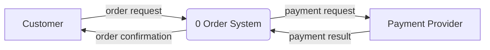

# Systems Analysis & Design Project Framework — Artifact Catalog

> Version 2.3 · Companion to `master_planning_agent_protocol.md`. The protocol says *when* to produce each artifact; this file says *what* it contains and *what good looks like*.

## 1. How to Use This File

- Before producing an artifact, read its entry: **Path**, **Must contain**, depth by tier, and **Acceptance checks**.
- The Reviewer runs each artifact's *Acceptance checks* at the gate for the stage that produced it.
- Whether an artifact is produced at all is decided in the Tailoring Record (A04), using the tiers, risk flags, and project types in §2 and the matrix in §3.
- Appendix A maps this catalog to the classic lifecycle models. Appendix B holds reference material: formulas, normalization rules, validation types, and design guidelines.

---

## 2. Project Tiers and Risk Flags

### 2.1 Tiers

| Tier | Typical shape | Examples |
| :-- | :-- | :-- |
| **S — Small** | One builder; roughly 8 or fewer Must features; one or two user roles; at most one integration; no regulated data | CLI tool, internal script with a simple UI, personal app, prototype |
| **M — Medium** | Small team; several roles; a few integrations; real production users | Team SaaS app, internal line-of-business system, mobile app with a backend |
| **L — Large** | Several teams or many months; many integrations; regulated data or high availability; legacy migration | Multi-tenant platform, payments or health system, ERP replacement |

Risk flags are not size signals: they add artifacts (§2.2) but do not raise the tier on their own. When the size signals point to different tiers, pick the higher tier if any risk flag is set; otherwise pick the tier that matches most signals. Record the reasoning in A04. The user can override the tier in the seed spec.

### 2.2 Risk flags
Flags add required artifacts regardless of tier.

| Flag | Set when | Adds |
| :-- | :-- | :-- |
| **PD** | Personal data is stored or processed | A36, A37 |
| **FIN** | Money, payments, billing, or financial records | A15 for money logic; A36; audit trail in A33 |
| **REG** | Regulated domain (health, finance, children, public sector, etc.) | In-depth legal feasibility in A02; A36; A37 |
| **HA** | Availability target of 99.9% or more, or zero-downtime updates required | A38, A53, A71; zero-downtime strategy in A61 |
| **MIG** | Existing data or a legacy system must be migrated | A62 |
| **INT** | Integrates with external systems | A34 for every integration; contract tests in A39 |
| **MT** | Multi-tenant | Tenant isolation in A33 and A36 |
| **NTU** | Primary users are non-technical | A21, A64, A65; usability assessment in A35 |
| **AI** | Includes machine-learning or LLM components (predictions, recommendations, generated content, agents) | A42; model-specific threats (e.g. prompt injection, data leakage through outputs) in A36; evaluation results in A53 |

### 2.3 Project types
The book's method was built for business information systems. Other kinds of software need some of its models less and some things it doesn't cover. Record the type in A04; it adjusts the matrix in §3. A project can combine types (a business system with a data pipeline); apply each type's adjustments to the parts they describe.

| Type | Typical examples | Emphasise | De-emphasise |
| :-- | :-- | :-- | :-- |
| **BIS** — Business information system (default) | Order processing, CRM, internal workflow apps, web stores | The full method: DFDs or use cases, E-R and normalization, forms, reports, business rules, decision tables | — |
| **DEV** — Developer tool, library, SDK, or API product | Developer-facing CLI tools, client libraries, public APIs, build plugins (a CLI for end users is BIS, with A35 as command UX) | A34 as the core design artifact (API ergonomics, naming, error design, versioning and deprecation policy, compatibility matrix); A63 developer docs with runnable examples; semantic versioning in A70 | A12, A14, A41; A35 becomes command/CLI UX only; A64 usually N/A |
| **DATA** — Data pipeline, analytics, or ML system | ETL/ELT jobs, data warehouses, dashboards, model training and serving | A12 DFDs (data flows are the system); data lineage and data-quality rules in A42; A16/A32 including source and target schemas; A41 for dashboards; scheduling, backfill, and reprocessing in A61 | A35 unless there is an application UI |
| **RT** — Real-time, game, embedded, or interactive media | Games, device firmware, audio/video tools, trading or control loops | State diagrams (Mermaid `stateDiagram`) in A14 for behaviour; measurable performance budgets in A10 (frame time, latency, memory, power); hardware/platform constraints in A30; A53 on target hardware | A12, A15 unless rules are complex; A16/A32/A33 shrink to save data and configuration |

---

## 3. Applicability Matrix

**R** required · **R-lite** required in the short form described in the entry · **C** conditional, required when the condition holds · **O** optional, only with a recorded reason · **—** not produced unless a flag or condition requires it. In the entries and gate checklists, a check, or part of a check, marked *(M/L)* is N/A at tier S.

Project types (§2.3) can downgrade an R or C to N/A for parts of the system they don't fit; record each such change and its reason in A04.

| ID | Artifact | S | M | L | Also required when |
| :-- | :-- | :-: | :-: | :-: | :-- |
| A00 | Assumptions, Decisions & Change Requests | R | R | R | |
| A01 | Charter & Scope Statement | R-lite | R | R | |
| A02 | Feasibility Assessment | R-lite | R | R | REG (legal in depth) |
| A03 | Risk Register | R | R | R | |
| A04 | Tailoring Record | R | R | R | |
| A05 | Work Breakdown Structure | O | R | R | |
| A06 | Schedule | R-lite | R | R | |
| A07 | Baseline Project Plan | R-lite | R | R | (S: `README.md` serves; A07's checks apply) |
| A09 | Requirements Sources & Document Analysis | R | R | R | |
| A10 | Requirements Catalog | R | R | R | |
| A11 | Context Diagram | R | R | R | |
| A12 | Data Flow Diagrams | — | C | R | M: structured approach chosen in A04 |
| A13 | Use Cases | R-lite | R | R | |
| A14 | Activity / BPMN Diagrams | — | C | C | Multi-actor workflow with hand-offs or parallel paths |
| A15 | Decision Tables | C | C | C | Three or more interacting conditions; FIN |
| A16 | Conceptual Data Model | R | R | R | (skip only if no persistent data) |
| A17 | Business Rules | R | R | R | |
| A18 | Glossary & Data Dictionary | R-lite | R | R | |
| A19 | Acceptance Scenarios | R | R | R | |
| A20 | Master Test Plan | R-lite | R | R | |
| A21 | Elicitation Prototype | O | C | C | User-facing UI whose workflow is uncertain; NTU |
| A22 | Sourcing Decision | R-lite | R | R | |
| A30 | Architecture Decision Records | R | R | R | |
| A31 | Architecture Overview | R | R | R | |
| A32 | Logical Data Model | R | R | R | (skip only if no persistent data) |
| A33 | Physical Data Design | R | R | R | (skip only if no persistent data) |
| A34 | Interface Contracts | C | R | R | Any API, CLI, or event interface; INT |
| A35 | UI & Dialogue Design | C | C | C | Any user interface |
| A36 | Security Design | C | R | R | Any authentication; PD, FIN, REG, MT |
| A37 | Privacy Data Map | — | — | — | PD, REG |
| A38 | Observability & SLOs | O | R | R | HA |
| A39 | Test Design | R | R | R | |
| A40 | Slice Plan | R | R | R | |
| A41 | Report & Output Design | C | C | C | The system produces reports, dashboards, exports, documents, or notifications for people |
| A42 | Data & Model Quality Plan | — | — | — | DATA type; AI flag |
| A50 | Slice Record | R | R | R | BUILD mode only |
| A51 | Implementation Guide | R | R | R | PLAN mode only |
| A52 | Defect Log | R | R | R | |
| A53 | NFR Verification | C | R | R | Any Must `REQ-N`; HA |
| A60 | Delivery Pipeline & Environments | R-lite | R | R | |
| A61 | Deployment & Rollback Plan | R-lite | R | R | |
| A62 | Data Migration & Conversion Plan | — | — | — | MIG |
| A63 | Documentation Set | R-lite | R | R | |
| A64 | Training & Support Plan | — | O | R | NTU |
| A65 | Adoption & Change Plan | — | R | R | NTU; the system changes the daily work of people other than those who commissioned it or will run it |
| A70 | Configuration & Change Management | R-lite | R | R | |
| A71 | Operational Health & Maintenance Pipeline | — | R | R | HA |
| A72 | Closedown Review | R-lite | R | R | |

---

## 4. Artifact Catalog

### Governance (all stages)

#### A00 · Assumptions, Decisions & Change Requests
**Path:** `00-governance/assumptions-decisions.md`
**Must contain:**
- *Assumption register:* ID; statement; basis; impact if wrong (H/M/L); confidence (H/M/L); status (open / confirmed / refuted / carried to the maintenance backlog); resolved by (`Q-nn`, checkpoint, CR, or closedown).
- *Decision log:* ID; decision; alternatives considered; rationale; decided by (user or agent); stage.
- *Change requests:* ID; requested change; reason; impacted items (from the traceability matrix); gate checks to re-run; status.

**Acceptance checks:**
- Every high-impact, low-confidence assumption is confirmed, refuted, or presented at the next checkpoint.
- Every `[ASM-nnn]` tag used anywhere in the Workbook exists in the register.
- Every change to a baselined artifact has a CR.

---

### Stage 1 — Initiation & Planning

#### A01 · Project Charter & Scope Statement
**Path:** `01-initiation/charter-scope.md`
**Must contain:** problem or opportunity; objectives with measurable success metrics (current baseline, target, measurement method); stakeholders and their interests; in-scope list; out-of-scope list (every seed non-goal plus any additions); deliverables; constraints (budget, deadline, team, technology); key assumptions by ASM ID; high-level milestones.
**R-lite (S):** one page — problem, primary goal and its metric, in and out of scope, constraints.
**Acceptance checks:**
- Every objective has a metric.
- The scope lists are specific enough to decide whether any given feature is in or out.

#### A02 · Feasibility Assessment
**Path:** `01-initiation/feasibility.md`
**Must contain** one section per dimension, each ending with a verdict (*Feasible / Feasible with conditions / Not feasible*) and its evidence:
- **Economic:**
  - S: qualitative cost/benefit table — build effort range, running cost range, expected benefits.
  - M: three-year total cost of ownership (one-time and recurring costs) and simple payback period.
  - L: present value of costs and benefits, NPV, ROI, and break-even point (formulas in B1), with the discount rate recorded as an assumption; tangible and intangible benefits listed separately.
- **Technical:** project size, requirement structure, and team familiarity with the technology and domain, combined into a risk rating (B2); key technical unknowns.
- **Operational:** whether the system fits users' work and processes; adoption risks.
- **Schedule:** estimate range against the deadline.
- **Legal & contractual:** licences, regulations, data protection, contracts with vendors or clients.
- **Political / organisational:** stakeholder support or resistance. Required for tier L, or whenever stakeholder groups have conflicting interests; otherwise N/A with a reason.

**R-lite (S):** economic, technical, and schedule dimensions only, a few lines each.
**Acceptance checks:**
- Every figure has a source tag; unsourced estimates are ranges, not points.
- Every "Not feasible" or "Feasible with conditions" verdict produces a risk in A03.

#### A03 · Risk Register
**Path:** `01-initiation/risk-register.md`
**Must contain** per risk: ID; description as cause → event → impact; likelihood (H/M/L); impact (H/M/L); mitigation; contingency; trigger or early-warning sign; owner role; status. Updated at every gate: status, likelihood, impact, trigger and owner are working fields, exempt from R7, but adding or removing a risk after CP1 needs a CR. Threats left unmitigated in A36, and residual risks accepted at an escalation, are entered here for the user to accept. At closedown, every risk gets a final status and an owner who outlives the project.
**Acceptance checks:**
- Every high-likelihood, high-impact risk has a mitigation scheduled in A05/A06.
- Risks arising from feasibility verdicts and high-impact assumptions are present.
- Every accepted risk names the checkpoint or decision where the user accepted it.

#### A04 · Tailoring Record
**Path:** `01-initiation/tailoring.md`
**Must contain:**
- Tier, risk flags, and project type(s) (§2.3), each with reasoning; for a mixed system, which parts each type applies to.
- Modeling approach — *structured* (DFD + E-R) or *object-oriented* (use cases + class + activity diagrams) — with reasoning. Choose structured when the system is mainly data transformation and storage (back-office, reporting, pipelines). Choose object-oriented when the domain has rich behaviour and the target stack is object-oriented. Use cases are produced under either approach, because acceptance tests derive from them.
- A table listing every artifact A00–A72 with its decision (produce / skip), depth (R / R-lite), and reason.

**Acceptance checks:**
- Every catalog artifact is listed.
- Every artifact required by a flag is selected.
- Every skip has a reason.

#### A05 · Work Breakdown Structure
**Path:** `01-initiation/wbs.md`
**Must contain:** a hierarchical breakdown by stage and slice. Each leaf work package has exactly one deliverable (artifact ID or slice), an owner role, its predecessors, and optimistic, most likely, and pessimistic estimates (o, r, p) with source tags.
**Acceptance checks:**
- Every selected artifact and every slice appears as a deliverable.
- No leaf has more than one deliverable.

#### A06 · Schedule
**Path:** `01-initiation/schedule.md`
**Must contain:**
- Expected time per task, ET = (o + 4r + p) / 6 (B1).
- Network diagram (Mermaid flowchart) with ES, EF, LS, and LF per task; slack (LS − ES); the critical path highlighted.
- Gantt chart (Mermaid `gantt`).

**R-lite (S):** a milestone list with effort ranges and the pacing assumption behind any dates; no network diagram.
**Note:** unless the user supplied team capacity, durations are effort estimates under a capacity assumption — record that assumption in A00.
**Acceptance checks:**
- The Reviewer recomputes the arithmetic.
- *(M/L)* Critical-path tasks have zero slack.
- The riskiest slice is scheduled early.
- Any dates rest on a recorded capacity or pacing assumption.

#### A07 · Baseline Project Plan
**Path:** `01-initiation/baseline-project-plan.md`
**Must contain:** a summary of A01–A06 with links; the communication plan (checkpoints, status updates); management procedures (change control per protocol R7, escalation path); a test strategy summary from A20 once it exists.
**R-lite (S):** `README.md` serves as the Baseline Project Plan; record it as *Produce (README)* in A04.
**Acceptance checks:** consistent with A01–A06 — no conflicting dates, scope, or costs.

---

### Stage 2 — Requirements Analysis & Sourcing

#### A09 · Requirements Sources & Document Analysis
**Path:** `02-analysis/requirements-sources.md`; copies of supplied documents in `02-analysis/sources/`
**Purpose:** the agent cannot interview users or run JAD sessions, so it relies on the sources it *can* use: the seed spec, answers to clarifying questions, checkpoint feedback, and existing documents. Existing documents often reveal more than people remember to say.
**Must contain:**
- An inventory of every source: seed sections, `Q-nn` answers, and each supplied document, with type and date.
- For each document, what it reveals. Ask of each type:
  - *Written procedures and work instructions:* the steps people actually follow; where the written procedure and real practice may differ (flag as a question).
  - *Business forms and spreadsheets* (paper, PDF, spreadsheet columns): the data captured, required fields, codes and allowed values, implied business rules and calculations.
  - *Current reports and exports:* the outputs people rely on, their audience and frequency, and the data and rules needed to produce them.
  - *Screenshots of current systems:* workflows, terminology, and pain points.
- Findings mapped to requirements, entities, rules, or reports (with source tags), plus contradictions and gaps turned into new `Q-nn` questions.
- If the user supplied no documents: a note saying so, and a list of the documents that would most help.

**Acceptance checks:**
- Every supplied document is analysed.
- Every finding is reflected in A10, A16, A17, A18, or A41, or explicitly set aside with a reason.
- Contradictions between sources are raised as questions, not silently resolved.

#### A10 · Requirements Catalog
**Path:** `02-analysis/requirements.md`
**Must contain:**
- *Functional* (`REQ-F-nnn`): one testable statement each ("The system shall…"), MoSCoW priority, source tag.
- *Non-functional* (`REQ-N-nnn`): category (performance, scalability, availability, correctness and integrity, security, privacy, accessibility, usability, maintainability, portability, compliance), measurable target, and measurement method — e.g. "p95 response time ≤ 300 ms at 50 requests/s, verified by TC-S-004."
- A seed item phrased as an approval ("ask me before adding a dependency", template §10) is not a requirement. Record it as a decision point for the user (protocol R6), not as a REQ.

**Acceptance checks:**
- No compound requirements (two behaviours joined by "and" or "or").
- No REQ restates an approval-style seed item as a prohibition.
- No unmeasurable words ("fast", "user-friendly", "secure") without a target.
- Every seed feature appears, or is explicitly out of scope.

#### A11 · Context Diagram
**Path:** `02-analysis/context-diagram.md`
**Must contain:** the system as a single process (P0); every external entity (users, external systems, devices) as a source or sink; every data flow crossing the boundary, labelled with a noun phrase. No data stores appear on the context diagram.
**Mermaid convention** (shared with A12):

**Acceptance checks:**
- Every seed actor and integration is an external entity, or is excluded with a reason (e.g. an indirect actor who never touches the system).
- Every flow is labelled.
- No flow connects two external entities.

#### A12 · Data Flow Diagrams (Level-0 and below)
**Path:** `02-analysis/dfd.md`
**Must contain:** a Level-0 diagram of the major processes (P1, P2, …) and data stores; Level-n decompositions to the depth set in A04; a short description of each primitive process.
**Conventions:** external entity `E1[Name]`; process `P1("1 Verb Noun")`; data store `D1[(D1 Name)]`; labelled arrows.
**Depth:** M — Level-0, plus Level-1 for processes supporting Must requirements. L — decompose until each process is primitive (one main transformation, describable in about a page of logic).
**Rules:**
- No flow between two external entities, between two data stores, or between an external entity and a data store; such movements go through a process.
- Every process has at least one input and one output.
- Every data store is written by at least one process and read by at least one process across the diagram set.
- Process names are verb–noun; flow and store names are noun phrases.

**Acceptance checks:**
- All the rules above hold.
- Balancing: each child diagram's net inputs and outputs equal its parent process's inputs and outputs.

#### A13 · Use Cases
**Path:** `02-analysis/use-cases.md`, optionally with a Mermaid overview of actors and use cases (`<<include>>` / `<<extend>>` noted)
**Must contain** (fully dressed, Cockburn template): ID and goal-phrased name; primary actor; stakeholders and interests; scope and level (user goal / subfunction); preconditions; minimal guarantees; success guarantees; trigger; main success scenario (numbered, about 3–9 steps); extensions (step number + letter: condition → handling); related REQ and BR IDs.
**Depth:** M/L — fully dressed for Must use cases, casual for Should.
**R-lite (S):** casual form for Must use cases — name, actor, one-paragraph main scenario, key extensions.
**Acceptance checks:**
- Every step is an actor action or a system response, with no UI detail ("clicks the blue button").
- Every extension's handling ends in success, failure, or a return to a named step.

#### A14 · Activity / BPMN Diagrams
**Path:** `02-analysis/workflows.md`
**When:** a workflow crosses several actors or systems with hand-offs, waiting, or parallel paths.
**Must contain:** swimlanes (pools or lanes) per participant; start and end events; activities; gateways (XOR exclusive, AND parallel, OR inclusive) with labelled conditions; forks and joins for parallel work. A Mermaid flowchart with subgraphs as lanes is acceptable.
**Acceptance checks:**
- Every gateway branch is labelled.
- Every path reaches an end event.
- Every parallel fork is joined.

#### A15 · Decision Tables
**Path:** `02-analysis/decision-tables.md`
**When:** logic with three or more interacting conditions, and always for money calculations under FIN.
**Must contain** per table: ID; condition stubs with their possible values; action stubs; the complete rule set (the product of the number of values of each condition — 2ⁿ for n binary conditions); the reduced table, with indifferent conditions marked "–"; the BR IDs implemented.
**Acceptance checks:**
- The complete rule count is correct before reduction.
- No two rules overlap with different actions.
- Every rule has an action.
- Each complete rule (before reduction) can be traced to the reduced rule that covers it, so tests can cover every complete rule (G2.4).

#### A16 · Conceptual Data Model
**Path:** `02-analysis/conceptual-data-model.md`
**Starting point:** begin from a packaged data model where one fits — a universal pattern (party/role, product, order and line item, account and transaction, location, event) or an industry-specific model — and record which one was adapted and what changed. Design from scratch only when no pattern fits, and say so.
**Must contain** an E-R diagram (Mermaid `erDiagram`) or class diagram (Mermaid `classDiagram`) according to the A04 approach, plus an entity table covering:
- Entities or classes with identifiers (candidate keys); attributes marked composite, multivalued, or derived (with a derivation rule).
- Relationships with degree (unary, binary, ternary) and minimum and maximum cardinality on each side.
- Associative entities for many-to-many relationships that carry attributes.
- Supertypes and subtypes with completeness (total or partial), disjointness (disjoint or overlapping), and the subtype discriminator.
- For class diagrams, also key operations, visibility, and aggregation vs. composition.

Not produced if the system stores no persistent data; record that in A04.
**Acceptance checks:**
- The starting pattern, or the reason none was used, is recorded.
- Every DFD data store, or every stored noun in the use cases, maps to an entity.
- Every entity has an identifier.
- Every relationship has cardinality on both sides.

#### A17 · Business Rules
**Path:** `02-analysis/business-rules.md`
**Must contain** per rule: ID; plain-language statement; type (domain constraint, derivation, triggering operation, authorization); source tag. Triggering operations also state their five parts: user rule, event, entity name, condition, action. The enforcement location is recorded in Stage 3 in A31's rule-enforcement table, so A17 itself does not change after CP2.
**Acceptance checks:**
- Each rule is atomic and testable.
- No two rules conflict.
- Every rule is referenced by a UC, entity, or decision table.

#### A18 · Glossary & Data Dictionary
**Path:** `02-analysis/glossary.md`
**Must contain:** domain terms with definitions; synonyms (one preferred term each); homonyms (a separate term per meaning). For each stored attribute: name, definition, type class (text, number, money, date-time, identifier, enumeration), allowed values or range, and source.
**R-lite (S):** the user's own terms and any terms the agent introduces, one line each with the preferred word; the data dictionary is optional.
**Acceptance checks:** preferred terms are used consistently across A10–A17.

#### A19 · Acceptance Scenarios
**Path:** `02-analysis/acceptance-scenarios.md`
**Must contain** per scenario: ID; Given / When / Then; traces to a UC (main scenario or extension) and/or a DT rule, and to a REQ.
**Acceptance checks:**
- Every UC main scenario, every extension, and every complete DT rule has a scenario.
- Every Then clause is observable through a specified output (a REQ, screen, report or command response), not only by inspecting stored data.
- Every scenario traces to a REQ.

#### A20 · Master Test Plan
**Path:** `02-analysis/master-test-plan.md`
**Must contain:**
- Test levels (unit, integration, system, acceptance) with the scope and entry/exit criteria for each.
- Test environments and data strategy, including how personal data is kept out of test data under PD. Name the production environment's parameters — OS, runtime version, locale and encoding, tools installed — and how tests cover each difference from the build environment.
- Tools.
- NFR verification approach.
- User acceptance testing plan: alpha with internal users and beta with real users — participants, duration, how feedback is captured.
- Defect management process (A52) and regression policy (full suite on every batch of fixes).

**R-lite (S):** levels, tools, and exit criteria in half a page.
**Acceptance checks:**
- Exit criteria are objective.
- Every `REQ-N` in A10 has a verification approach.
- Every difference between the test and production environments is covered or recorded as a risk.

#### A21 · Elicitation Prototype
**Path:** `02-analysis/prototype/` (a self-contained HTML page or similar) plus `02-analysis/prototype-findings.md`
**When:** the system has a user-facing UI and the workflow is uncertain, or primary users are non-technical (NTU). Seeing a screen draws out requirements that questions miss.
**Must contain:**
- A clickable, throwaway prototype of the Must use cases' main scenarios, using placeholder data and clearly labelled as a prototype.
- Questions to ask the user while reviewing it ("What's missing on this screen?", "What do you do next?").
- Findings from the user's feedback, each mapped to a new or changed REQ, UC, or BR, with source tags.

**Rules:** the prototype exists to learn requirements, not to fix the design. Do not reuse its code or layout in Stage 3 without deciding to in an ADR.
**Acceptance checks:**
- Every finding is reflected in A10–A17 or set aside with a reason.
- Nothing in A10 rests only on the agent's own reading of the prototype; user feedback is the source.

#### A22 · Sourcing Decision
**Path:** `02-analysis/sourcing.md`
**Purpose:** buying, subscribing to, or reusing software is a design strategy chosen *after* requirements are structured, not instead of analysis. Decide it before designing anything.
**Must contain:**
- Options considered from B11: custom in-house build; packaged (off-the-shelf) software; SaaS/cloud application; open-source software; enterprise-wide solution; IT services firm or outsourcing; and hybrids (e.g. SaaS core plus custom integration).
- For each realistic option: coverage of the Must and Should requirements (which are met, which need customisation or workarounds); evaluation against the B11 criteria; total cost of ownership over the A02 horizon, including licences, subscriptions, customisation, integration, and staff time; lock-in and exit cost.
- A recommendation, with what would change it.
- Reusable components for a custom build: libraries, frameworks, and services to adopt rather than write.

**What options are judged against.** Coverage and ruling-out use only requirements the user stated, with `[SEED]`, `[USER]` or `[DOC]` sources. Show two further groups in separate rows: requirements the agent proposed (marked as proposals, protocol G2.13), and approval-style constraints ("ask me before…"). Neither group rules an option out on its own. If one of them would decide the choice, say so in the recommendation and put it to the user at CP2 — for example, "ihatemoney would need your approval for a third-party dependency".

**R-lite (S):** a short table — "Is there an existing tool or library that already does this?" — with two or three options, one column per option stating which Must requirements it covers (judged as above), and a recommendation.
**Note:** product features, prices, and vendor details change. In BUILD mode or with web access, verify them and cite sources; otherwise mark them as assumptions for the user to check.
**Acceptance checks:**
- At least one non-build option was genuinely evaluated, or the reason none exists is stated.
- Every Must requirement's coverage is stated for each option.
- No option is ruled out only by an agent-proposed requirement or an approval-style constraint; any such deciding factor is listed for CP2.
- If the recommendation is not a full custom build, A04 records which Stage 3 artifacts change (configuration, integration, and data migration replace internal design).

---

### Stage 3 — Architecture & Design

#### A30 · Architecture Decision Records
**Path:** `03-design/adr/ADR-nnn-<slug>.md`
**Must contain** per ADR: context (the forces at play, citing `REQ-N` and constraints); decision; alternatives considered and why they were rejected; consequences, positive and negative; status.
**Required ADRs:** language and framework; data store(s); hosting and deployment model (evaluated with B9); architecture style (modular monolith vs. services); authentication approach. Also any decision the protocol says needs an ADR: denormalization, business logic outside the business layer, distributed services.
**Acceptance checks:**
- Each ADR weighs at least two real alternatives.
- Each decision cites the requirement or constraint that drove it.

#### A31 · Architecture Overview
**Path:** `03-design/architecture.md`
**Must contain:**
- C4-style context and container diagrams in Mermaid.
- The tiers — presentation, business logic, data management — and which component implements each.
- A module list with each module's responsibility and owned data.
- How components communicate (synchronous API, events, shared nothing).
- A deployment view: environments, hosting, network boundaries.
- A rule-enforcement table: each business rule (A17) and each design rule that code applies in several places, with its single location.
- Architecture rules that a program can check (layering, a rule's single location, the schema matching A33), each with the automated test that checks it.

**Acceptance checks:**
- Each module has one clear responsibility.
- No two modules write the same table without an ADR.
- Presentation components never access the data store directly.

#### A32 · Logical Data Model
**Path:** `03-design/db/logical-model.md`
**Must contain:** relations with primary keys, foreign keys, and attributes; the functional dependencies of each non-trivial relation; a normalization statement per relation (B3); view-integration notes resolving synonyms, homonyms, transitive dependencies, and supertype/subtype mappings. For non-relational stores: the document or collection design, driven by listed access patterns, with an ADR.
**Acceptance checks:**
- No partial or transitive dependencies without an ADR.
- Every many-to-many relationship is resolved.
- Every A16 entity maps to a relation or a documented merge.

#### A33 · Physical Data Design
**Path:** `03-design/db/schema.sql` and `03-design/db/physical-design.md`
**Must contain:**
- DDL for the chosen engine.
- Data types, with rationale where it matters: exact decimal for money (never floating point); UTC timestamps with time zone; identifier strategy (sequence vs. UUID) per ADR.
- Integrity controls: NOT NULL, CHECK range constraints, DEFAULT values, UNIQUE, and foreign keys with explicit ON DELETE / ON UPDATE behaviour. Where a constraint enforces a business rule, it is that rule's single location in A31; don't duplicate it in code (or record the backstop in an ADR).
- Indexes, each justified by a named query or access pattern. Partitioning only with a data-volume justification.
- Migration strategy (versioned migrations, tooling, rollback approach); how the system recognises its own data store and what it does with anything else; backup, retention, and restore targets, with a backup and restore method that stays correct after a crash mid-write (e.g. side files of an embedded database); encryption at rest for sensitive columns; audit trail design under FIN or REG; tenant isolation under MT.

**Acceptance checks:**
- Every range or allowed-values rule in A18 or A17 is enforced by a constraint or a named validation rule.
- Every foreign key has defined delete behaviour.
- Every index has a justification.

#### A34 · Interface Contracts
**Path:** `03-design/api/`
**Must contain:**
- Each interface's contract in its standard format (protocol §5.3).
- Per operation: operationId (or command name); trace to REQ/UC; required role; request and response schemas; error responses using one consistent error model (e.g. RFC 9457 problem details); pagination for list operations; idempotency for unsafe operations that may be retried.
- Versioning policy, and rate limits where relevant.
- For each external integration (INT): the external contract, timeouts, retries, and failure handling.

**Acceptance checks:**
- The contract validates against its schema (in BUILD mode, run a linter). For a CLI command reference, a test checks that the parser's commands and options match the reference.
- Every operation has at least one error response.
- Every operation appears in the A36 authorization matrix, when A36 applies.

#### A35 · UI & Dialogue Design
**Path:** `03-design/ui.md`
**When:** the system has any user interface.
**Must contain:**
- *Screen inventory:* SCR ID, name, purpose, UC served, roles.
- *Wireframes:* a low-fidelity layout per screen (ASCII block layout or simple HTML) showing the placement and spacing of elements.
- *Dialogue diagram:* a Mermaid flowchart whose nodes are screens (SCR ID + name) and whose edges are labelled with the user action; it shows sequence, selection (branches), and iteration (loops back).
- *Field validation table:* screen, field, data type, required or not, validation types (B4), error message text, BR/REQ trace.
- Accessibility target (WCAG 2.2 AA unless the seed says otherwise) and how it will be tested.
- Under NTU: a usability assessment plan (speed, accuracy, learnability, error rate, satisfaction).
- Reports, exports, and notifications are designed in A41, not here.

**Acceptance checks:**
- Every screen is reachable and has an exit.
- Destructive actions have a confirmation and, where feasible, undo.
- Every field has validation and a plain-language error message.
- The design follows B5 and B6.

#### A36 · Security Design
**Path:** `03-design/security.md`
**Must contain:**
- Assets worth protecting, and a trust-boundary diagram.
- A threat model per boundary using STRIDE (spoofing, tampering, repudiation, information disclosure, denial of service, elevation of privilege). Each threat has a mitigation that maps to a `REQ-N` (and through it to a TC), or is an accepted risk entered in A03 for the user to accept.
- Authentication method.
- Authorization matrix: role × operation → allow / deny / own records only.
- Session and token handling; secrets management (no secrets in the repository); encryption in transit and at rest; security event logging.
- Dependency and supply-chain policy: lockfiles, vulnerability scanning, update cadence.
- Under AI: model-specific threats — prompt injection, sensitive data exposed through outputs, over-permissioned tool use by agents, and abuse of generation features.

**Acceptance checks:**
- Every role × operation cell is filled.
- For each boundary, every STRIDE category is addressed or marked N/A with a reason.

#### A37 · Privacy Data Map
**Path:** `03-design/privacy.md`
**Must contain:** per personal-data field — category (including special categories), purpose, legal basis (where GDPR, UK GDPR, or similar law applies), retention period, storage location, who can access it, and cross-border transfers. Also: procedures for data-subject requests (access, correction, deletion, export) and data-minimization decisions.
**Acceptance checks:**
- Every personal-data attribute in A18 appears.
- Every field has a retention period and a deletion mechanism.

#### A38 · Observability & SLOs
**Path:** `03-design/observability.md`
**Must contain:** SLOs derived from `REQ-N` (indicator, target, measurement window); a structured-logging standard (no personal data or secrets in logs); metrics; distributed tracing where there are multiple components; alert rules tied to SLOs; dashboards to build; links to runbook procedures in A63.
**Acceptance checks:**
- Every availability and performance `REQ-N` has an SLO.
- Every alert has a runbook entry.

#### A39 · Test Design
**Path:** `03-design/test-design.md`, with a CSV for large case sets
**Must contain:**
- Unit, integration, and system test plans: scope, tools, environments, data.
- Test case descriptions: ID; level; traces (REQ / UC / BR / operation / field); preconditions; input data; steps; expected output; case type (normal, boundary, invalid, authorization, error/recovery).
- **Review scope** for adversarial testing at G4: the input and failure classes the system must handle (e.g. anything typed into the interface, including control characters and non-UTF-8 bytes; files the system wrote; a crash mid-write; a full disk), and those left as accepted risks (e.g. files edited with other tools), each with its A03 risk.
- Test runtime: a case that repeats many operations states how its cost grows and its time budget.

**Minimum coverage:**
- Every interface operation: a success case, at least one error case, and — where the system has roles — an authorization-denied case.
- Every validation rule: boundary and invalid cases (for existence rules such as "the id exists", an invalid case is enough).
- Every complete decision-table rule: one case.
- Every measurable `REQ-N`: one verification case.
- Every external integration (INT): a contract test.

Unit-level cases are added per slice in Stage 4b.
**Acceptance checks:**
- The minimum coverage above is met.
- Expected outputs are specific values or states, never "works correctly".
- The review scope is stated, and its accepted risks are in A03.

#### A40 · Slice Plan
**Path:** `03-design/slice-plan.md`
**Must contain:** slices `SL-nn`, each delivering one or more use cases end to end through every layer. For each: UCs and REQs covered, risk retired, dependencies, WBS mapping. `SL-01` is the walking skeleton through the riskiest architectural component.
**Acceptance checks:**
- Every Must REQ is in a slice.
- Slices are ordered by risk, then dependencies, then priority.

#### A41 · Report & Output Design
**Path:** `03-design/reports.md`
**When:** the system produces anything people read outside an entry screen — printed or PDF reports, dashboards, exports, generated documents, emails, or notifications.
**Must contain:**
- *Report inventory:* ID (`RPT-nn`); name; purpose (the decision or task it supports); audience role; trigger or frequency (scheduled, on demand, event); delivery channel (screen, PDF, email, file export); REQ trace.
- Per report: data items and their sources (entities and attributes, derived values with derivation rules); filters, sorting, grouping, and totals; display choice per B5 — tables to read individual values, line graphs for trends over time, bar charts for comparisons; a sample layout with realistic placeholder data; volume (rows or pages) and performance expectation.
- For notifications: trigger event, recipient, content, and how a recipient turns them off.
- Under DATA type: dashboard refresh frequency and data freshness indicator.

**Acceptance checks:**
- Every report traces to a REQ and names an audience role from A13/A36.
- Every data item is available from A16/A32 or derivable by a stated rule.
- Every report in the current-state documents (A09) is either replaced, retired with the user's agreement, or listed as out of scope.

#### A42 · Data & Model Quality Plan
**Path:** `03-design/data-model-quality.md`
**When:** DATA project type, or the AI flag.
**Must contain:**
- *Data sources and lineage:* each source, owner, refresh cadence, and the path from source to every output.
- *Data-quality rules:* completeness, validity, uniqueness, timeliness, and consistency checks per critical dataset, with thresholds and what happens when a check fails (halt, quarantine, alert).
- *For machine-learning or LLM components:*
  - task definition and what a good output is;
  - training, fine-tuning, or prompt/retrieval data — source, licensing, consent, and personal-data handling (link A37);
  - evaluation dataset kept separate from development data, with metrics and acceptance thresholds, including failure-mode and fairness slices where people are affected;
  - human oversight: when a person reviews or can override outputs;
  - production monitoring: drift, quality sampling, cost, and a rollback or fallback path.

**Acceptance checks:**
- Every output in A41 or A34 has traceable lineage.
- Every AI component has an evaluation set and a numeric acceptance threshold, verified in A53.
- Every quality rule has a failure action.

---

### Stage 4 — Construction (per slice)

#### A50 · Slice Record (BUILD mode)
**Path:** `04-construction/SL-nn-<slug>/slice-record.md`
**Must contain:** slice design notes and any new ADRs; the slice's test case list (IDs), with any deferral and the slice that will take it; evidence of red (an excerpt of a failing run per test case or batch, failing for the expected reason); for a test that cannot fail first, the mutation it catches; evidence of green (full-suite output); refactoring notes; static analysis and lint results; code inspection results (B10); modules and files changed; traceability updates.
**Acceptance checks:**
- Test commits or log timestamps precede the code they test.
- The full suite is green.
- Inspection findings are resolved or logged as defects.
- The record, A53 and the matrix describe the reviewed commit.

#### A51 · Implementation Guide (PLAN mode)
**Path:** `04-construction/SL-nn-<slug>/implementation-guide.md`
**Must contain:** module and file structure for the slice; each module's responsibilities and interfaces; an ordered task list that follows the test cases (which test to write first, what makes it pass); notes on tricky logic with BR references; the inspection checklist to apply (B10); the definition of done.
**Acceptance checks:**
- Every test case for the slice is covered by a task.
- The structure matches A31.

#### A52 · Defect Log
**Path:** `04-construction/defect-log.md`
**Must contain** per defect: ID; found by (TC, gate, or user); severity; description; root-cause stage (requirements, design, implementation, test, documentation); fix; where the same pattern was checked elsewhere; regression test case added.
**Severity:** *blocker* — the system can't be used or loses or corrupts data; *major* — a wrong result, a crash, or a broken documented procedure in a normal path; *minor* — anything else.
**Acceptance checks:**
- Every fixed defect has a regression test that fails on the pre-fix code, for the defect's reason, shown in a log. A structural defect (e.g. a rule in two places) has a test that catches a mutation reintroducing it.
- Every fix states where the same pattern was checked.
- Root-cause stages are recorded, so patterns are visible at closedown.
- A defect that recurs gets an automated check that would catch it next time.

#### A53 · NFR Verification
**Path:** `04-construction/nfr-verification.md`
**Must contain** per measurable `REQ-N`: method, environment, load profile or scenario, pass criteria, and either the result (BUILD) or the procedure (PLAN). As applicable, covers:
- Performance.
- Load and stress: behaviour beyond the expected peak.
- Recovery: forced failures (killed processes, lost connections, full disk) and time to recover.
- Security testing: authorization bypass attempts, input fuzzing, dependency scanning, TLS and encryption checks.
- Accessibility testing.
- AI components: results against the A42 evaluation set and thresholds.

**Acceptance checks:**
- Every measurable `REQ-N` appears.
- In PLAN mode, no results are reported.
- When the system stores data, recovery is tested by killing a process mid-write, and the documented backup and restore are then run as written.
- In BUILD mode, every procedure in A61 and A63 was executed as written from a clean install, and each run is recorded.

---

### Stage 5 — Release Readiness

#### A60 · Delivery Pipeline & Environments
**Path:** `05-release/pipeline.md`
**Must contain:** environments (e.g. dev, test, staging, production) and how they differ; CI steps (lint, test, build, security scan); deployment automation; infrastructure-as-code tool and scope; configuration and secrets per environment.
**R-lite (S):** how to build, test, and release in a few commands, and how a release reaches production — the hand-over, the update, and going back to an earlier release.
**Acceptance checks:**
- Every gate check that can be automated runs in CI (at tier S, in one check script).
- Every manual step has a written procedure.
- *BUILD:* the release hand-over was carried out once as written. *PLAN:* each hand-over step has pass criteria.
- Checks that can be skipped on a user's machine (e.g. development-only tools) can't be skipped in the release run.

#### A61 · Deployment & Rollback Plan
**Path:** `05-release/deployment.md`
**Must contain:** installation strategy chosen from B7, with rationale against the risk profile; go-live checklist; rollback trigger conditions and procedure, including data rollback or a forward-fix approach; communication to users.
**R-lite (S):** strategy, release steps, and rollback steps.
**Acceptance checks:** rollback is possible after the database migration, or the plan states why forward-fix is acceptable.

#### A62 · Data Migration & Conversion Plan
**Path:** `05-release/migration.md`
**When:** flag MIG.
**Must contain:** source inventory; source-to-target field mapping; cleansing rules for known data-quality problems; conversion procedure; reconciliation checks (row counts, checksums, sampled record comparison); dry-run plan; cutover and fallback plan.
**Acceptance checks:**
- Every target table populated from legacy data has a mapping.
- Reconciliation has numeric pass criteria.

#### A63 · Documentation Set
**Path:** `05-release/docs/`
**Must contain:** a user guide per role; a quick-reference guide; an administrator/operations runbook (start, stop, deploy, restore from backup, rotate secrets, respond to each alert); a developer README (setup, architecture link, running tests, contribution conventions); an API reference generated from A34.
**R-lite (S):** a README covering use, setup, and operation.
**Acceptance checks:**
- Every A38 alert and every A61 procedure has a runbook entry.
- Every role has user documentation.
- In BUILD mode, every procedure was executed as written from a clean install (A53), and any worked example matches the system's output.

#### A64 · Training & Support Plan
**Path:** `05-release/training-support.md`
**Must contain:** audiences; training methods (in-app help, documentation, live or recorded sessions, blended); support channels and response expectations; how issues enter the maintenance pipeline (A71).
**Acceptance checks:** every primary user role has a training path.

#### A65 · Adoption & Change Plan
**Path:** `05-release/adoption.md`
**Why:** systems fail after delivery even with management support and user involvement. Commitment to change, realistic user expectations, and how much users actually use the system decide the outcome (B12).
**Must contain:**
- *Change impact:* for each affected role, what changes in their daily work, what they stop doing, and what they gain.
- *Use factors* (B12): an assessment per primary role of personal stake, system characteristics, user experience, organisational support, and expected performance benefit — with actions for any weak factor.
- *Expectations:* what v1.0 will and will not do, communicated before launch (link the non-goals in A01).
- *Sponsor and champions:* who in the organisation backs the change and who helps peers.
- *Success measurement:* usage measures (active users, task completion, abandonment of old workarounds) and a satisfaction measure, each tied to an A01 success metric, with a date for the post-launch review.

**Acceptance checks:**
- Every A01 success metric has a measurement method and review date.
- Every role whose work changes has a change-impact entry, and a training path in A64 when A64 is produced.

---

### Stage 6 — Maintenance & Closedown

#### A70 · Configuration & Change Management
**Path:** `06-maintenance/config-change-mgmt.md`
**Must contain:** version control and branching strategy, including how slice branches are integrated and how a release reaches the main line; versioning scheme (e.g. semantic versioning); release tags as baselines, with the Workbook versioned alongside the code; where records made after a release (closedown, maintenance) go; build and release procedure (link to A60); change request intake; for any data-format change, what happens to older releases that meet the new format.
**R-lite (S):** repository, versioning, and how to propose a change.
**Acceptance checks:** any baseline can be reproduced from its tag.

#### A71 · Operational Health & Maintenance Pipeline
**Path:** `06-maintenance/operations.md`
**Must contain:**
- *Maintenance pipeline:* request intake; classification as corrective, adaptive, perfective, or preventive (B8); triage, with urgent corrective fixes on a fast path and other changes batched into planned releases; the rule that each change updates the Workbook and re-runs the affected tests.
- *Health metrics:* failure taxonomy; mean time between failures (MTBF); mean time to recovery (MTTR); change failure rate; SLO error-budget policy.
- *Continuity (web/cloud):* zero-downtime update procedure; uptime and broken-link monitoring; dependency update cadence.

**Acceptance checks:**
- Every metric has a data source.
- Every SLO has an error-budget policy.

#### A72 · Closedown Review
**Path:** `06-maintenance/closedown.md`
**Must contain:** planned vs. actual scope, schedule, and cost; success metrics from A01 measured as planned in A65 (or, if it is too early, the scheduled post-launch review); assumptions confirmed and refuted; defect root-cause patterns from A52; lessons learned; confirmation that the Workbook matches the final baseline tag; items handed to the maintenance backlog.
**R-lite (S):** planned vs. actual, lessons learned, and open items in half a page, plus the maintenance backlog when A71 is skipped.
**Acceptance checks:**
- Every open item, deferred feature (including deferred seed cards) and open risk has a destination and an owner who outlives the project.
- Figures that compare plan and actual have a stated basis; narrative statistics that change no decision are observations, not failures.

---

## Appendix A — Lifecycle Mapping

| SDLC phase | Classic activities | Protocol stages |
| :-- | :-- | :-- |
| Planning | Project identification and selection; project initiation and planning | 0–1 |
| Analysis | Requirements determination (interviews, JAD, observation, document analysis, prototyping — for an agent: clarifying questions, document analysis in A09, prototype feedback in A21, and user review at checkpoints); requirements structuring; choosing a sourcing strategy (A22) | 0, 2 |
| Design | Logical design (platform-independent); physical design (technology-specific) | 3, 4a |
| Implementation | Coding, testing, installation, documentation, training, support | 4–5 |
| Maintenance | Corrective, adaptive, perfective, and preventive change | 6 |

**Project management phases:** initiation (Stages 0–1), planning (Stage 1), execution with change control and status reporting at checkpoints (Stages 2–5), closedown (Stage 6).

**Iterative frameworks:** the Stage 4 slice loop is the agile element — each slice is a short design → test → build cycle. In Rational Unified Process terms: Inception ≈ Stages 0–1; Elaboration ≈ Stages 2–3 plus `SL-01`; Construction ≈ the remaining slices; Transition ≈ Stage 5.

---

## Appendix B — Reference

### B1 · Formulas
- **PERT expected time:** ET = (o + 4r + p) / 6, where o = optimistic, r = realistic (most likely), p = pessimistic. Standard deviation ≈ (p − o) / 6.
- **Slack:** LS − ES (equivalently T_L − T_E). Critical-path tasks have zero slack. The critical path is the longest path through the network and sets the shortest possible completion time.
- **Present value:** PV_n = Y × 1 / (1 + i)^n, for amount Y in year n at discount rate i.
- **NPV** = Σ PV(benefits) − Σ PV(costs).
- **ROI** = (Σ PV(benefits) − Σ PV(costs)) / Σ PV(costs).
- **Break-even:** the point where cumulative PV of benefits equals cumulative PV of costs. Interpolate within the year in which cumulative net PV turns positive. The break-even graph plots both cumulative curves.

### B2 · Technical risk rating
Risk rises with project size, and falls as requirement structure (how well defined and stable the requirements are) and familiarity (the team's experience with the technology and domain) increase.

| Familiarity | Size | High structure | Low structure |
| :-- | :-- | :-- | :-- |
| High | Large | Low | Low (very susceptible to mismanagement) |
| High | Small | Very low | Very low (very susceptible to mismanagement) |
| Low | Large | Medium | Very high |
| Low | Small | Medium-low | High |

### B3 · Normalization and E-R transformation
- **1NF:** atomic values; no multivalued attributes or repeating groups; a primary key.
- **2NF:** 1NF, and every non-key attribute depends on the whole primary key (no partial dependency on part of a composite key).
- **3NF:** 2NF, and no non-key attribute depends on another non-key attribute (no transitive dependency).
- **Anomalies prevented:** insertion, deletion, and update anomalies.
- **View integration:** synonyms (two names, one meaning → choose one name); homonyms (one name, two meanings → rename); transitive dependencies introduced by merging relations (→ split); supertype/subtype (→ one relation per supertype and subtype sharing the key, or a single table with an ADR).
- **E-R to relations:** strong entity → relation; weak entity → relation whose primary key includes the owner's key; 1:N relationship → foreign key on the N side; M:N relationship → associative relation; unary relationship → recursive foreign key or associative relation; multivalued attribute → separate relation.

### B4 · Input validation types

| Type | Checks that the data… | Example |
| :-- | :-- | :-- |
| Class / composition | contains the right kind of characters | A name contains letters only |
| Combinations | is valid in combination with other fields | A discount code is valid for this product |
| Expected values | matches what is expected, given data already held | Customer name matches an existing customer; payment equals the amount due |
| Missing data | is present when required | Email is required |
| Picture / template | conforms to a predefined format | Postcode pattern |
| Range | lies within limits | Quantity is 1–99 |
| Reasonableness | is plausible in context | Order 1,000× the usual size is flagged |
| Self-checking digits | passes a check-digit calculation | ISBN, IBAN, card number (Luhn) |
| Size | has an acceptable length | Description ≤ 500 characters |
| Values | comes from a set of standard values | Two-letter state or ISO country code |

These tests catch the four classic entry errors: appending (extra characters), truncating (lost characters), transcribing (wrong characters), and transposing (swapped characters).

### B5 · Form and report guidelines
- **Titles:** clear and specific, with a revision or current date where relevant.
- **Content:** only the information needed, in a form usable without modification.
- **Layout:** balanced, with adequate white space, consistent margins, clear labels, and navigation indicators (e.g. "Page 1 of 3").
- **Highlighting:** used sparingly for errors, warnings, and key items. Never let colour alone carry meaning; meet contrast ratios.
- **Text:** sentence case, left-aligned, ragged right; plain language; no jargon or unclear abbreviations.
- **Tables and lists:** meaningful labels; numbers right-aligned with decimals aligned; text left-aligned; grouping by spacing; long lists sorted meaningfully.
- **Choosing a display:** tables for reading individual values; line graphs for trends over time; bar charts for comparing categories.
- **Usability measures:** speed, accuracy, satisfaction, learnability, efficiency, error rate, memorability.

### B6 · Interface and dialogue guidelines
- **Interaction style fits users and tasks:** forms for data entry; menus for navigation; direct manipulation for spatial tasks; commands for expert or automation use; natural language only where ambiguity is tolerable.
- **Data entry:** top-to-bottom, left-to-right flow; never ask for data the system already has or can compute; provide defaults and clear captions; format and justify input automatically.
- **Dialogue:** consistency; shortcuts for experienced users; feedback for every action; clear closure; graceful error handling with a route to recovery; reversal of actions (undo, confirmation before deletion); the user stays in control.
- **Help:** context-sensitive and following SOS — Simplicity (short, direct), Organize (lists and steps), Show (examples).
- **Navigation:** breadcrumbs on deep sites; permanent links; style separated from content (CSS) to support different devices.
- **Messages:** specific, polite, jargon-free; say what went wrong and how to fix it.
- **Accessibility (WCAG 2.2 AA):** keyboard operability, labels for assistive technology, sufficient contrast, visible focus, resizable text, no information conveyed by colour alone.

### B7 · Installation and deployment strategies

| Strategy | How it works | Suits | Trade-off |
| :-- | :-- | :-- | :-- |
| Direct | Old system off, new system on | Low-risk systems; no old system | Highest impact if it fails |
| Parallel | Run old and new side by side and compare | High-stakes calculations (FIN); legacy replacement | Double the operating effort |
| Single-location (pilot) | One site or group first | Multi-site or multi-group organisations | Slower rollout; temporary old–new interfaces |
| Phased | Module by module | Modular systems; large migrations | Long transition; temporary interfaces |
| Blue-green | Two production environments; switch traffic | HA; fast rollback | Duplicate infrastructure; care with shared data |
| Canary | A small share of traffic first | HA; large user bases | Needs traffic routing and good monitoring |
| Feature flags | Deploy dark; enable per user or group | Gradual exposure; separating deploy from release | Flag debt that must be cleaned up |

### B8 · Maintenance types

| Type | Purpose | Handling |
| :-- | :-- | :-- |
| Corrective | Repair defects | Urgent fast path for production-impacting defects |
| Adaptive | Adapt to new environments, platforms, or rules | Planned releases |
| Perfective | Add features; improve performance or usability | Planned and prioritised |
| Preventive | Reduce future failures: refactoring, dependency updates, documentation | A regular allowance in every release |

The maintenance process mirrors the SDLC: obtain the request → transform it into a change → design the change → implement the change. Maintenance cost is driven by latent defects, number of users, documentation quality, staff, tools, and software structure.

### B9 · Hosting and cloud evaluation
- **Service models:** IaaS (rented infrastructure), PaaS (managed platform), SaaS (finished application), serverless/FaaS (managed functions).
- **Deployment models:** public, private, hybrid.
- **ADR evaluation criteria:** availability and reliability; scalability; provider viability; security and compliance; openness (lock-in, portability); cost, including data egress and operations staff time.

### B10 · Code inspection checklist
- Names reveal intent and match the glossary (A18).
- Each function and module has a single responsibility; logic is not duplicated.
- Business rules are implemented only in their designated location, with the BR ID in a comment.
- Inputs are validated at the boundary, for the whole class the review scope (A39) names, not only the reported example: every route by which user text reaches output is escaped, and every conversion of user input is bounded. Errors are handled explicitly, never swallowed.
- A fix for a defect was applied to every place the same pattern occurs.
- No secrets, credentials, or environment-specific values in code.
- No business logic in presentation code; no data access outside the data layer.
- Comments explain *why*, not *what*; no commented-out or dead code.
- Language-specific pitfalls checked: null handling, overflow, floating-point money, time zones, injection, concurrency.
- Tests are readable, deterministic, and independent of execution order.

### B11 · Sourcing options and selection criteria

| Source | Go here when | Internal staffing needed |
| :-- | :-- | :-- |
| IT services firm / outsourcing | The task needs custom support and can't be built internally | Some, depending on the application |
| Packaged software producer | The supported task is generic | Some IS and user staff to define requirements and evaluate packages |
| Enterprise-wide solution vendor | A complete system crossing functional boundaries | Some internal staff; mostly consultants |
| Cloud / SaaS | Instant access is wanted and the task is generic | Few |
| Open-source software | The task is generic and cost is an issue | Some IS and user staff to define requirements and evaluate |
| In-house development | Resources are available and the system must be built from scratch | Internal staff, size varies |

**Selection criteria**, compared explicitly against building in-house: cost (purchase or subscription vs. development and upkeep, compared on present value); functionality (coverage of Must, Should, and Could requirements); vendor support; vendor viability; flexibility (customisation and integration); documentation; response time (performance); ease of installation. Vendor viability and vendor support are almost always among the most important. Add for current practice: data portability and exit cost, security and compliance certifications, licence terms (especially for open source), and the health of the project or vendor community.

Purchased software still needs the analysis phase: requirements must be structured before packages can be evaluated against them.

### B12 · Implementation success factors
- **Conditions usually cited:** management support and user involvement. They help but are not sufficient.
- **Further factors:** commitment to the project (the problem is well understood and the system actually solves it); commitment to change (willingness to change behaviour and procedures); the extent of project definition and planning; realistic early user expectations.
- **Success is measured** most reliably by the extent of use and by user satisfaction.
- **Factors that drive use:** the user's personal stake (relevance of the system to their work, raised by management support and problem urgency); system characteristics (ease of use, reliability, relevance); user demographics (experience with computers); organisational support; performance (what users can do with it); and satisfaction. Use, performance, and satisfaction reinforce each other.
