# A06 · Schedule

Owner: Strategic Planner. Stage 1, written 2026-10-21. Generated from [`wbs.csv`](wbs.csv) by [`schedule_calc.py`](schedule_calc.py); re-run the script after any change to the WBS.

## Method and assumptions

- **Expected time:** ET = (o + 4r + p) / 6 for every task, and SD = (p − o) / 6 (catalog B1). Estimates come from A05 (`ASM-052`).
- **One builder.** The agent does the authoring and building, so the tasks are chained one after another (resource-levelled). The student's work happens inside tasks and milestones, as reviews and answers. All tasks on the chain are therefore critical, with zero slack.
- **Level-of-effort work** (A00, A52) runs alongside and is not on the network.
- **Milestones** are the gates and checkpoints, with their time for review, revision and, at STRICT checkpoints, the student's reply.
- **Dates are derived, not estimated.** Hours are converted to days at **3 hours of work per day, every day**, from 2026-10-21 (`ASM-053`: range 2–4 h/day). The date ranges combine the pacing range with ET ± 2·SD of the path to each milestone.
- **Exams.** The HKUST exam period is 7–19 Dec 2026 [DOC ug_course_syllabus_template_doc_COMP4901B.docx.pdf p.2], and the first midterm falls within 2 weeks of 2026-10-20 [USER Q-02]. Both may lower the pacing (`RSK-015`).

## Riskiest work first

- **`SL-01`, the walking skeleton,** is the first slice after the design baseline. It runs the sample lecture through slide reading, a Card Creator and an independent Card Reviewer into the app, retiring `RSK-002` (H/H), `RSK-004` and `RSK-018` before anything else is built. The evaluation set it is measured against (A42, task 3.11) comes before it.
- **The pipeline slices** (`SL-01`–`SL-05`) come before the app slices, so processing real lectures can start as early as possible (proposed SM-1, `RSK-001`).

## Reading the results

- **R1 (MVP)** reaches its checkpoint about 80 hours in: **16 Nov 2026** at 3 h/day, between 8 Nov and 3 Dec 2026 across the range. That is before the exam period in every case.
- **The pipeline** is complete (`SL-05`) on **9 Nov 2026** (3–21 Nov). From then on, the Computer Science lectures can be processed for the proposed 30 Nov target (A02 §4).
- **R2 and R3** fall in late November at 3 h/day, but in the slow case run into the exam period (to 13 and 20 Dec). Whether to continue straight on or pause R2 and R3 until after the exams is a choice for CP1.

<!-- BEGIN GENERATED by schedule_calc.py -->
### Network calculation

All figures are in hours of work [ASM-052]. ET = (o + 4r + p) / 6; SD = (p − o) / 6; slack = LS − ES.

| ID | Task | Predecessors | o | r | p | ET | SD | ES | EF | LS | LF | Slack | Critical |
| :-- | :-- | :-- | --: | --: | --: | --: | --: | --: | --: | --: | --: | --: | :-: |
| 1.1 | Charter and scope statement | — | 0.5 | 1 | 2 | 1.08 | 0.25 | 0.00 | 1.08 | 0.00 | 1.08 | 0.00 | yes |
| 1.2 | Feasibility assessment | 1.1 | 0.5 | 1 | 2 | 1.08 | 0.25 | 1.08 | 2.17 | 1.08 | 2.17 | 0.00 | yes |
| 1.3 | Risk register | 1.2 | 0.3 | 0.5 | 1 | 0.55 | 0.12 | 2.17 | 2.72 | 2.17 | 2.72 | 0.00 | yes |
| 1.4 | Tailoring record | 1.3 | 0.3 | 0.5 | 1 | 0.55 | 0.12 | 2.72 | 3.27 | 2.72 | 3.27 | 0.00 | yes |
| 1.5 | Work breakdown structure | 1.4 | 0.3 | 0.5 | 1 | 0.55 | 0.12 | 3.27 | 3.82 | 3.27 | 3.82 | 0.00 | yes |
| 1.6 | Schedule | 1.5 | 0.3 | 0.5 | 1 | 0.55 | 0.12 | 3.82 | 4.37 | 3.82 | 4.37 | 0.00 | yes |
| 1.7 | Baseline project plan | 1.6 | 0.2 | 0.3 | 0.5 | 0.32 | 0.05 | 4.37 | 4.68 | 4.37 | 4.68 | 0.00 | yes |
| M1 | Gate G1 and checkpoint CP1 (STRICT) | 1.7 | 1 | 2 | 6 | 2.50 | 0.83 | 4.68 | 7.18 | 4.68 | 7.18 | 0.00 | yes |
| 2.1 | Requirements sources and document analysis | M1 | 0.5 | 1 | 2 | 1.08 | 0.25 | 7.18 | 8.27 | 7.18 | 8.27 | 0.00 | yes |
| 2.2 | Requirements catalog | 2.1 | 1 | 2 | 4 | 2.17 | 0.50 | 8.27 | 10.43 | 8.27 | 10.43 | 0.00 | yes |
| 2.3 | Context diagram | 2.2 | 0.2 | 0.4 | 1 | 0.47 | 0.13 | 10.43 | 10.90 | 10.43 | 10.90 | 0.00 | yes |
| 2.4 | Data flow diagrams (pipeline) | 2.3 | 0.5 | 1 | 2 | 1.08 | 0.25 | 10.90 | 11.98 | 10.90 | 11.98 | 0.00 | yes |
| 2.5 | Use cases | 2.4 | 1 | 2 | 4 | 2.17 | 0.50 | 11.98 | 14.15 | 11.98 | 14.15 | 0.00 | yes |
| 2.6 | Activity diagram (pipeline run) | 2.5 | 0.3 | 0.5 | 1 | 0.55 | 0.12 | 14.15 | 14.70 | 14.15 | 14.70 | 0.00 | yes |
| 2.7 | Decision tables | 2.6 | 0.5 | 1 | 2 | 1.08 | 0.25 | 14.70 | 15.78 | 14.70 | 15.78 | 0.00 | yes |
| 2.8 | Conceptual data model | 2.7 | 0.5 | 1 | 2 | 1.08 | 0.25 | 15.78 | 16.87 | 15.78 | 16.87 | 0.00 | yes |
| 2.9 | Business rules | 2.8 | 0.5 | 1 | 2 | 1.08 | 0.25 | 16.87 | 17.95 | 16.87 | 17.95 | 0.00 | yes |
| 2.10 | Glossary and data dictionary | 2.9 | 0.3 | 0.5 | 1 | 0.55 | 0.12 | 17.95 | 18.50 | 17.95 | 18.50 | 0.00 | yes |
| 2.11 | Acceptance scenarios | 2.10 | 1 | 1.5 | 3 | 1.67 | 0.33 | 18.50 | 20.17 | 18.50 | 20.17 | 0.00 | yes |
| 2.12 | Master test plan | 2.11 | 0.3 | 0.6 | 1.2 | 0.65 | 0.15 | 20.17 | 20.82 | 20.17 | 20.82 | 0.00 | yes |
| 2.13 | Sourcing decision | 2.12 | 0.5 | 1 | 2 | 1.08 | 0.25 | 20.82 | 21.90 | 20.82 | 21.90 | 0.00 | yes |
| M2 | Gate G2 and checkpoint CP2 (STRICT) | 2.13 | 1.5 | 3 | 8 | 3.58 | 1.08 | 21.90 | 25.48 | 21.90 | 25.48 | 0.00 | yes |
| 3.1 | Architecture decision records | M2 | 0.5 | 1 | 2 | 1.08 | 0.25 | 25.48 | 26.57 | 25.48 | 26.57 | 0.00 | yes |
| 3.2 | Architecture overview | 3.1 | 0.5 | 1 | 2 | 1.08 | 0.25 | 26.57 | 27.65 | 26.57 | 27.65 | 0.00 | yes |
| 3.3 | Logical data model | 3.2 | 0.3 | 0.6 | 1.2 | 0.65 | 0.15 | 27.65 | 28.30 | 27.65 | 28.30 | 0.00 | yes |
| 3.4 | Physical data design | 3.3 | 0.3 | 0.6 | 1.2 | 0.65 | 0.15 | 28.30 | 28.95 | 28.30 | 28.95 | 0.00 | yes |
| 3.5 | Interface contracts | 3.4 | 1 | 1.5 | 3 | 1.67 | 0.33 | 28.95 | 30.62 | 28.95 | 30.62 | 0.00 | yes |
| 3.6 | UI and dialogue design | 3.5 | 0.5 | 1 | 2 | 1.08 | 0.25 | 30.62 | 31.70 | 30.62 | 31.70 | 0.00 | yes |
| 3.7 | Report and output design | 3.6 | 0.3 | 0.6 | 1.2 | 0.65 | 0.15 | 31.70 | 32.35 | 31.70 | 32.35 | 0.00 | yes |
| 3.8 | Security design | 3.7 | 0.5 | 1 | 2 | 1.08 | 0.25 | 32.35 | 33.43 | 32.35 | 33.43 | 0.00 | yes |
| 3.9 | Privacy data map | 3.8 | 0.2 | 0.4 | 0.8 | 0.43 | 0.10 | 33.43 | 33.87 | 33.43 | 33.87 | 0.00 | yes |
| 3.10 | Observability and SLOs | 3.9 | 0.2 | 0.4 | 0.8 | 0.43 | 0.10 | 33.87 | 34.30 | 33.87 | 34.30 | 0.00 | yes |
| 3.11 | Data and model quality plan | 3.10 | 0.5 | 1 | 2.5 | 1.17 | 0.33 | 34.30 | 35.47 | 34.30 | 35.47 | 0.00 | yes |
| 3.12 | Test design and review scope | 3.11 | 1 | 2 | 4 | 2.17 | 0.50 | 35.47 | 37.63 | 35.47 | 37.63 | 0.00 | yes |
| 3.13 | Slice plan | 3.12 | 0.2 | 0.4 | 1 | 0.47 | 0.13 | 37.63 | 38.10 | 37.63 | 38.10 | 0.00 | yes |
| M3 | Gate G3 and checkpoint CP3 (ADVISORY) | 3.13 | 1 | 2 | 5 | 2.33 | 0.67 | 38.10 | 40.43 | 38.10 | 40.43 | 0.00 | yes |
| SL-01 | Walking skeleton: one lecture through the pipeline into the app | M3 | 3 | 5 | 10 | 5.50 | 1.17 | 40.43 | 45.93 | 40.43 | 45.93 | 0.00 | yes |
| SL-02 | Card stage review loop and human review step (stories 1 and 5) | SL-01 | 2 | 3 | 6 | 3.33 | 0.67 | 45.93 | 49.27 | 45.93 | 49.27 | 0.00 | yes |
| SL-03 | Extractor and Canvas reading (story 3) | SL-02 | 2 | 3 | 7 | 3.50 | 0.83 | 49.27 | 52.77 | 49.27 | 52.77 | 0.00 | yes |
| SL-04 | Question bank stage and module audit (story 2) | SL-03 | 2 | 3 | 6 | 3.33 | 0.67 | 52.77 | 56.10 | 52.77 | 56.10 | 0.00 | yes |
| SL-05 | Run order and run summary and exports (story 4) | SL-04 | 1 | 2 | 4 | 2.17 | 0.50 | 56.10 | 58.27 | 56.10 | 58.27 | 0.00 | yes |
| SL-06 | Import with preview (story 6) | SL-05 | 1.5 | 2.5 | 5 | 2.75 | 0.58 | 58.27 | 61.02 | 58.27 | 61.02 | 0.00 | yes |
| SL-07 | Flashcard review (story 7) | SL-06 | 1 | 2 | 4 | 2.17 | 0.50 | 61.02 | 63.18 | 61.02 | 63.18 | 0.00 | yes |
| SL-08 | Daily quiz (story 8) | SL-07 | 1.5 | 3 | 6 | 3.25 | 0.75 | 63.18 | 66.43 | 63.18 | 66.43 | 0.00 | yes |
| SL-09 | Deadlines and countdowns (story 9) | SL-08 | 1 | 2 | 4 | 2.17 | 0.50 | 66.43 | 68.60 | 66.43 | 68.60 | 0.00 | yes |
| SL-10 | Today checklist (story 10) | SL-09 | 1.5 | 2.5 | 5 | 2.75 | 0.58 | 68.60 | 71.35 | 68.60 | 71.35 | 0.00 | yes |
| SL-11 | Report a problem and export reports (story 11) | SL-10 | 0.5 | 1 | 2 | 1.08 | 0.25 | 71.35 | 72.43 | 71.35 | 72.43 | 0.00 | yes |
| 5.1 | NFR verification at system level | SL-11 | 1 | 2 | 4 | 2.17 | 0.50 | 72.43 | 74.60 | 72.43 | 74.60 | 0.00 | yes |
| 5.2 | Delivery pipeline and environments | 5.1 | 0.5 | 1 | 2 | 1.08 | 0.25 | 74.60 | 75.68 | 74.60 | 75.68 | 0.00 | yes |
| 5.3 | Deployment and rollback plan | 5.2 | 0.5 | 1 | 2 | 1.08 | 0.25 | 75.68 | 76.77 | 75.68 | 76.77 | 0.00 | yes |
| 5.4 | Documentation set | 5.3 | 0.5 | 1 | 2 | 1.08 | 0.25 | 76.77 | 77.85 | 76.77 | 77.85 | 0.00 | yes |
| M4 | Gate G5 and checkpoint CP4 for R1 (ADVISORY) | 5.4 | 1 | 2 | 5 | 2.33 | 0.67 | 77.85 | 80.18 | 77.85 | 80.18 | 0.00 | yes |
| SL-12 | Claude marking of written answers (story 12) | M4 | 1 | 2 | 4 | 2.17 | 0.50 | 80.18 | 82.35 | 80.18 | 82.35 | 0.00 | yes |
| SL-13 | Claude tutor (story 13) | SL-12 | 2 | 3.5 | 7 | 3.83 | 0.83 | 82.35 | 86.18 | 82.35 | 86.18 | 0.00 | yes |
| SL-14 | Tutor proposals (story 14) | SL-13 | 1 | 1.5 | 3 | 1.67 | 0.33 | 86.18 | 87.85 | 86.18 | 87.85 | 0.00 | yes |
| SL-15 | Assessment mode and mock exams (story 15) | SL-14 | 1.5 | 2.5 | 5 | 2.75 | 0.58 | 87.85 | 90.60 | 87.85 | 90.60 | 0.00 | yes |
| SL-16 | Time budget and milestones and calendar export (story 16) | SL-15 | 1.5 | 2.5 | 5 | 2.75 | 0.58 | 90.60 | 93.35 | 90.60 | 93.35 | 0.00 | yes |
| SL-17 | Stats page | SL-16 | 1 | 2 | 4 | 2.17 | 0.50 | 93.35 | 95.52 | 93.35 | 95.52 | 0.00 | yes |
| 5.5 | NFR verification update for R2 | SL-17 | 1 | 1.5 | 3 | 1.67 | 0.33 | 95.52 | 97.18 | 95.52 | 97.18 | 0.00 | yes |
| M5 | Gate G5 and checkpoint CP4 for R2 (ADVISORY) | 5.5 | 1 | 1.5 | 4 | 1.83 | 0.50 | 97.18 | 99.02 | 97.18 | 99.02 | 0.00 | yes |
| SL-18 | Hosted access with password and offline study and notifications (story 17) | M5 | 3 | 5 | 10 | 5.50 | 1.17 | 99.02 | 104.52 | 99.02 | 104.52 | 0.00 | yes |
| SL-19 | Full feedback export (story 18) | SL-18 | 0.5 | 1 | 2 | 1.08 | 0.25 | 104.52 | 105.60 | 104.52 | 105.60 | 0.00 | yes |
| SL-20 | FSRS optimiser and load forecasts (story 19) | SL-19 | 1 | 2 | 4 | 2.17 | 0.50 | 105.60 | 107.77 | 105.60 | 107.77 | 0.00 | yes |
| SL-21 | Anki export (story 20) | SL-20 | 0.5 | 0.8 | 1.5 | 0.87 | 0.17 | 107.77 | 108.63 | 107.77 | 108.63 | 0.00 | yes |
| 5.6 | Deployment and rollback update for hosting | SL-21 | 1 | 2 | 4 | 2.17 | 0.50 | 108.63 | 110.80 | 108.63 | 110.80 | 0.00 | yes |
| M6 | Gate G5 and checkpoint CP4 for R3 (ADVISORY) | 5.6 | 1 | 1.5 | 4 | 1.83 | 0.50 | 110.80 | 112.63 | 110.80 | 112.63 | 0.00 | yes |
| 6.1 | Configuration and change management | M6 | 0.3 | 0.6 | 1.2 | 0.65 | 0.15 | 112.63 | 113.28 | 112.63 | 113.28 | 0.00 | yes |
| 6.2 | Operational health and maintenance pipeline | 6.1 | 0.5 | 1 | 2 | 1.08 | 0.25 | 113.28 | 114.37 | 113.28 | 114.37 | 0.00 | yes |
| 6.3 | Closedown review | 6.2 | 0.3 | 0.6 | 1.2 | 0.65 | 0.15 | 114.37 | 115.02 | 114.37 | 115.02 | 0.00 | yes |
| M7 | Gate G6 final audit | 6.3 | 0.5 | 1 | 3 | 1.25 | 0.42 | 115.02 | 116.27 | 115.02 | 116.27 | 0.00 | yes |

Level-of-effort packages, not on the network: 0.1 Assumption register and decision log kept current (A00, ET 2.17 h, spread over the span it covers); 4.0 Defect log kept current (A52, ET 0.53 h, spread over the span it covers).

### Milestones and derived dates

Dates count from 2026-10-21 at 3 h of work per day, every day (`ASM-053`). The range columns use 4 h/day (earliest) and 2 h/day (latest), applied to ET − 2·SD and ET + 2·SD of the path, roughly a 95% band under PERT's assumptions.

| Milestone | EF (h) | Path SD (h) | Date at 3 h/day | Earliest (ET − 2SD at 4 h/day) | Latest (ET + 2SD at 2 h/day) |
| :-- | --: | --: | :-- | :-- | :-- |
| M1 Gate G1 and checkpoint CP1 (STRICT) | 7.18 | 0.94 | 2026-10-23 | 2026-10-22 | 2026-10-25 |
| M2 Gate G2 and checkpoint CP2 (STRICT) | 25.48 | 1.76 | 2026-10-29 | 2026-10-26 | 2026-11-04 |
| M3 Gate G3 and checkpoint CP3 (ADVISORY) | 40.43 | 2.09 | 2026-11-03 | 2026-10-30 | 2026-11-12 |
| SL-05 pipeline complete: real lectures can be processed | 58.27 | 2.75 | 2026-11-09 | 2026-11-03 | 2026-11-21 |
| M4 Gate G5 and checkpoint CP4 for R1 (ADVISORY) | 80.18 | 3.20 | 2026-11-16 | 2026-11-08 | 2026-12-03 |
| M5 Gate G5 and checkpoint CP4 for R2 (ADVISORY) | 99.02 | 3.55 | 2026-11-23 | 2026-11-12 | 2026-12-13 |
| M6 Gate G5 and checkpoint CP4 for R3 (ADVISORY) | 112.63 | 3.85 | 2026-11-27 | 2026-11-16 | 2026-12-20 |
| M7 Gate G6 final audit | 116.27 | 3.88 | 2026-11-28 | 2026-11-17 | 2026-12-22 |

Critical path: 1.1 → 1.2 → 1.3 → 1.4 → 1.5 → 1.6 → 1.7 → M1 → 2.1 → 2.2 → 2.3 → 2.4 → 2.5 → 2.6 → 2.7 → 2.8 → 2.9 → 2.10 → 2.11 → 2.12 → 2.13 → M2 → 3.1 → 3.2 → 3.3 → 3.4 → 3.5 → 3.6 → 3.7 → 3.8 → 3.9 → 3.10 → 3.11 → 3.12 → 3.13 → M3 → SL-01 → SL-02 → SL-03 → SL-04 → SL-05 → SL-06 → SL-07 → SL-08 → SL-09 → SL-10 → SL-11 → 5.1 → 5.2 → 5.3 → 5.4 → M4 → SL-12 → SL-13 → SL-14 → SL-15 → SL-16 → SL-17 → 5.5 → M5 → SL-18 → SL-19 → SL-20 → SL-21 → 5.6 → M6 → 6.1 → 6.2 → 6.3 → M7.

Project length on the critical path: 116.27 h (70 tasks, all with zero slack).

### Network diagram

Each node shows the task ID, ET, ES–EF and LS–LF, in hours. Critical tasks are shaded.

```mermaid
flowchart TD
  subgraph g_1_Initiation["1 Initiation"]
    n1_1["1.1 · ET 1.08 · ES–EF 0.00–1.08 · LS–LF 0.00–1.08"]
    n1_2["1.2 · ET 1.08 · ES–EF 1.08–2.17 · LS–LF 1.08–2.17"]
    n1_3["1.3 · ET 0.55 · ES–EF 2.17–2.72 · LS–LF 2.17–2.72"]
    n1_4["1.4 · ET 0.55 · ES–EF 2.72–3.27 · LS–LF 2.72–3.27"]
    n1_5["1.5 · ET 0.55 · ES–EF 3.27–3.82 · LS–LF 3.27–3.82"]
    n1_6["1.6 · ET 0.55 · ES–EF 3.82–4.37 · LS–LF 3.82–4.37"]
    n1_7["1.7 · ET 0.32 · ES–EF 4.37–4.68 · LS–LF 4.37–4.68"]
    nM1["M1 · ET 2.50 · ES–EF 4.68–7.18 · LS–LF 4.68–7.18"]
  end
  subgraph g_2_Requirements["2 Requirements"]
    n2_1["2.1 · ET 1.08 · ES–EF 7.18–8.27 · LS–LF 7.18–8.27"]
    n2_2["2.2 · ET 2.17 · ES–EF 8.27–10.43 · LS–LF 8.27–10.43"]
    n2_3["2.3 · ET 0.47 · ES–EF 10.43–10.90 · LS–LF 10.43–10.90"]
    n2_4["2.4 · ET 1.08 · ES–EF 10.90–11.98 · LS–LF 10.90–11.98"]
    n2_5["2.5 · ET 2.17 · ES–EF 11.98–14.15 · LS–LF 11.98–14.15"]
    n2_6["2.6 · ET 0.55 · ES–EF 14.15–14.70 · LS–LF 14.15–14.70"]
    n2_7["2.7 · ET 1.08 · ES–EF 14.70–15.78 · LS–LF 14.70–15.78"]
    n2_8["2.8 · ET 1.08 · ES–EF 15.78–16.87 · LS–LF 15.78–16.87"]
    n2_9["2.9 · ET 1.08 · ES–EF 16.87–17.95 · LS–LF 16.87–17.95"]
    n2_10["2.10 · ET 0.55 · ES–EF 17.95–18.50 · LS–LF 17.95–18.50"]
    n2_11["2.11 · ET 1.67 · ES–EF 18.50–20.17 · LS–LF 18.50–20.17"]
    n2_12["2.12 · ET 0.65 · ES–EF 20.17–20.82 · LS–LF 20.17–20.82"]
    n2_13["2.13 · ET 1.08 · ES–EF 20.82–21.90 · LS–LF 20.82–21.90"]
    nM2["M2 · ET 3.58 · ES–EF 21.90–25.48 · LS–LF 21.90–25.48"]
  end
  subgraph g_3_Design["3 Design"]
    n3_1["3.1 · ET 1.08 · ES–EF 25.48–26.57 · LS–LF 25.48–26.57"]
    n3_2["3.2 · ET 1.08 · ES–EF 26.57–27.65 · LS–LF 26.57–27.65"]
    n3_3["3.3 · ET 0.65 · ES–EF 27.65–28.30 · LS–LF 27.65–28.30"]
    n3_4["3.4 · ET 0.65 · ES–EF 28.30–28.95 · LS–LF 28.30–28.95"]
    n3_5["3.5 · ET 1.67 · ES–EF 28.95–30.62 · LS–LF 28.95–30.62"]
    n3_6["3.6 · ET 1.08 · ES–EF 30.62–31.70 · LS–LF 30.62–31.70"]
    n3_7["3.7 · ET 0.65 · ES–EF 31.70–32.35 · LS–LF 31.70–32.35"]
    n3_8["3.8 · ET 1.08 · ES–EF 32.35–33.43 · LS–LF 32.35–33.43"]
    n3_9["3.9 · ET 0.43 · ES–EF 33.43–33.87 · LS–LF 33.43–33.87"]
    n3_10["3.10 · ET 0.43 · ES–EF 33.87–34.30 · LS–LF 33.87–34.30"]
    n3_11["3.11 · ET 1.17 · ES–EF 34.30–35.47 · LS–LF 34.30–35.47"]
    n3_12["3.12 · ET 2.17 · ES–EF 35.47–37.63 · LS–LF 35.47–37.63"]
    n3_13["3.13 · ET 0.47 · ES–EF 37.63–38.10 · LS–LF 37.63–38.10"]
    nM3["M3 · ET 2.33 · ES–EF 38.10–40.43 · LS–LF 38.10–40.43"]
  end
  subgraph g_4_Slices_R1["4 Slices R1"]
    nSL_01["SL-01 · ET 5.50 · ES–EF 40.43–45.93 · LS–LF 40.43–45.93"]
    nSL_02["SL-02 · ET 3.33 · ES–EF 45.93–49.27 · LS–LF 45.93–49.27"]
    nSL_03["SL-03 · ET 3.50 · ES–EF 49.27–52.77 · LS–LF 49.27–52.77"]
    nSL_04["SL-04 · ET 3.33 · ES–EF 52.77–56.10 · LS–LF 52.77–56.10"]
    nSL_05["SL-05 · ET 2.17 · ES–EF 56.10–58.27 · LS–LF 56.10–58.27"]
    nSL_06["SL-06 · ET 2.75 · ES–EF 58.27–61.02 · LS–LF 58.27–61.02"]
    nSL_07["SL-07 · ET 2.17 · ES–EF 61.02–63.18 · LS–LF 61.02–63.18"]
    nSL_08["SL-08 · ET 3.25 · ES–EF 63.18–66.43 · LS–LF 63.18–66.43"]
    nSL_09["SL-09 · ET 2.17 · ES–EF 66.43–68.60 · LS–LF 66.43–68.60"]
    nSL_10["SL-10 · ET 2.75 · ES–EF 68.60–71.35 · LS–LF 68.60–71.35"]
    nSL_11["SL-11 · ET 1.08 · ES–EF 71.35–72.43 · LS–LF 71.35–72.43"]
  end
  subgraph g_5_Release_R1["5 Release R1"]
    n5_1["5.1 · ET 2.17 · ES–EF 72.43–74.60 · LS–LF 72.43–74.60"]
    n5_2["5.2 · ET 1.08 · ES–EF 74.60–75.68 · LS–LF 74.60–75.68"]
    n5_3["5.3 · ET 1.08 · ES–EF 75.68–76.77 · LS–LF 75.68–76.77"]
    n5_4["5.4 · ET 1.08 · ES–EF 76.77–77.85 · LS–LF 76.77–77.85"]
    nM4["M4 · ET 2.33 · ES–EF 77.85–80.18 · LS–LF 77.85–80.18"]
  end
  subgraph g_6_Slices_R2["6 Slices R2"]
    nSL_12["SL-12 · ET 2.17 · ES–EF 80.18–82.35 · LS–LF 80.18–82.35"]
    nSL_13["SL-13 · ET 3.83 · ES–EF 82.35–86.18 · LS–LF 82.35–86.18"]
    nSL_14["SL-14 · ET 1.67 · ES–EF 86.18–87.85 · LS–LF 86.18–87.85"]
    nSL_15["SL-15 · ET 2.75 · ES–EF 87.85–90.60 · LS–LF 87.85–90.60"]
    nSL_16["SL-16 · ET 2.75 · ES–EF 90.60–93.35 · LS–LF 90.60–93.35"]
    nSL_17["SL-17 · ET 2.17 · ES–EF 93.35–95.52 · LS–LF 93.35–95.52"]
  end
  subgraph g_7_Release_R2["7 Release R2"]
    n5_5["5.5 · ET 1.67 · ES–EF 95.52–97.18 · LS–LF 95.52–97.18"]
    nM5["M5 · ET 1.83 · ES–EF 97.18–99.02 · LS–LF 97.18–99.02"]
  end
  subgraph g_8_Slices_R3["8 Slices R3"]
    nSL_18["SL-18 · ET 5.50 · ES–EF 99.02–104.52 · LS–LF 99.02–104.52"]
    nSL_19["SL-19 · ET 1.08 · ES–EF 104.52–105.60 · LS–LF 104.52–105.60"]
    nSL_20["SL-20 · ET 2.17 · ES–EF 105.60–107.77 · LS–LF 105.60–107.77"]
    nSL_21["SL-21 · ET 0.87 · ES–EF 107.77–108.63 · LS–LF 107.77–108.63"]
  end
  subgraph g_9_Release_R3["9 Release R3"]
    n5_6["5.6 · ET 2.17 · ES–EF 108.63–110.80 · LS–LF 108.63–110.80"]
    nM6["M6 · ET 1.83 · ES–EF 110.80–112.63 · LS–LF 110.80–112.63"]
  end
  subgraph g_10_Closedown["10 Closedown"]
    n6_1["6.1 · ET 0.65 · ES–EF 112.63–113.28 · LS–LF 112.63–113.28"]
    n6_2["6.2 · ET 1.08 · ES–EF 113.28–114.37 · LS–LF 113.28–114.37"]
    n6_3["6.3 · ET 0.65 · ES–EF 114.37–115.02 · LS–LF 114.37–115.02"]
    nM7["M7 · ET 1.25 · ES–EF 115.02–116.27 · LS–LF 115.02–116.27"]
  end
  n1_1 --> n1_2
  n1_2 --> n1_3
  n1_3 --> n1_4
  n1_4 --> n1_5
  n1_5 --> n1_6
  n1_6 --> n1_7
  n1_7 --> nM1
  nM1 --> n2_1
  n2_1 --> n2_2
  n2_2 --> n2_3
  n2_3 --> n2_4
  n2_4 --> n2_5
  n2_5 --> n2_6
  n2_6 --> n2_7
  n2_7 --> n2_8
  n2_8 --> n2_9
  n2_9 --> n2_10
  n2_10 --> n2_11
  n2_11 --> n2_12
  n2_12 --> n2_13
  n2_13 --> nM2
  nM2 --> n3_1
  n3_1 --> n3_2
  n3_2 --> n3_3
  n3_3 --> n3_4
  n3_4 --> n3_5
  n3_5 --> n3_6
  n3_6 --> n3_7
  n3_7 --> n3_8
  n3_8 --> n3_9
  n3_9 --> n3_10
  n3_10 --> n3_11
  n3_11 --> n3_12
  n3_12 --> n3_13
  n3_13 --> nM3
  nM3 --> nSL_01
  nSL_01 --> nSL_02
  nSL_02 --> nSL_03
  nSL_03 --> nSL_04
  nSL_04 --> nSL_05
  nSL_05 --> nSL_06
  nSL_06 --> nSL_07
  nSL_07 --> nSL_08
  nSL_08 --> nSL_09
  nSL_09 --> nSL_10
  nSL_10 --> nSL_11
  nSL_11 --> n5_1
  n5_1 --> n5_2
  n5_2 --> n5_3
  n5_3 --> n5_4
  n5_4 --> nM4
  nM4 --> nSL_12
  nSL_12 --> nSL_13
  nSL_13 --> nSL_14
  nSL_14 --> nSL_15
  nSL_15 --> nSL_16
  nSL_16 --> nSL_17
  nSL_17 --> n5_5
  n5_5 --> nM5
  nM5 --> nSL_18
  nSL_18 --> nSL_19
  nSL_19 --> nSL_20
  nSL_20 --> nSL_21
  nSL_21 --> n5_6
  n5_6 --> nM6
  nM6 --> n6_1
  n6_1 --> n6_2
  n6_2 --> n6_3
  n6_3 --> nM7
  classDef crit fill:#f9d5d3,stroke:#b03a2e,color:#000
  class n1_1,n1_2,n1_3,n1_4,n1_5,n1_6,n1_7,nM1,n2_1,n2_2,n2_3,n2_4,n2_5,n2_6,n2_7,n2_8,n2_9,n2_10,n2_11,n2_12,n2_13,nM2,n3_1,n3_2,n3_3,n3_4,n3_5,n3_6,n3_7,n3_8,n3_9,n3_10,n3_11,n3_12,n3_13,nM3,nSL_01,nSL_02,nSL_03,nSL_04,nSL_05,nSL_06,nSL_07,nSL_08,nSL_09,nSL_10,nSL_11,n5_1,n5_2,n5_3,n5_4,nM4,nSL_12,nSL_13,nSL_14,nSL_15,nSL_16,nSL_17,n5_5,nM5,nSL_18,nSL_19,nSL_20,nSL_21,n5_6,nM6,n6_1,n6_2,n6_3,nM7 crit
```

### Gantt chart

Bars use the derived dates at 3 h/day; tasks shorter than a day are drawn as one day.

```mermaid
gantt
  title Study App plan (dates derived at 3 h of work per day, ASM-053)
  dateFormat YYYY-MM-DD
  axisFormat %d %b
  section 1 Initiation
  1.1 Charter and scope statement :crit, 2026-10-21, 2026-10-22
  1.2 Feasibility assessment :crit, 2026-10-21, 2026-10-22
  1.3 Risk register :crit, 2026-10-21, 2026-10-22
  1.4 Tailoring record :crit, 2026-10-21, 2026-10-22
  1.5 Work breakdown structure :crit, 2026-10-22, 2026-10-23
  1.6 Schedule :crit, 2026-10-22, 2026-10-23
  1.7 Baseline project plan :crit, 2026-10-22, 2026-10-23
  M1 Gate G1 and checkpoint CP1 (STRICT) :milestone, crit, 2026-10-23, 0d
  section 2 Requirements
  2.1 Requirements sources and document analysis :crit, 2026-10-23, 2026-10-24
  2.2 Requirements catalog :crit, 2026-10-23, 2026-10-24
  2.3 Context diagram :crit, 2026-10-24, 2026-10-25
  2.4 Data flow diagrams (pipeline) :crit, 2026-10-24, 2026-10-25
  2.5 Use cases :crit, 2026-10-24, 2026-10-25
  2.6 Activity diagram (pipeline run) :crit, 2026-10-25, 2026-10-26
  2.7 Decision tables :crit, 2026-10-25, 2026-10-26
  2.8 Conceptual data model :crit, 2026-10-26, 2026-10-27
  2.9 Business rules :crit, 2026-10-26, 2026-10-27
  2.10 Glossary and data dictionary :crit, 2026-10-26, 2026-10-27
  2.11 Acceptance scenarios :crit, 2026-10-27, 2026-10-28
  2.12 Master test plan :crit, 2026-10-27, 2026-10-28
  2.13 Sourcing decision :crit, 2026-10-27, 2026-10-28
  M2 Gate G2 and checkpoint CP2 (STRICT) :milestone, crit, 2026-10-29, 0d
  section 3 Design
  3.1 Architecture decision records :crit, 2026-10-29, 2026-10-30
  3.2 Architecture overview :crit, 2026-10-29, 2026-10-30
  3.3 Logical data model :crit, 2026-10-30, 2026-10-31
  3.4 Physical data design :crit, 2026-10-30, 2026-10-31
  3.5 Interface contracts :crit, 2026-10-30, 2026-10-31
  3.6 UI and dialogue design :crit, 2026-10-31, 2026-11-01
  3.7 Report and output design :crit, 2026-10-31, 2026-11-01
  3.8 Security design :crit, 2026-10-31, 2026-11-01
  3.9 Privacy data map :crit, 2026-11-01, 2026-11-02
  3.10 Observability and SLOs :crit, 2026-11-01, 2026-11-02
  3.11 Data and model quality plan :crit, 2026-11-01, 2026-11-02
  3.12 Test design and review scope :crit, 2026-11-01, 2026-11-02
  3.13 Slice plan :crit, 2026-11-02, 2026-11-03
  M3 Gate G3 and checkpoint CP3 (ADVISORY) :milestone, crit, 2026-11-03, 0d
  section 4 Slices R1
  SL-01 Walking skeleton  one lecture through the pipeline into the app :crit, 2026-11-03, 2026-11-05
  SL-02 Card stage review loop and human review step (stories 1 and 5) :crit, 2026-11-05, 2026-11-06
  SL-03 Extractor and Canvas reading (story 3) :crit, 2026-11-06, 2026-11-07
  SL-04 Question bank stage and module audit (story 2) :crit, 2026-11-07, 2026-11-08
  SL-05 Run order and run summary and exports (story 4) :crit, 2026-11-08, 2026-11-09
  SL-06 Import with preview (story 6) :crit, 2026-11-09, 2026-11-10
  SL-07 Flashcard review (story 7) :crit, 2026-11-10, 2026-11-11
  SL-08 Daily quiz (story 8) :crit, 2026-11-11, 2026-11-12
  SL-09 Deadlines and countdowns (story 9) :crit, 2026-11-12, 2026-11-13
  SL-10 Today checklist (story 10) :crit, 2026-11-12, 2026-11-13
  SL-11 Report a problem and export reports (story 11) :crit, 2026-11-13, 2026-11-14
  section 5 Release R1
  5.1 NFR verification at system level :crit, 2026-11-14, 2026-11-15
  5.2 Delivery pipeline and environments :crit, 2026-11-14, 2026-11-15
  5.3 Deployment and rollback plan :crit, 2026-11-15, 2026-11-16
  5.4 Documentation set :crit, 2026-11-15, 2026-11-16
  M4 Gate G5 and checkpoint CP4 for R1 (ADVISORY) :milestone, crit, 2026-11-16, 0d
  section 6 Slices R2
  SL-12 Claude marking of written answers (story 12) :crit, 2026-11-16, 2026-11-17
  SL-13 Claude tutor (story 13) :crit, 2026-11-17, 2026-11-18
  SL-14 Tutor proposals (story 14) :crit, 2026-11-18, 2026-11-19
  SL-15 Assessment mode and mock exams (story 15) :crit, 2026-11-19, 2026-11-20
  SL-16 Time budget and milestones and calendar export (story 16) :crit, 2026-11-20, 2026-11-21
  SL-17 Stats page :crit, 2026-11-21, 2026-11-22
  section 7 Release R2
  5.5 NFR verification update for R2 :crit, 2026-11-21, 2026-11-22
  M5 Gate G5 and checkpoint CP4 for R2 (ADVISORY) :milestone, crit, 2026-11-23, 0d
  section 8 Slices R3
  SL-18 Hosted access with password and offline study and notifications (story 17) :crit, 2026-11-23, 2026-11-24
  SL-19 Full feedback export (story 18) :crit, 2026-11-24, 2026-11-25
  SL-20 FSRS optimiser and load forecasts (story 19) :crit, 2026-11-25, 2026-11-26
  SL-21 Anki export (story 20) :crit, 2026-11-25, 2026-11-26
  section 9 Release R3
  5.6 Deployment and rollback update for hosting :crit, 2026-11-26, 2026-11-27
  M6 Gate G5 and checkpoint CP4 for R3 (ADVISORY) :milestone, crit, 2026-11-27, 0d
  section 10 Closedown
  6.1 Configuration and change management :crit, 2026-11-27, 2026-11-28
  6.2 Operational health and maintenance pipeline :crit, 2026-11-27, 2026-11-28
  6.3 Closedown review :crit, 2026-11-28, 2026-11-29
  M7 Gate G6 final audit :milestone, crit, 2026-11-28, 0d
```

<!-- END GENERATED -->
