# A16 · Conceptual Data Model

Owner: Systems Analyst. Stage 2, written 2026-10-21. Catalog entry: A16.

This document specifies the conceptual data model of the **Study App & Generation Pipeline** across all 28 domain classes (`E01`–`E28`), matching the attribute definitions in [`glossary.md`](glossary.md) (`A18`) and the DFD data stores `D1`–`D9` in [`dfd.md`](dfd.md) (`A12`, `G2.7`).

---

## 1. Adapted universal data model patterns (`A16.1`)

Rather than designing from scratch, the conceptual model adapts three universal patterns (Silverston, *The Data Model Resource Book*, Vol. 1; Hay, *Data Model Patterns*):

| Universal pattern | How it is adapted in the Study App & Generation Pipeline | What changed for this domain |
| :-- | :-- | :-- |
| **1. Product / Content Hierarchy & Bill-of-Materials pattern** | Models the academic curriculum hierarchy: `Module` (`E01`) → `Lecture` (`E02`) → `Concept` (`E03`) → `Card` (`E05`) and `Question` (`E08`), plus module-scoped `GlossaryEntry` (`E10`), `Deadline` (`E11`), and `Reading` (`E13`). | Replaced commercial SKUs and pricing with deterministic content IDs (`<MODULE>-<WEEK>-K<nn>`), Bloom/importance levels (`core`, `supporting`, `detail`), LaTeX/cloze card templates, and multi-variant question banks. Addedpipeline audit entities (`ReviewRecord` `E25`, `FlaggedItem` `E26`, `ModuleAudit` `E27`, `PipelineRunSummary` `E28`). |
| **2. Account & Transaction (Mutable State + Append-Only Ledger) pattern** | Models spaced-repetition memory state (`CardState` `E06`, `ConceptState` `E04`) separately from the immutable review/attempt ledger (`CardReviewLog` `E07`, `QuestionAttempt` `E09`), and models API spend accounting via `TutorMessage` (`E18`) and `GradingCallLog` (`E23`). | Replaced monetary balances with FSRS memory variables (`stability`, `difficulty`, `due`, `reps`, `lapses`, `state`) and preserved the ledger invariant (`BR-021`) that re-importing content (`ImportBatch` `E22`) updates `Card`/`Question` while never deleting `CardState`/`ConceptState` or ledger rows. |
| **3. Work Effort / Order & Line Item pattern** | Models daily study execution (`DailyPlan` `E15` header with `DailyPlanItem` `E16` line items), coursework planning (`Deadline` `E11` with `Milestone` `E12` steps and standalone `Task` `E14`), and conversational threads (`TutorThread` `E17` with `TutorMessage` `E18` and `Proposal` `E19`). | Added formula-derived `est_minutes` per line item (`BR-035`), 9-step priority ordering (`REQ-F-039`), and daily time-budget deferral (`DT-06`). |

---

## 2. Conceptual class diagram (`A16`, Mermaid `classDiagram`)

```mermaid
classDiagram
  class Module {
    +string id PK
    +string code
    +string name
    +string colour
    +string timezone
    +int priority_rank
    +int new_cards_per_day
    +int max_reviews_per_day
    +int quiz_per_day
    +float desired_retention
    +computeMasteryPct() float
    +isAssessmentModeActive() bool
  }

  class Lecture {
    +string id PK
    +string module_id FK
    +int week
    +string title
    +date date
    +string source_file
  }

  class Concept {
    +string id PK
    +string module_id FK
    +string lecture_id FK
    +string summary
    +string importance
    +string[] card_ids
    +string[] question_ids
    +string[] prerequisites
    +string[] assessments
    +targetDifficulty() int
  }

  class ConceptState {
    +string concept_id PK,FK
    +datetime due
    +float stability
    +float difficulty
    +int reps
    +int lapses
    +string state
    +datetime last_review
    +applyAttemptRating(rating) void
  }

  class Card {
    +string id PK
    +string module_id FK
    +string lecture_id FK
    +string concept_id FK
    +string type
    +string front
    +string back
    +string extra
    +string source
    +string[] tags
    +string importance
    +bool flagged
    +bool suspended
    +renderCloze() string
  }

  class CardState {
    +string card_id PK,FK
    +datetime due
    +float stability
    +float difficulty
    +int elapsed_days
    +int scheduled_days
    +int reps
    +int lapses
    +string state
    +datetime last_review
    +scheduleReview(rating, now) CardReviewLog
  }

  class CardReviewLog {
    +string id PK
    +string card_id FK
    +int rating
    +string state_before
    +datetime reviewed_at
    +int duration_ms
  }

  class Question {
    +string id PK
    +string module_id FK
    +string lecture_id FK
    +string concept_id FK
    +string[] concept_ids
    +string type
    +int difficulty
    +string stem
    +string[] options
    +string correct_option
    +string distractor_explanations
    +string model_answer
    +string[] marking_points
    +string source
    +string[] assessments
    +bool flagged
    +bool suspended
    +gradeMcq(option) bool
  }

  class QuestionAttempt {
    +string id PK
    +string question_id FK
    +string concept_id FK
    +string mode
    +string response
    +int[] points_met
    +string comment
    +int rating
    +string grader
    +bool overridden
    +datetime attempted_at
    +int duration_ms
  }

  class GlossaryEntry {
    +string id PK
    +string module_id FK
    +string term
    +string abbreviation
    +string canonical
    +string kind
    +string where_defined
    +bool confirmed
  }

  class Deadline {
    +string id PK
    +string module_id FK
    +string title
    +string type
    +datetime due_at
    +string timezone
    +float weighting
    +string submission_url
    +string[] covers_lectures
    +string format
    +string origin
    +string confidence
    +bool confirmed
    +bool manually_edited
    +string status
    +string notes
    +remainingHours(now) float
    +urgencyTier(now) string
  }

  class Milestone {
    +string id PK
    +string deadline_id FK
    +string title
    +date due_on
    +float est_minutes
    +bool done
  }

  class Reading {
    +string id PK
    +string module_id FK
    +string lecture_id FK
    +string citation
    +string pages
    +int page_count
    +bool required
    +date read_by
    +string confidence
    +float est_minutes
    +string status
    +estimatedMinutes(rate) float
  }

  class Task {
    +string id PK
    +string module_id FK
    +string title
    +date due_on
    +string recurrence
    +float est_minutes
    +string priority
    +bool done
  }

  class DailyPlan {
    +string id PK
    +date date
    +int budget_min
    +datetime generated_at
    +bool over_budget_warning
    +totalEstimatedMinutes() float
    +enforceBudget() void
  }

  class DailyPlanItem {
    +string id PK
    +string plan_id FK
    +string kind
    +string module_id FK
    +string ref_id
    +float est_minutes
    +string priority
    +bool carried_over
    +bool deferred
    +bool done
    +datetime completed_at
  }

  class TutorThread {
    +string id PK
    +string module_id FK
    +string title
    +string mode
    +string linked_type
    +string linked_id
    +datetime created_at
  }

  class TutorMessage {
    +string id PK
    +string thread_id FK
    +string role
    +string content
    +string[] citations
    +int input_tokens
    +int output_tokens
    +decimal cost_usd
    +datetime created_at
  }

  class Proposal {
    +string id PK
    +string thread_id FK
    +string module_id FK
    +string kind
    +string payload_json
    +string status
    +acceptOrEdit(payload) FeedbackItem
  }

  class FeedbackItem {
    +string id PK
    +string kind
    +string item_type
    +string item_id
    +string module_id FK
    +string reason
    +string comment
    +datetime created_at
    +bool exported
  }

  class Settings {
    +int id PK
    +int daily_budget_min
    +int new_cards_per_day
    +int review_cards_per_day
    +int quiz_per_day
    +float desired_retention
    +int assessment_mode_days
    +int reading_lookahead_days
    +float minutes_per_page
    +string timezone
    +string grading_model
    +string tutor_model
    +decimal monthly_spend_cap_usd
    +string fsrs_weights_json
    +string token_rates_json
    +currentMonthSpendUsd() decimal
  }

  class ImportBatch {
    +string id PK
    +string module_id FK
    +string[] lecture_ids
    +string file_kind
    +int new_count
    +int updated_count
    +int suspended_count
    +datetime imported_at
  }

  class GradingCallLog {
    +string id PK
    +string question_id FK
    +string attempt_id FK
    +string model
    +int input_tokens
    +int output_tokens
    +decimal cost_usd
    +int duration_ms
    +datetime called_at
  }

  class PipelineConfig {
    +string module_id PK,FK
    +string canvas_course_id
    +string semester
    +string assessments_json
    +string cards_per_lecture
    +string variants_json
    +int max_revision_rounds
    +int parallel_lectures
    +float human_spot_check_rate
  }

  class ReviewRecord {
    +string id PK
    +string lecture_id FK
    +string stage
    +int round
    +string item_type
    +string item_id
    +string blind_answer
    +bool blind_match
    +string[] failed_criteria
    +string verdict
    +string feedback
    +string missing_concepts
  }

  class FlaggedItem {
    +string id PK
    +string module_id FK
    +string lecture_id FK
    +string item_type
    +string item_id
    +string reason
    +string disposition
  }

  class ModuleAudit {
    +string id PK
    +string module_id FK
    +string uncovered_outcomes_json
    +string low_variant_concepts_json
    +string duplicate_pairs_json
    +string notation_deviations_json
    +string proposed_synthesis_json
  }

  class PipelineRunSummary {
    +string id PK
    +string module_id FK
    +int cards_accepted
    +int cards_rejected
    +int cards_flagged
    +int questions_accepted
    +int questions_rejected
    +int questions_flagged
  }

  Module "1" *-- "0..*" Lecture : contains
  Module "1" *-- "1..1" PipelineConfig : configured_by
  Module "1" *-- "0..*" GlossaryEntry : defines_notation
  Module "1" *-- "0..*" Deadline : has_assessment
  Module "1" *-- "0..*" Reading : assigns_reading
  Module "1" o-- "0..*" Task : scopes_task
  Module "1" o-- "0..*" TutorThread : grounds_thread
  Module "1" o-- "0..*" ImportBatch : tracks_import
  Module "1" *-- "0..*" ModuleAudit : audited_by
  Module "1" *-- "0..*" PipelineRunSummary : summarised_by
  Lecture "1" *-- "0..*" Concept : introduces
  Lecture "1" *-- "0..*" Card : sources_card
  Lecture "1" *-- "0..*" Question : sources_question
  Lecture "1" *-- "0..*" ReviewRecord : logs_review
  Lecture "1" *-- "0..*" FlaggedItem : flags_item
  Concept "1" --> "0..*" Concept : has_prerequisite
  Concept "1" *-- "1..1" ConceptState : scheduled_by
  Concept "1" o-- "0..*" Card : covered_by
  Concept "1" *-- "0..*" Question : tested_by
  Card "1" *-- "1..1" CardState : scheduled_by
  Card "1" *-- "0..*" CardReviewLog : logs_rating
  Question "1" *-- "0..*" QuestionAttempt : attempted_in
  QuestionAttempt "0..1" *-- "0..1" GradingCallLog : billed_in
  Deadline "1" *-- "0..*" Milestone : decomposed_into
  DailyPlan "1" *-- "0..*" DailyPlanItem : comprises
  TutorThread "1" *-- "0..*" TutorMessage : contains_message
  TutorThread "1" *-- "0..*" Proposal : yields_proposal
  Proposal "0..1" --> "0..1" FeedbackItem : exported_as
```

---

## 3. Entity catalog, candidate keys, and special attributes (`A16`)

All 262 attributes across `E01`–`E28` are defined in [`glossary.md`](glossary.md) (`A18`) and [`data-dictionary.csv`](data-dictionary.csv). The table below records each entity's primary/candidate keys, DFD data store mapping (`G2.7`), and composite, multivalued, or derived attributes:

| ID | Entity | Candidate / primary key(s) | DFD stores (`A12`) | Composite, multivalued & derived attributes (with derivation rules) |
| :-- | :-- | :-- | :-- | :-- |
| `E01` | `Module` | PK: `id` (e.g. `"comp4901b"`); AK: `code` | `D1`, `D6`, `D7` | *Derived:* `mastery_pct` = count of module concepts with `ConceptState.stability >= 14` divided by total module concepts (`BR-044`); `assessment_mode_active` = `true` when an unsubmitted exam/midterm `Deadline` is within `Settings.assessment_mode_days` (`BR-043`). |
| `E02` | `Lecture` | PK: `id` (`"<MODULE>-<WEEK>"`); AK: `(module_id, week)` | `D1`, `D6`, `D7` | — |
| `E03` | `Concept` | PK: `id` (`"<MODULE>-<WEEK>-K<nn>"`) | `D3`, `D6`, `D7` | *Multivalued:* `card_ids` (linked `Card.id` list), `prerequisites` (prerequisite `Concept.id` list). *Derived:* `target_difficulty` = `1` if `ConceptState.stability < 7`, `2` if `< 30`, `3` if `>= 30` (`BR-029`). |
| `E04` | `ConceptState` | PK/FK: `concept_id` | `D8` | *Derived on transition:* `due`, `stability`, `difficulty`, `reps`, `lapses`, `state` computed via `ts-fsrs` from `QuestionAttempt.rating` (`BR-026`, `BR-032`). |
| `E05` | `Card` | PK: `id` (`"<MODULE>-<WEEK>-C<nnn>"`) | `D3`, `D6`, `D7` | *Multivalued:* `tags` (hierarchical topic tags). |
| `E06` | `CardState` | PK/FK: `card_id` | `D8` | *Derived on transition:* `due`, `stability`, `difficulty`, `elapsed_days`, `scheduled_days`, `reps`, `lapses`, `state` computed via `ts-fsrs` (`BR-026`). |
| `E07` | `CardReviewLog` | PK: `id` (UUID) | `D8` | Append-only ledger row (`BR-021`). |
| `E08` | `Question` | PK: `id` (`"<MODULE>-<WEEK>-Q<nnn>"`) | `D4`, `D6`, `D7` | *Composite/Multivalued:* `options` (4 MCQ options `{label, text}`), `distractor_explanations` (map per wrong option), `marking_points` (2–5 rubric criteria). |
| `E09` | `QuestionAttempt` | PK: `id` (UUID) | `D8` | *Multivalued:* `points_met` (array of met marking-point indices). *Derived:* `rating` (`1`–`4`) derived via `DT-04` (`BR-031`) unless `overridden = true`. |
| `E10` | `GlossaryEntry` | PK: `id` (`"<MODULE>-G<nnn>"`); AK: `(module_id, abbreviation)` | `D2`, `D6`, `D7` | *Derived:* `canonical` = `"<term> (<abbreviation>)"` for `standard` or `"<term> (<abbreviation> in this module)"` for `module_specific` (`BR-009`). |
| `E11` | `Deadline` | PK: `id` (`"<MODULE>-D<nnn>"`) | `D2`, `D6`, `D7` | *Multivalued:* `covers_lectures` (`Lecture.id` list). *Derived:* `remaining_ms = due_at - now()`; `urgency_tier` derived via `DT-05` (`BR-033`). |
| `E12` | `Milestone` | PK: `id` (UUID) | `D7` | — |
| `E13` | `Reading` | PK: `id` (`"<MODULE>-R<nnn>"`) | `D2`, `D6`, `D7` | *Derived:* `est_minutes = page_count * Settings.minutes_per_page` (`BR-035`). |
| `E14` | `Task` | PK: `id` (UUID) | `D7` | — |
| `E15` | `DailyPlan` | PK: `id`; AK: `date` | `D7` | *Derived:* `total_est_minutes` = sum of `DailyPlanItem.est_minutes` for items in the plan (`BR-035`). |
| `E16` | `DailyPlanItem` | PK: `id` (UUID) | `D7` | Associative line-item entity linking `DailyPlan` to due reviews, quizzes, readings, milestones, or tasks. *Derived:* `est_minutes` computed by item `kind` (`BR-035`). |
| `E17` | `TutorThread` | PK: `id` (UUID) | `D9` | Polymorphic context link `(linked_type, linked_id)`. |
| `E18` | `TutorMessage` | PK: `id` (UUID) | `D9` | *Multivalued:* `citations` (slide/page references). *Derived:* `cost_usd` = `(input_tokens * in_rate + output_tokens * out_rate) / 1e6` from `Settings.token_rates_json` (`BR-041`). |
| `E19` | `Proposal` | PK: `id` (UUID) | `D9` | *Composite:* `payload_json` (draft card or question fields). |
| `E20` | `FeedbackItem` | PK: `id` (UUID) | `D9` | *Composite:* `payload_json` (for `proposed` items). |
| `E21` | `Settings` | PK: `id` (`1`, singleton) | `D7` | *Composite:* `fsrs_weights_json`, `token_rates_json`. *Derived:* `current_month_spend_usd` = sum of `TutorMessage.cost_usd + GradingCallLog.cost_usd` in current UTC/local calendar month (`BR-041`). |
| `E22` | `ImportBatch` | PK: `id` (UUID) | `D7` | *Multivalued:* `lecture_ids` (`Lecture.id` list). |
| `E23` | `GradingCallLog` | PK: `id` (UUID) | `D9` | *Derived:* `cost_usd` computed from `input_tokens`, `output_tokens`, and `Settings.token_rates_json` (`BR-041`). |
| `E24` | `PipelineConfig` | PK/FK: `module_id` | `D1` | *Composite:* `semester`, `assessments_json`, `cards_per_lecture`, `variants_json`. |
| `E25` | `ReviewRecord` | PK: `id`; AK: `(item_id, round)` | `D3`, `D4` | *Multivalued/Composite:* `failed_criteria` (`failed[]` array of rubric criterion names), `missing_concepts`. |
| `E26` | `FlaggedItem` | PK: `id` | `D5` | *Composite:* `draft_payload_json`, `reviewer_notes`. |
| `E27` | `ModuleAudit` | PK: `id` | `D5` | *Composite/Multivalued:* `uncovered_outcomes_json`, `low_variant_concepts_json`, `duplicate_pairs_json`, `notation_deviations_json`, `proposed_synthesis_json`. |
| `E28` | `PipelineRunSummary` | PK: `id` | `D6` | *Composite:* `per_lecture_counts_json`. |

---

## 4. Relationships, degrees, and min..max cardinalities (`A16`)

Every relationship specifies its degree and the minimum and maximum cardinality on both sides (`A16.4`):

| Rel ID | Left entity | Right entity | Degree | Left cardinality (`min..max`) | Right cardinality (`min..max`) | Relationship Kind & Semantics |
| :-- | :-- | :-- | :-: | :-: | :-: | :-- |
| `REL-01` | `Module` | `Lecture` | Binary | `1..1` | `0..*` | Composition: a module owns zero or more lectures; each lecture belongs to one module. |
| `REL-02` | `Module` | `PipelineConfig` | Binary | `1..1` | `1..1` | Composition: each module has one pipeline configuration. |
| `REL-03` | `Module` | `GlossaryEntry` | Binary | `1..1` | `0..*` | Composition: a module defines zero or more notation glossary entries. |
| `REL-04` | `Module` | `Deadline` | Binary | `1..1` | `0..*` | Composition: a module has zero or more assessment/coursework deadlines. |
| `REL-05` | `Module` | `Reading` | Binary | `1..1` | `0..*` | Composition: a module has zero or more assigned readings. |
| `REL-06` | `Module` | `Task` | Binary | `0..1` | `0..*` | Aggregation: a personal study task is optionally scoped to one module. |
| `REL-07` | `Module` | `TutorThread` | Binary | `1..1` | `0..*` | Aggregation: every tutor thread is grounded in one module's glossary and slides. |
| `REL-08` | `Module` | `ImportBatch` | Binary | `1..1` | `0..*` | Association: each import batch logs an import event for one module. |
| `REL-09` | `Module` | `ModuleAudit` | Binary | `1..1` | `0..*` | Composition: a module has zero or more module-level audit reports across runs. |
| `REL-10` | `Module` | `PipelineRunSummary` | Binary | `1..1` | `0..*` | Composition: each pipeline run produces one summary report for the module. |
| `REL-11` | `Lecture` | `Concept` | Binary | `1..1` | `0..*` | Composition: a processed lecture extracts 8–20 concepts (`0..*` before extraction). |
| `REL-12` | `Lecture` | `Card` | Binary | `1..1` | `0..*` | Composition: a processed lecture produces 15–40 flashcards (`0..*` before generation). |
| `REL-13` | `Lecture` | `Question` | Binary | `1..1` | `0..*` | Composition: a processed lecture produces question variants (`0..*` before generation). |
| `REL-14` | `Lecture` | `Reading` | Binary | `0..1` | `0..*` | Association: a reading may be linked to a specific lecture (`read_by` default). |
| `REL-15` | `Lecture` | `ReviewRecord` | Binary | `1..1` | `0..*` | Composition: a lecture owns the per-round Reviewer records for its items. |
| `REL-16` | `Lecture` | `FlaggedItem` | Binary | `1..1` | `0..*` | Composition: a lecture owns any items flagged during its pipeline stages. |
| `REL-17` | `Concept` | `Concept` | Unary | `0..*` | `0..*` | Recursive association (`prerequisites`): a concept may depend on `0..*` prerequisite concepts and be a prerequisite for `0..*` concepts. |
| `REL-18` | `Concept` | `ConceptState` | Binary | `1..1` | `1..1` | Composition: every imported concept has exactly one FSRS `ConceptState`. |
| `REL-19` | `Concept` | `Card` | Binary | `1..1` | `0..*` | Aggregation: each flashcard tests one primary concept (`concept_id`); a concept is covered by `0..*` flashcards (`card_ids`). |
| `REL-20` | `Concept` | `Question` | Binary | `1..1` | `0..*` | Composition: each question variant tests one concept (`3–5` for `core`, `2–3` for `supporting`, `0–1` for `detail`). |
| `REL-21` | `Card` | `CardState` | Binary | `1..1` | `1..1` | Composition: every imported flashcard has exactly one FSRS `CardState`. |
| `REL-22` | `Card` | `CardReviewLog` | Binary | `1..1` | `0..*` | Composition: a flashcard accumulates `0..*` immutable rating log entries over time. |
| `REL-23` | `Question` | `QuestionAttempt` | Binary | `1..1` | `0..*` | Composition: a question variant accumulates `0..*` student attempt records. |
| `REL-24` | `Concept` | `QuestionAttempt` | Binary | `1..1` | `0..*` | Association: each `QuestionAttempt` updates one `Concept`'s `ConceptState`. |
| `REL-25` | `QuestionAttempt` | `GradingCallLog` | Binary | `1..1` | `0..1` | Composition: an attempt marked by Claude (`grader = "claude"`) has one `GradingCallLog`; MCQ and self-marked attempts have `0`. |
| `REL-26` | `Deadline` | `Milestone` | Binary | `1..1` | `0..*` | Composition: a coursework/exam deadline may be broken into `0..*` milestones. |
| `REL-27` | `Deadline` | `Lecture` | Binary | `0..*` | `0..*` | Many-to-many association (`covers_lectures`): an assessment covers `0..*` lectures, and a lecture may be covered by `0..*` assessments. |
| `REL-28` | `DailyPlan` | `DailyPlanItem` | Binary | `1..1` | `0..*` | Composition (associative line items): a daily plan contains `0..*` ordered checklist items. |
| `REL-29` | `TutorThread` | `TutorMessage` | Binary | `1..1` | `0..*` | Composition: a tutor thread contains `0..*` ordered messages. |
| `REL-30` | `TutorThread` | `Proposal` | Binary | `1..1` | `0..*` | Composition: a tutor thread yields `0..*` proposed cards or questions. |
| `REL-31` | `Proposal` | `FeedbackItem` | Binary | `0..1` | `0..1` | Association: an accepted/edited `Proposal` generates one `FeedbackItem` (`kind = "proposed"`). |
| `REL-32` | `Module` | `FeedbackItem` | Binary | `1..1` | `0..*` | Association: each feedback item belongs to one module. |

---

## 5. Associative entities and supertype / subtype hierarchies (`A16`)

### 5.1 Associative entities
- **`DailyPlanItem` (`E16`):** Resolves the many-to-many relationship between a `DailyPlan` (`E15`) and the study targets scheduled on that day (`Module` review queues, `Reading`, `Milestone`, `Task`), carrying `order_index`, `est_minutes`, `priority`, `done`, and `completed_at`.
- **`QuestionAttempt` (`E09`):** Resolves the many-to-many historical interaction between the Student, a `Question` (`E08`), and a `Concept` (`E03`), carrying `response`, `points_met`, `rating`, `grader`, `overridden`, `attempted_at`, and `duration_ms`.
- **`ReviewRecord` (`E25`):** Resolves the many-to-many review relationship across rounds (`round = 1..3`) between a Reviewer subagent invocation and a draft `Card` (`E05`) or `Question` (`E08`), carrying `blind_answer`, `blind_match`, `failed_criteria`, `verdict`, and `feedback`.

### 5.2 Supertype and subtype hierarchies
1. **Study Item (`Card` `E05` vs `Question` `E08`):**
   - **Completeness:** Total (every generated test/review item is either a `Card` or a `Question`).
   - **Disjointness:** Disjoint.
   - **Discriminator:** `item_type` (`"card" | "question"`).
   - **Card subtypes:** Discriminated by `Card.type` (`"basic" | "cloze" | "reverse"`, total and disjoint).
   - **Question subtypes:** Discriminated by `Question.type` (`"mcq"` vs written/calculation types `"short_answer" | "calculation" | "explain" | "compare" | "scenario" | "essay_plan"`, total and disjoint; `"mcq"` carries `options`, `correct_option`, `distractor_explanations`).
2. **Feedback Item (`FeedbackItem` `E20`):**
   - **Completeness:** Total.
   - **Disjointness:** Disjoint.
   - **Discriminator:** `FeedbackItem.kind` (`"reported" | "topup" | "proposed"`).

---

## 6. CRUD matrix — Processes & Use Cases × Entities (`G2.7`)

Every entity (`E01`–`E28`) is created (`C`) by at least one use case/process and read (`R`) by at least one use case/process (`G2.7`):

| Entity | `UC-01` (`P2`) | `UC-02` (`P3`,`P4`) | `UC-03` (`P1`) | `UC-04` (`P1`–`P6`) | `UC-05` (`P5`) | `UC-06` (`P7.1`) | `UC-07` (`P7.2`) | `UC-08` (`P7.3`) | `UC-09` (`P7.4`) | `UC-10` (`P7.4`) | `UC-11` (`P6`,`P7`) | `UC-12`–`14` (`P6`,`P7.5`) | `UC-15`–`17` (`P7.3`–`7.5`) | `UC-18`–`21` (`P5`–`P7`) |
| :-- | :-: | :-: | :-: | :-: | :-: | :-: | :-: | :-: | :-: | :-: | :-: | :-: | :-: | :-: |
| `E01 Module` | R | R | C,R | R | R | C,R,U | R | R | R | R | R | R | R | R |
| `E02 Lecture` | R | R | C,R | R | R | C,R,U | R | R | R | R | R | R | R | R |
| `E03 Concept` | C,R | R | — | R | R,U | C,R,U | R | R | — | R | R | R | R | R |
| `E04 ConceptState` | — | — | — | — | — | C,R | — | R,U | — | R | — | R,U | R,U | R |
| `E05 Card` | C,R,U | R,C | — | R | R,U | C,R,U | R,U | R | — | R | R,U | R,U | R | R |
| `E06 CardState` | — | — | — | — | — | C,R | R,U | — | — | R | — | — | R | R,U |
| `E07 CardReviewLog` | — | — | — | — | — | R | C,R | — | — | — | — | — | R | R |
| `E08 Question` | — | C,R,U | — | R | R,U | C,R,U | — | R | — | R | R,U | R,U | R | C,R,U |
| `E09 QuestionAttempt` | — | — | — | — | — | R | — | C,R,U | — | — | — | C,R,U | C,R | C,R,U |
| `E10 GlossaryEntry` | R | R | C,R | R | R,U | C,R,U | — | — | — | — | — | R | — | — |
| `E11 Deadline` | — | R | C,R | R | R,U | C,R,U | — | — | C,R,U | R | — | R | R | R |
| `E12 Milestone` | — | — | — | — | — | — | — | — | — | R,U | — | — | C,R,U,D | — |
| `E13 Reading` | — | — | C,R | R | R,U | C,R,U | — | — | — | R,U | — | R | R | — |
| `E14 Task` | — | — | — | — | — | — | — | — | — | C,R,U,D | — | — | R,U | — |
| `E15 DailyPlan` | — | — | — | — | — | — | — | — | — | C,R,U | — | — | R,U | R |
| `E16 DailyPlanItem` | — | — | — | — | — | — | — | — | — | C,R,U | — | — | R,U | R |
| `E17 TutorThread` | — | — | — | — | — | — | — | — | — | — | — | C,R,U,D | — | — |
| `E18 TutorMessage` | — | — | — | — | — | — | — | — | — | — | — | C,R,D | R | — |
| `E19 Proposal` | — | — | — | — | — | — | — | — | — | — | — | C,R,U | — | R |
| `E20 FeedbackItem` | — | — | — | R | — | — | — | C | — | — | C,R,U | C,R,U | R | R,U |
| `E21 Settings` | — | — | — | — | — | R | R | R | R | R | — | R | R,U | R,U |
| `E22 ImportBatch` | — | — | — | — | — | C,R | — | — | — | — | — | — | R | — |
| `E23 GradingCallLog` | — | — | — | — | — | — | — | — | — | — | — | C,R | R | C,R |
| `E24 PipelineConfig` | R | R | C,R | R | R | — | — | — | — | — | R | — | — | R |
| `E25 ReviewRecord` | C,R | C,R | — | R | R | — | — | — | — | — | C,R | C,R | — | C,R |
| `E26 FlaggedItem` | C,R | C,R | — | R | R,U | — | — | — | — | — | C,R | C,R | — | C,R |
| `E27 ModuleAudit` | — | C,R | — | R | R | — | — | — | — | — | — | — | — | — |
| `E28 PipelineRunSummary` | — | — | — | C,R | C,R | — | — | — | — | — | — | — | — | — |
