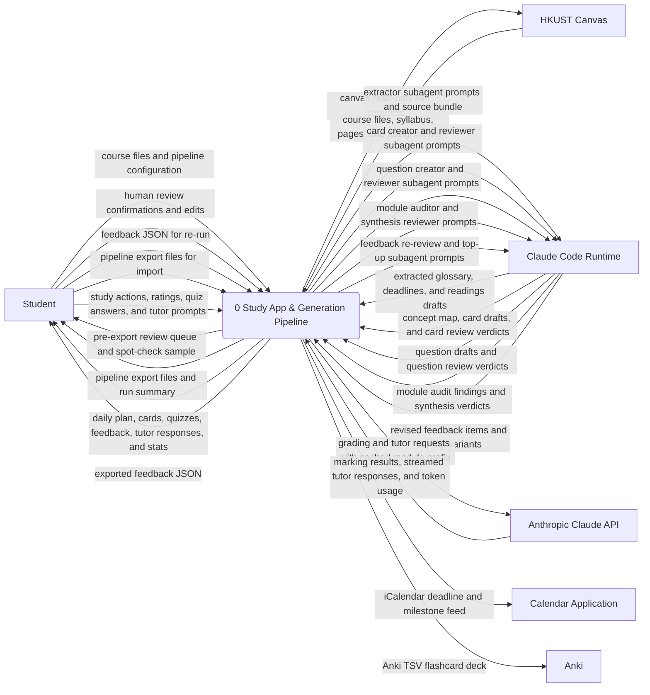

# A11 · Context Diagram

Owner: Systems Analyst. Stage 2, written 2026-10-21. Catalog entry: A11. Approved and baselined at CP2 (2026-10-21; updated via `CR-003`).

This diagram shows the **Study App & Generation Pipeline** as a single process (`P0`) together with every external entity (`E1`–`E6`) and every data flow crossing the system boundary. No data stores appear at context level (`A11`). Every boundary flow on this diagram balances one-for-one with the net external inputs and outputs of the Level-0 Data Flow Diagram in [`dfd.md`](dfd.md) (`A12`, `G2.5`, `G2.6`).

---

## 1. Context diagram (`P0`)

---

## 2. External entities and excluded seed actors (`G2.5`)

| Entity ID | Name | Role (`[SEED §2, §5]`, `[USER Q-17]`) | Direction |
| :-- | :-- | :-- | :-- |
| `E1` | `Student` | Single primary human actor (`[SEED §2]`): runs the pipeline, reviews flagged/spot-checked items, imports module files, completes daily reviews/quizzes/readings, manages deadlines, uses the tutor, and exports feedback. | Source & Sink |
| `E2` | `Claude Code Runtime` | External agentic CLI host (`[SEED §5]`, `[USER Q-05]`, `[USER Q-15]`, `ASM-058`, `REQ-N-022`): executes the Extractor, Card Creator, Card Reviewer, Question Creator, Question Reviewer, and Module Auditor subagents during interactive pipeline runs. | Source & Sink |
| `E3` | `Anthropic Claude API` | External HTTPS API (`[SEED §5]`): invoked by the local/hosted study app backend in `R2`–`R3` for written-answer marking (`REQ-F-043`) and course-grounded tutoring (`REQ-F-045`–`REQ-F-048`, `REQ-F-088`, `REQ-F-089`) with prompt caching. | Source & Sink |
| `E4` | `HKUST Canvas` | External university LMS (`[USER Q-17]`, `DEC-009`, `REQ-F-002`): read in read-only mode by the pipeline to fetch the student's course files, syllabi, pages, announcements, and assignments. | Source & Sink |
| `E5` | `Calendar Application` | External calendar client (`[SEED §5]`, `REQ-F-057`, `REQ-F-093`): subscribes to or imports the `.ics` deadline and milestone feed (`GET /calendar.ics`). | Sink |
| `E6` | `Anki` | External spaced-repetition client (`[SEED §5]`, `[SEED §11]`, `REQ-F-066`): receives the one-way `deck.anki.tsv` flashcard export in `R3`. | Sink |

### Excluded actors (`A11` acceptance check)

| Actor / Stakeholder in `[SEED §2]` | Reason for exclusion from the Context Diagram |
| :-- | :-- |
| **Module Lecturers & HKUST** | Indirect stakeholders (`[SEED §2]`) who author lecture slides, handbooks, and syllabi and set academic-integrity rules (`SRC-05`), but never interact directly with `P0`. Their materials enter `P0` exclusively through `E4` (`HKUST Canvas`) or through local files supplied by `E1` (`Student`). |

---

## 3. Boundary data flow catalog and Level-0 balancing map (`G2.6`)

Every flow below is a noun phrase (`A11`, `A12`) and maps to an exact Level-0 process in [`dfd.md`](dfd.md):

| Flow ID | Source | Destination | Flow label (exact noun phrase) | Level-0 process in `A12` | Related `REQ`s |
| :-- | :-- | :-- | :-- | :-- | :-- |
| `CF-01` | `E1` | `P0` | `course files and pipeline configuration` | `P1` (`P1.1`) | `REQ-F-001`, `REQ-F-006`, `REQ-F-067`–`REQ-F-069` |
| `CF-02` | `P0` | `E4` | `canvas read-only API requests` | `P1` (`P1.1`) | `REQ-F-002`, `REQ-N-016` |
| `CF-03` | `E4` | `P0` | `course files, syllabus, pages, and assignments` | `P1` (`P1.1`) | `REQ-F-002`, `REQ-F-068` |
| `CF-04` | `P0` | `E2` | `extractor subagent prompts and source bundle` | `P1` (`P1.2`) | `REQ-F-003`–`REQ-F-005`, `REQ-N-014` |
| `CF-05` | `E2` | `P0` | `extracted glossary, deadlines, and readings drafts` | `P1` (`P1.2`) | `REQ-F-003`–`REQ-F-005` |
| `CF-06` | `P0` | `E2` | `card creator and reviewer subagent prompts` | `P2` (`P2.1`, `P2.2`) | `REQ-F-007`–`REQ-F-010`, `REQ-F-070`–`REQ-F-072`, `REQ-N-012` |
| `CF-07` | `E2` | `P0` | `concept map, card drafts, and card review verdicts` | `P2` (`P2.1`, `P2.2`) | `REQ-F-007`–`REQ-F-010`, `REQ-F-070`–`REQ-F-072` |
| `CF-08` | `P0` | `E2` | `question creator and reviewer subagent prompts` | `P3` (`P3.1`, `P3.2`) | `REQ-F-011`–`REQ-F-014`, `REQ-F-073`–`REQ-F-075`, `REQ-N-012` |
| `CF-09` | `E2` | `P0` | `question drafts and question review verdicts` | `P3` (`P3.1`, `P3.2`) | `REQ-F-011`–`REQ-F-014`, `REQ-F-073`–`REQ-F-075` |
| `CF-10` | `P0` | `E2` | `module auditor and synthesis reviewer prompts` | `P4` (`P4.1`, `P4.2`) | `REQ-F-015`, `REQ-F-016` |
| `CF-11` | `E2` | `P0` | `module audit findings and synthesis verdicts` | `P4` (`P4.1`, `P4.2`) | `REQ-F-015`, `REQ-F-016` |
| `CF-12` | `P0` | `E1` | `pre-export review queue and spot-check sample` | `P5` (`P5.1`) | `REQ-F-017` |
| `CF-13` | `E1` | `P0` | `human review confirmations and edits` | `P5` (`P5.2`) | `REQ-F-017` |
| `CF-14` | `P0` | `E1` | `pipeline export files and run summary` | `P5` (`P5.3`) | `REQ-F-018`, `REQ-F-019` |
| `CF-15` | `P0` | `E6` | `Anki TSV flashcard deck` | `P5` (`P5.3`) | `REQ-F-066` |
| `CF-16` | `E1` | `P0` | `feedback JSON for re-run` | `P6` | `REQ-F-020`, `REQ-F-050`, `REQ-F-064` |
| `CF-17` | `P0` | `E2` | `feedback re-review and top-up subagent prompts` | `P6` | `REQ-F-020`, `REQ-F-050`, `REQ-F-064` |
| `CF-18` | `E2` | `P0` | `revised feedback items and top-up variants` | `P6` | `REQ-F-020`, `REQ-F-050`, `REQ-F-064` |
| `CF-19` | `E1` | `P0` | `pipeline export files for import` | `P7` | `REQ-F-021`–`REQ-F-023`, `REQ-F-076`, `REQ-F-086` |
| `CF-20` | `E1` | `P0` | `study actions, ratings, quiz answers, and tutor prompts` | `P7` | `REQ-F-024`–`REQ-F-065`, `REQ-F-077`–`REQ-F-094` |
| `CF-21` | `P0` | `E1` | `daily plan, cards, quizzes, feedback, tutor responses, and stats` | `P7` | `REQ-F-024`–`REQ-F-065`, `REQ-F-077`–`REQ-F-094` |
| `CF-22` | `P0` | `E1` | `exported feedback JSON` | `P7` | `REQ-F-042`, `REQ-F-063`, `REQ-F-085` |
| `CF-23` | `P0` | `E3` | `grading and tutor requests with cached module prefix` | `P7` | `REQ-F-043`, `REQ-F-045`–`REQ-F-048`, `REQ-F-083`, `REQ-F-088`, `REQ-F-089` |
| `CF-24` | `E3` | `P0` | `marking results, streamed tutor responses, and token usage` | `P7` | `REQ-F-043`, `REQ-F-045`–`REQ-F-048`, `REQ-F-083`, `REQ-F-088`, `REQ-F-089` |
| `CF-25` | `P0` | `E5` | `iCalendar deadline and milestone feed` | `P7` | `REQ-F-057`, `REQ-F-093` |
