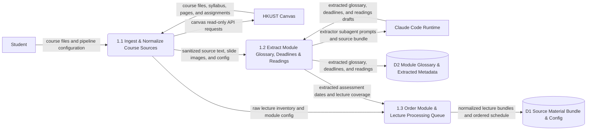
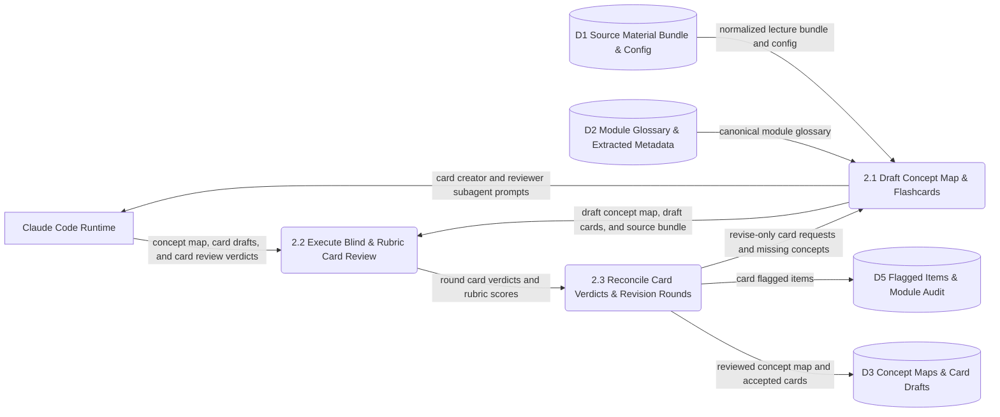
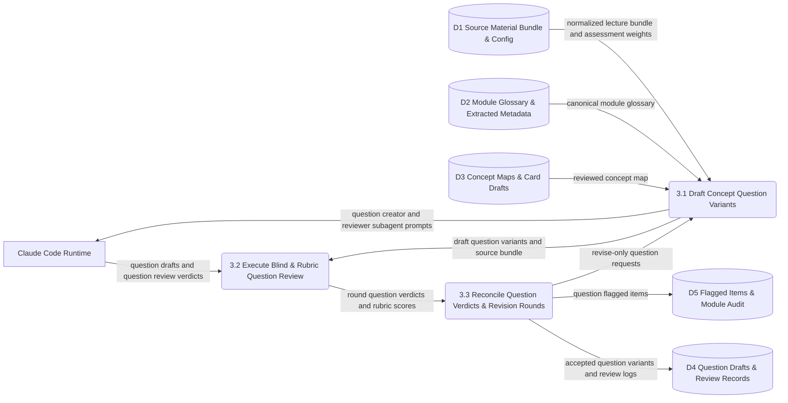
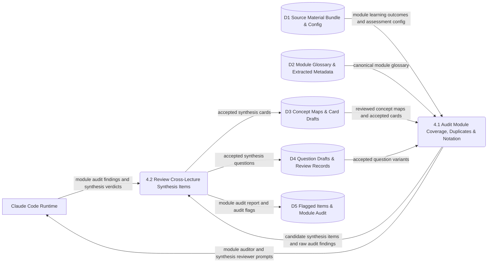
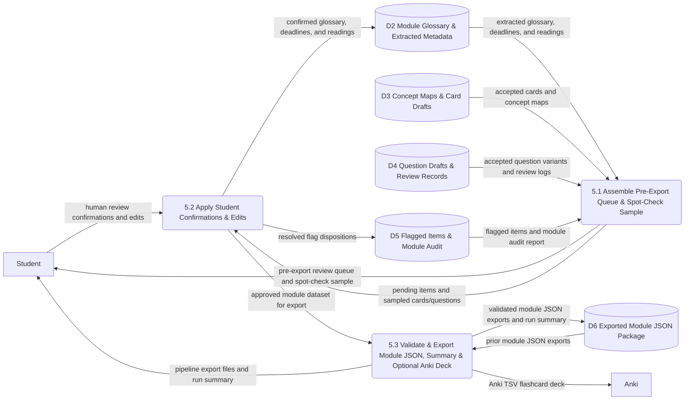
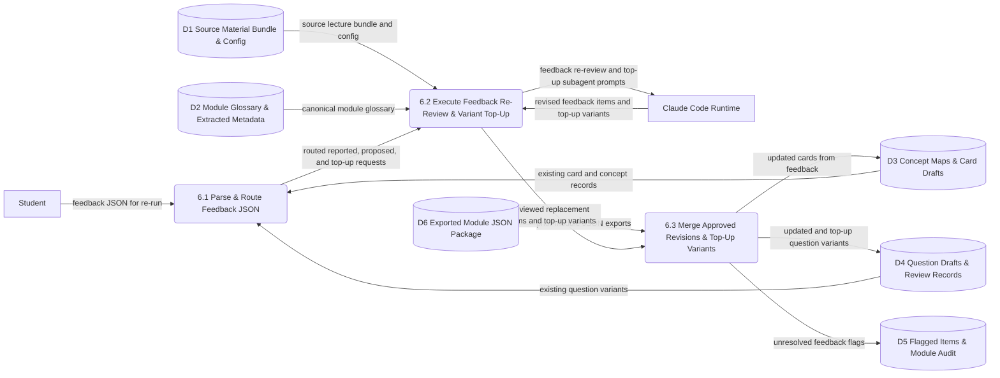

# A12 · Data Flow Diagrams (Level-0 and Level-1)

Owner: Systems Analyst. Stage 2, written 2026-10-21. Catalog entry: A12. Approved and baselined at CP2 (2026-10-21; updated via `CR-003`).

This document decomposes `P0("0 Study App & Generation Pipeline")` from [`context-diagram.md`](context-diagram.md) (`A11`) into a **Level-0 Data Flow Diagram** (`P1`–`P7`, data stores `D1`–`D9`) and **Level-1 Data Flow Diagrams** for the `Must` generation pipeline processes (`P1`–`P6`), per `A04` (*"Reduced: the pipeline only, Level-0 plus Level-1 for Must processes … The app is modelled with use cases instead"*) and `DEC-011`. Process `P7` (`"7 Operate Study App"`) appears on Level-0 to balance all 25 `P0` context flows (`G2.6`) and connect the pipeline file handoff (`D6`, `CF-12`–`CF-14`, `CF-22`), while the study app's internal behaviour is modelled with object-oriented Use Cases (`UC-06`–`UC-20` in [`use-cases.md`](use-cases.md), `A13`). *(Note: `P1`–`P7` here denote Level-0 DFD processes per catalog entry `A12`; `A01` scope items use `SC-P01`–`SC-P11`.)*

Every rule of catalog entry `A12` and gate checks `G2.6` and `G2.7` holds across the diagram set:
1. No flow connects two external entities, two data stores, or an external entity and a data store directly.
2. Every process has at least one input flow and at least one output flow, and uses a verb–noun name.
3. Every data store (`D1`–`D9`) is written by at least one process and read by at least one process, and maps to entities in [`conceptual-data-model.md`](conceptual-data-model.md) (`A16`, §9 below).
4. **Strict parent–child balancing (`G2.6`):** The net external flows of Level-0 equal the 25 boundary flows of `P0` in `A11`, and the net boundary flows of each Level-1 pipeline diagram (`P1`–`P6`) equal the parent process's inputs and outputs on Level-0.

---

## 1. Level-0 Data Flow Diagram (`P1`–`P7`)

```mermaid
flowchart TB
  E1[Student]
  E2[Claude Code Runtime]
  E3[Anthropic Claude API]
  E4[HKUST Canvas]
  E5[Calendar Application]
  E6[Anki]

  P1("1 Ingest & Extract Module Sources")
  P2("2 Generate & Review Flashcards")
  P3("3 Generate & Review Quiz Questions")
  P4("4 Audit Module & Synthesise")
  P5("5 Conduct Pre-Export Review & Export")
  P6("6 Process Feedback & Top-Up")
  P7("7 Operate Study App")

  D1[(D1 Source Material Bundle & Config)]
  D2[(D2 Module Glossary & Extracted Metadata)]
  D3[(D3 Concept Maps & Card Drafts)]
  D4[(D4 Question Drafts & Review Records)]
  D5[(D5 Flagged Items & Module Audit)]
  D6[(D6 Exported Module JSON Package)]
  D7[(D7 Study App Content & Schedule Store)]
  D8[(D8 FSRS State & Review History Store)]
  D9[(D9 Tutor Threads, Proposals & Feedback Store)]

  %% P1 flows
  E1 -->|course files and pipeline configuration| P1
  P1 -->|canvas read-only API requests| E4
  E4 -->|course files, syllabus, pages, and assignments| P1
  P1 -->|extractor subagent prompts and source bundle| E2
  E2 -->|extracted glossary, deadlines, and readings drafts| P1
  P1 -->|normalized lecture bundles and ordered schedule| D1
  P1 -->|extracted glossary, deadlines, and readings| D2

  %% P2 flows
  D1 -->|normalized lecture bundle and config| P2
  D2 -->|canonical module glossary| P2
  P2 -->|card creator and reviewer subagent prompts| E2
  E2 -->|concept map, card drafts, and card review verdicts| P2
  P2 -->|reviewed concept map and accepted cards| D3
  P2 -->|card flagged items| D5

  %% P3 flows
  D1 -->|normalized lecture bundle and assessment weights| P3
  D2 -->|canonical module glossary| P3
  D3 -->|reviewed concept map| P3
  P3 -->|question creator and reviewer subagent prompts| E2
  E2 -->|question drafts and question review verdicts| P3
  P3 -->|accepted question variants and review logs| D4
  P3 -->|question flagged items| D5

  %% P4 flows
  D1 -->|module learning outcomes and assessment config| P4
  D2 -->|canonical module glossary| P4
  D3 -->|reviewed concept maps and accepted cards| P4
  D4 -->|accepted question variants| P4
  P4 -->|module auditor and synthesis reviewer prompts| E2
  E2 -->|module audit findings and synthesis verdicts| P4
  P4 -->|accepted synthesis cards| D3
  P4 -->|accepted synthesis questions| D4
  P4 -->|module audit report and audit flags| D5

  %% P5 flows
  D2 -->|extracted glossary, deadlines, and readings| P5
  D3 -->|accepted cards and concept maps| P5
  D4 -->|accepted question variants and review logs| P5
  D5 -->|flagged items and module audit report| P5
  D6 -->|prior module JSON exports| P5
  P5 -->|pre-export review queue and spot-check sample| E1
  E1 -->|human review confirmations and edits| P5
  P5 -->|confirmed glossary, deadlines, and readings| D2
  P5 -->|resolved flag dispositions| D5
  P5 -->|validated module JSON exports and run summary| D6
  P5 -->|pipeline export files and run summary| E1
  P5 -->|Anki TSV flashcard deck| E6

  %% P6 flows
  E1 -->|feedback JSON for re-run| P6
  D1 -->|source lecture bundle and config| P6
  D2 -->|canonical module glossary| P6
  D3 -->|existing card and concept records| P6
  D4 -->|existing question variants| P6
  D6 -->|prior module JSON exports| P6
  P6 -->|feedback re-review and top-up subagent prompts| E2
  E2 -->|revised feedback items and top-up variants| P6
  P6 -->|updated cards from feedback| D3
  P6 -->|updated and top-up question variants| D4
  P6 -->|unresolved feedback flags| D5

  %% P7 flows
  E1 -->|pipeline export files for import| P7
  E1 -->|study actions, ratings, quiz answers, and tutor prompts| P7
  D7 -->|stored cards, questions, concepts, glossary, deadlines, readings, and daily plan| P7
  P7 -->|imported module content, deadlines, readings, and tasks| D7
  D8 -->|current FSRS states, review history, and attempt logs| P7
  P7 -->|updated card state, concept state, review logs, and question attempts| D8
  D9 -->|stored tutor threads, proposals, token spend logs, and unexported feedback| P7
  P7 -->|tutor messages, grading call logs, proposals, and feedback items| D9
  P7 -->|grading and tutor requests with cached module prefix| E3
  E3 -->|marking results, streamed tutor responses, and token usage| P7
  P7 -->|daily plan, cards, quizzes, feedback, tutor responses, and stats| E1
  P7 -->|exported feedback JSON| E1
  P7 -->|iCalendar deadline and milestone feed| E5
```

---

## 2. Level-1 DFD — `P1` ("1 Ingest & Extract Module Sources")

Decomposes `P1` (`REQ-F-001`–`REQ-F-006`, `REQ-F-067`–`REQ-F-069`, `REQ-N-014`, `REQ-N-016`):

---

## 3. Level-1 DFD — `P2` ("2 Generate & Review Flashcards")

Decomposes `P2` (Stage A per lecture: `REQ-F-007`–`REQ-F-010`, `REQ-F-070`–`REQ-F-072`, `REQ-N-012`):

---

## 4. Level-1 DFD — `P3` ("3 Generate & Review Quiz Questions")

Decomposes `P3` (Stage B per lecture: `REQ-F-011`–`REQ-F-014`, `REQ-F-073`–`REQ-F-075`, `REQ-N-012`):

---

## 5. Level-1 DFD — `P4` ("4 Audit Module & Synthesise")

Decomposes `P4` (`REQ-F-015`, `REQ-F-016`):

---

## 6. Level-1 DFD — `P5` ("5 Conduct Pre-Export Review & Export")

Decomposes `Must` pipeline export process `P5` (`REQ-F-017`–`REQ-F-019`, `REQ-N-020`; `P5.3` also carries the optional `R3` `Could` Anki TSV export flow `REQ-F-066 [R3]` / `UC-21` to `E6`):

---

## 7. Level-1 DFD — `P6` ("6 Process Feedback & Top-Up")

Decomposes `Must` pipeline feedback process `P6` (`REQ-F-020`, `UC-11`, plus `R2` `Should` `proposed` `REQ-F-050 [R2]` / `UC-14` and `R3` `Could` `topup` `REQ-F-064 [R3]` / `UC-19` sharing the `P6` sub-processes):

---

## 8. Primitive process descriptions (`A12` — Pipeline `P1.1`–`P6.3`)

| Process ID | Name | Transformation logic summary | Related `REQ`s |
| :-- | :-- | :-- | :-- |
| `P1.1` | Ingest & Normalize Course Sources | Reads `pipeline.config.json`, fetches in-scope course files/pages/assignments from HKUST Canvas in read-only mode (`REQ-F-002`) with local module folder fallback (`REQ-F-068`) and local file ingestion (`REQ-F-001`), renders slide pages to images, extracts text and decoded LaTeXiT equations (`REQ-F-067`, `ASM-046`), and wraps all course text in untrusted-data delimiters (`REQ-N-014`). | `REQ-F-001`, `REQ-F-002`, `REQ-F-067`, `REQ-F-068`, `REQ-N-014`, `REQ-N-016` |
| `P1.2` | Extract Module Glossary, Deadlines & Readings | Invokes the Extractor subagent across module handbooks, syllabi, and slides to produce `glossary.json` (`standard` vs `module_specific`), `deadlines.json` (with `explicit` vs `inferred` confidence and UTC/timezone fields), and `readings.json` (with `required` vs `recommended` and default `read_by`). | `REQ-F-003`, `REQ-F-004`, `REQ-F-005` |
| `P1.3` | Order Module & Lecture Processing Queue | Orders modules with Computer Science modules (`Theory of Computation`, `Machine Learning`, `Large Language Models`) first (`REQ-F-006`, `Q-12`, `ASM-040`) and orders lectures within each module by inclusion in the nearest upcoming assessment (`REQ-F-069`). | `REQ-F-006`, `REQ-F-069` |
| `P2.1` | Draft Concept Map & Flashcards | Invokes the Card Creator subagent per lecture with the normalized lecture bundle and `glossary.json` to produce `concept-map.json` (8–20 concepts) and `cards.draft.json` (15–40 atomic cards), diverting ambiguous source points directly to `flagged.json` (`REQ-F-070`). | `REQ-F-007`, `REQ-F-008`, `REQ-F-070` |
| `P2.2` | Execute Blind & Rubric Card Review | Invokes a fresh, context-isolated Card Reviewer subagent (`REQ-N-012`) to run Pass 1 (blind-answer test from card fronts only, `REQ-F-009`) and Pass 2 (8-criterion rubric and concept coverage check, `REQ-F-071`), writing `cards.review.r<n>.json`. | `REQ-F-009`, `REQ-F-071`, `REQ-N-012` |
| `P2.3` | Reconcile Card Verdicts & Revision Rounds | Freezes `accept` cards, discards `reject` cards, sends `revise` cards and `missing_concepts` back to `P2.1` (`REQ-F-010`) for up to 2 revision rounds (3 review rounds total), and routes any card still failing after round 3 to `flagged.json` (`REQ-F-072`). | `REQ-F-010`, `REQ-F-072` |
| `P3.1` | Draft Concept Question Variants | Invokes the Question Creator subagent per lecture (after `P2.3` completes) to draft `3–5` variants per `core` concept (`DEC-006`), `2–3` per `supporting`, and `0–1` per `detail` (`REQ-F-011`), weighted to the assessment format (or balanced MCQ/short-written default per `Q-16`, `REQ-F-012`), with `model_answer`, difficulty, source, and `2–5` `marking_points` / distractor notes (`REQ-F-073`). | `REQ-F-011`, `REQ-F-012`, `REQ-F-073` |
| `P3.2` | Execute Blind & Rubric Question Review | Invokes a fresh, context-isolated Question Reviewer subagent (`REQ-N-012`) to run Pass 1 (blind-answer test from stems and options only, `REQ-F-013`) and Pass 2 (8-criterion question rubric and core-variant count check, `REQ-F-074`), writing `questions.review.r<n>.json`. | `REQ-F-013`, `REQ-F-074`, `REQ-N-012` |
| `P3.3` | Reconcile Question Verdicts & Revision Rounds | Freezes `accept` questions, discards `reject` questions, sends `revise` questions back to `P3.1` (`REQ-F-014`) for up to 2 revision rounds (3 review rounds total), and routes any question still failing after round 3 to `flagged.json` (`REQ-F-075`). | `REQ-F-014`, `REQ-F-075` |
| `P4.1` | Audit Module Coverage, Duplicates & Notation | Invokes the Module Auditor subagent across all completed lectures of a module to check learning-outcome coverage, assessment-scope variant counts, cross-lecture duplicates, and glossary notation consistency, proposing synthesis items where needed. | `REQ-F-015` |
| `P4.2` | Review Cross-Lecture Synthesis Items | Routes any synthesis cards or questions proposed by `P4.1` through a fresh Reviewer subagent before adding accepted items to `D3`/`D4` and writing `module-audit.json` to `D5`. | `REQ-F-015`, `REQ-F-016` |
| `P5.1` | Assemble Pre-Export Queue & Spot-Check Sample | Gathers all `flagged.json` items, unconfirmed `module_specific` glossary entries, `inferred` deadlines/readings, and a random sample (`human_spot_check_rate`, default 10%) of accepted cards and questions per lecture. | `REQ-F-017` |
| `P5.2` | Apply Student Confirmations & Edits | Applies the student's confirmations, edits, and flag dispositions (`accept_edit`, `discard`, `keep_flagged`) to `D2`, `D3`, `D4`, and `D5`. | `REQ-F-017` |
| `P5.3` | Validate & Export Module JSON, Summary & Optional Anki Deck | Preserves deterministic item IDs against prior exports in `D6`, validates all 6 export JSON files against `A34` JSON Schemas (`REQ-N-020`), writes the pipeline run summary report (`REQ-F-019`), and in `R3` optionally formats accepted flashcards into `deck.anki.tsv` (`REQ-F-066` [`R3`], `UC-21`). | `REQ-F-018`, `REQ-F-019`, `REQ-N-020`, `REQ-F-066` (`R3`) |
| `P6.1` | Parse & Route Feedback JSON | Reads `feedback.json` (`reported` in `R1` `REQ-F-020`; `proposed` in `R2` `REQ-F-050` [`R2`]; `topup` in `R3` `REQ-F-064` [`R3`]) and matches entries against existing module records in `D3`/`D4`. | `REQ-F-020`, `REQ-F-050` (`R2`), `REQ-F-064` (`R3`) |
| `P6.2` | Execute Feedback Re-Review & Variant Top-Up | Routes `reported` items (`REQ-F-020`) and tutor-`proposed` items (`REQ-F-050` [`R2`]) to the Card/Question Creator and a fresh independent Reviewer subagent, and in `R3` invokes the Question Creator + Reviewer to generate additional question variants for `topup` concepts (`REQ-F-064` [`R3`]). | `REQ-F-020`, `REQ-F-050` (`R2`), `REQ-F-064` (`R3`) |
| `P6.3` | Merge Approved Revisions & Top-Up Variants | Updates accepted replacement items in place (preserving stable IDs so app FSRS state is retained on re-import), appends approved new variants to `D4`, and routes unresolved items to `D5` (`REQ-F-018`, `REQ-F-020`, `REQ-F-050` [`R2`], `REQ-F-064` [`R3`]). | `REQ-F-018`, `REQ-F-020`, `REQ-F-050` (`R2`), `REQ-F-064` (`R3`) |

---

## 9. Data store mapping to `A16` entities and read/write verification (`G2.6`, `G2.7`)

Every DFD data store (`D1`–`D9`) is both written and read across the diagram set and maps to conceptual entities in [`conceptual-data-model.md`](conceptual-data-model.md) (`A16`):

| Store ID | Data store name | Written by (Level-0 / Level-1) | Read by (Level-0 / Level-1) | Mapped `A16` conceptual entities (`G2.7`) |
| :-- | :-- | :-- | :-- | :-- |
| `D1` | `Source Material Bundle & Config` | `P1` (`P1.3`) | `P2` (`P2.1`), `P3` (`P3.1`), `P4` (`P4.1`), `P6` (`P6.2`) | `PipelineConfig`, `Module`, `Lecture` |
| `D2` | `Module Glossary & Extracted Metadata` | `P1` (`P1.2`), `P5` (`P5.2`) | `P2` (`P2.1`), `P3` (`P3.1`), `P4` (`P4.1`), `P5` (`P5.1`), `P6` (`P6.2`) | `GlossaryEntry`, `Deadline`, `Reading` |
| `D3` | `Concept Maps & Card Drafts` | `P2` (`P2.3`), `P4` (`P4.2`), `P6` (`P6.3`) | `P3` (`P3.1`), `P4` (`P4.1`), `P5` (`P5.1`), `P6` (`P6.1`) | `Concept`, `Card`, `ReviewRecord` |
| `D4` | `Question Drafts & Review Records` | `P3` (`P3.3`), `P4` (`P4.2`), `P6` (`P6.3`) | `P4` (`P4.1`), `P5` (`P5.1`), `P6` (`P6.1`) | `Question`, `ReviewRecord` |
| `D5` | `Flagged Items & Module Audit` | `P2` (`P2.3`), `P3` (`P3.3`), `P4` (`P4.2`), `P5` (`P5.2`), `P6` (`P6.3`) | `P5` (`P5.1`) | `FlaggedItem`, `ModuleAudit` |
| `D6` | `Exported Module JSON Package` | `P5` (`P5.3`) | `P5` (`P5.3`), `P6` (`P6.3`) | `Module`, `Lecture`, `Concept`, `Card`, `Question`, `GlossaryEntry`, `Deadline`, `Reading`, `PipelineRunSummary` |
| `D7` | `Study App Content & Schedule Store` | `P7` (Level-0; `UC-06`, `UC-09`, `UC-10`, `UC-16`) | `P7` (Level-0; `UC-06`–`UC-20`) | `Module`, `Lecture`, `Concept`, `Card`, `Question`, `GlossaryEntry`, `Deadline`, `Milestone`, `Reading`, `Task`, `DailyPlan`, `DailyPlanItem`, `Settings`, `ImportBatch` |
| `D8` | `FSRS State & Review History Store` | `P7` (Level-0; `UC-07`, `UC-08`, `UC-12`, `UC-15`, `UC-20`) | `P7` (Level-0; `UC-07`, `UC-08`, `UC-10`, `UC-12`, `UC-13`, `UC-15`, `UC-17`, `UC-20`) | `CardState`, `CardReviewLog`, `ConceptState`, `QuestionAttempt` |
| `D9` | `Tutor Threads, Proposals & Feedback Store` | `P7` (Level-0; `UC-08`, `UC-11`–`UC-14`, `UC-19`) | `P7` (Level-0; `UC-11`–`UC-14`, `UC-17`, `UC-19`) | `TutorThread`, `TutorMessage`, `Proposal`, `FeedbackItem`, `GradingCallLog` |
