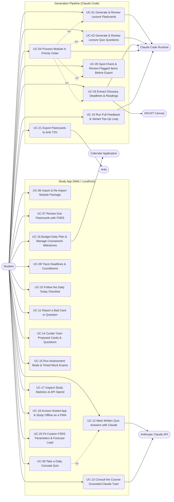

# A13 · Use Cases

Owner: Systems Analyst. Stage 2, written 2026-10-21. Catalog entry: A13. Approved and baselined at CP2 (2026-10-21).

This document specifies the 21 use cases (`UC-01`–`UC-21`) of the **Study App & Generation Pipeline**.
- **Must (`R1`) use cases (`UC-01`–`UC-11`):** Fully dressed Cockburn format (`A13`).
- **Should (`R2`) and Could (`R3`) use cases (`UC-12`–`UC-21`):** Structured casual format with numbered main scenario steps and explicit extensions so every extension traces to an acceptance scenario in [`acceptance-scenarios.md`](acceptance-scenarios.md) (`A19`, `G2.3`).
- **UI neutrality (`A13.1`):** All steps describe actor intent and system behaviour without UI layout, widget, or styling detail (UI design belongs in Stage 3 `A35`).
- **Extension termination (`A13.2`):** Every extension explicitly ends in **success**, **failure**, or **return to step N**.

---

## 1. Seed story mapping and priority preservation (`G2.12`)

Every user story in `[SEED §3]` (`1`–`20`) plus `Q-17` (`DEC-009`) maps to `UC-01`–`UC-21` with its seed priority preserved:

| Seed story | Seed summary | Seed priority | Mapped use case(s) | Priority in `A10`/`A13` | Mapped `REQ-F` IDs |
| :-: | :-- | :-: | :-- | :-: | :-- |
| `1` | Generate flashcards from a lecture | Must | `UC-01` | Must | `REQ-F-001`, `REQ-F-007`–`REQ-F-010`, `REQ-F-067`, `REQ-F-070`–`REQ-F-072` |
| `2` | Generate quiz questions from a lecture | Must | `UC-02` | Must | `REQ-F-011`–`REQ-F-016`, `REQ-F-073`–`REQ-F-075` |
| `3` | Extract module glossary, deadlines, and readings | Must | `UC-03` | Must | `REQ-F-001`–`REQ-F-005`, `REQ-F-067`, `REQ-F-068` |
| `4` | Process a full module in priority order | Must | `UC-04` | Must | `REQ-F-006`, `REQ-F-018`–`REQ-F-020`, `REQ-F-069` |
| `5` | Spot-check and review flagged items before export | Must | `UC-05` | Must | `REQ-F-017`, `REQ-F-018`, `REQ-F-028` |
| `6` | Import and re-import module files without losing progress | Must | `UC-06` | Must | `REQ-F-021`–`REQ-F-023`, `REQ-F-028`, `REQ-F-076`, `REQ-F-086` |
| `7` | Review due flashcards with FSRS | Must | `UC-07` | Must | `REQ-F-024`–`REQ-F-027`, `REQ-F-077`–`REQ-F-079` |
| `8` | Take a daily concept quiz | Must | `UC-08` | Must | `REQ-F-029`–`REQ-F-034`, `REQ-F-044`, `REQ-F-080`, `REQ-F-087` |
| `9` | Track deadlines and countdowns | Must | `UC-09` | Must | `REQ-F-035`–`REQ-F-038` |
| `10` | Follow the daily "Today" checklist | Must | `UC-10` | Must | `REQ-F-027`, `REQ-F-039`–`REQ-F-041`, `REQ-F-081`, `REQ-F-082` |
| `11` | Report a bad card or question (`R1`) | Must | `UC-11` | Must | `REQ-F-020`, `REQ-F-042`, `REQ-F-085` |
| `12` | Mark written answers with Claude | Should | `UC-12` | Should | `REQ-F-043`, `REQ-F-044`, `REQ-F-047`, `REQ-F-048`, `REQ-F-083`, `REQ-F-087`, `REQ-F-089` |
| `13` | Ask the course-grounded Claude tutor | Should | `UC-13` | Should | `REQ-F-045`–`REQ-F-048`, `REQ-F-051`, `REQ-F-052`, `REQ-F-083`, `REQ-F-084`, `REQ-F-088`, `REQ-F-089` |
| `14` | Save cards or questions proposed during a tutor chat | Should | `UC-14` | Should | `REQ-F-049`, `REQ-F-050` |
| `15` | Prepare for an upcoming exam with assessment mode and mock exams | Should | `UC-15` | Should | `REQ-F-053`, `REQ-F-054`, `REQ-F-090`–`REQ-F-092` |
| `16` | Keep the daily plan within a time budget and plan coursework milestones | Should | `UC-16` | Should | `REQ-F-055`–`REQ-F-057`, `REQ-F-093` |
| `—` *(Reports & outputs)* | View learning analytics, retention, coverage, and spend (`SM-1`–`SM-6`) | Should | `UC-17` | Should | `REQ-F-048`, `REQ-F-058`, `REQ-F-083`, `REQ-F-089` |
| `17` | Use the app on phone and laptop, including offline (`R3`) | Could | `UC-18` | Could | `REQ-F-059`–`REQ-F-062`, `REQ-F-094` |
| `18` | Close the full feedback loop (`reported`, `topup`, `proposed`) | Could | `UC-19` | Could | `REQ-F-063`, `REQ-F-064` |
| `19` | Tune FSRS to my own review history | Could | `UC-20` | Could | `REQ-F-065` |
| `20` | Export cards to Anki | Could | `UC-21` | Could | `REQ-F-066` |

---

## 2. Actor and use-case overview

---

## 3. Must use cases — Fully dressed (`UC-01`–`UC-11`)

### `UC-01` · Generate and review flashcards from a lecture
- **Primary actor:** Student (`E1`), assisted by Claude Code Runtime (`E2`).
- **Stakeholders and interests:**
  - *Student:* Wants atomic, context-free, notation-consistent flashcards covering every lecture concept without manual card writing (`SM-1`, `SM-3`).
  - *Module Lecturers & HKUST:* Require copyrighted lecture files to remain local and private (`DEC-008`, `REQ-N-016`).
- **Scope and level:** Generation Pipeline (`P1`, `P2`); user goal.
- **Preconditions:** Module `glossary.json` exists (`UC-03`) and the target lecture slide deck/notes and `pipeline.config.json` are readable.
- **Minimal guarantees:** No unreviewed or rejected card is marked accepted; any unclear source point or 3-round review failure is recorded in `flagged.json`; source files are not modified.
- **Success guarantees:** `concept-map.json` (8–20 concepts), `cards.final.json`, `cards.review.r<n>.json`, and `flagged.json` are written for the lecture with deterministic IDs.
- **Trigger:** The student invokes the lecture flashcard generation command for a lecture (directly or via `UC-04`).
- **Main success scenario:**
  1. The student specifies the module and lecture to process.
  2. The system ingests the lecture file, renders slide page images, extracts normalized text and decoded LaTeXiT equations (`REQ-F-001`, `REQ-F-067`), wraps the content as untrusted data (`REQ-N-014`), and loads the module's `glossary.json`.
  3. The system invokes the Card Creator subagent to extract `concept-map.json` containing 8 to 20 concepts with stable IDs, one-line summaries, source locations, and importance levels (`core`, `supporting`, `detail`) (`REQ-F-007`).
  4. The system invokes the Card Creator subagent to draft 15 to 40 atomic flashcards (`basic`, `cloze`, or `reverse`) in `cards.draft.json` following the 10 card rules and module glossary (`REQ-F-008`).
  5. The system invokes a fresh, context-isolated Card Reviewer subagent (`REQ-N-012`) to execute Pass 1 (blind-answer test on card fronts only) and Pass 2 (evaluating the 8 pass/fail card rubric criteria in `failed_criteria` and checking concept coverage) and write `cards.review.r1.json` (`REQ-F-009`, `REQ-F-071`, `DT-01`).
  6. The system freezes all `accept` cards, discards `reject` cards (requesting a replacement under a new ID only if a concept still needs coverage), and writes the accepted cards to `cards.final.json` (`REQ-F-010`).
- **Extensions:**
  - **2a.** The lecture file is missing, unreadable, or corrupt:
    - **2a1.** The system logs a structured ingestion error identifying the lecture path and halts processing for that lecture → *ends in failure*.
  - **4a.** The Card Creator encounters an illegible slide, undefined symbol, or contradiction between slides:
    - **4a1.** The Card Creator records the issue in `flagged.json` (`reason = "unclear_source"`) without drafting a speculative card (`REQ-F-070`, `BR-011`) → *returns to step 5*.
  - **5a.** One or more cards receive a `revise` verdict or `missing_concepts` is non-empty in review round `r < 3` (`DT-01`):
    - **5a1.** The system sends only the `revise` cards and `missing_concepts` back to the Card Creator to produce updated drafts (`REQ-F-010`, `REQ-F-072`).
    - **5a2.** The system invokes a fresh Card Reviewer subagent on the revised drafts to write `cards.review.r<r+1>.json` (`REQ-F-009`, `REQ-F-071`) → *returns to step 6*.
  - **5b.** A card still receives `revise` or `reject` after review round 3 (2 revision rounds completed, `DT-01`):
    - **5b1.** The system moves the card and its reviewer feedback into `flagged.json` (`reason = "failed_3_rounds"`) (`REQ-F-072`, `BR-014`) → *returns to step 6*.
- **Related `REQ` and `BR` IDs:** `REQ-F-001`, `REQ-F-007`–`REQ-F-010`, `REQ-F-067`, `REQ-F-070`–`REQ-F-072`, `REQ-N-006`, `REQ-N-012`, `REQ-N-014`, `REQ-N-016`, `REQ-N-017`; `BR-006`–`BR-014`.

---

### `UC-02` · Generate and review quiz questions from a lecture
- **Primary actor:** Student (`E1`), assisted by Claude Code Runtime (`E2`).
- **Stakeholders and interests:**
  - *Student:* Wants multi-variant concept quiz questions weighted to the module's assessment format and verified by an independent Reviewer (`SM-1`, `SM-5`).
- **Scope and level:** Generation Pipeline (`P3`, `P4`); user goal.
- **Preconditions:** Stage A (`UC-01`) has completed for the lecture, producing a reviewed `concept-map.json` and `glossary.json`.
- **Minimal guarantees:** Stage B never starts without a reviewed concept map (`BR-015`); no rejected or unreviewed question enters `questions.final.json`; unresolved items after round 3 are recorded in `flagged.json`.
- **Success guarantees:** `questions.final.json` and `questions.review.r<n>.json` are written for the lecture, and when all module lectures finish, `module-audit.json` is written.
- **Trigger:** Stage A completes for a lecture during a pipeline run, or the student invokes Stage B for the lecture.
- **Main success scenario:**
  1. The system loads the lecture's reviewed `concept-map.json`, normalized source bundle, `glossary.json`, and target assessment format weights from `pipeline.config.json`.
  2. The system invokes the Question Creator subagent to draft question variants per concept (`3–5` for `core` per `DEC-006`, `2–3` for `supporting`, `0–1` for `detail`) weighted to the assessment format, with model answers, `2–5` marking points (or 4 MCQ options with distractor explanations), difficulty (`1`–`3`), and source citations (`REQ-F-011`, `REQ-F-012`, `REQ-F-073`).
  3. The system invokes a fresh, context-isolated Question Reviewer subagent (`REQ-N-012`) to execute Pass 1 (answering from question stem and MCQ options only) and Pass 2 (evaluating the 8 pass/fail question rubric criteria in `failed_criteria` and checking `core` variant counts) and write `questions.review.r1.json` (`REQ-F-013`, `REQ-F-074`, `DT-01`).
  4. The system freezes `accept` questions, discards `reject` questions (requesting a replacement under a new ID only if a concept's variant count falls short), and writes `questions.final.json` (`REQ-F-014`).
  5. When all lectures in the module have completed Stages A and B, the system invokes the Module Auditor subagent to write `module-audit.json` checking learning-outcome coverage, assessment-scope variant counts, cross-lecture duplicates, and notation consistency (`REQ-F-015`).
  6. When the Module Auditor proposes cross-lecture synthesis cards or questions, the system routes them through a fresh Reviewer subagent and adds accepted synthesis items to the module output (`REQ-F-016`).
- **Extensions:**
  - **1a.** The target assessment format is unannounced in `pipeline.config.json` (`Q-16`, `ASM-047`):
    - **1a1.** The system applies the balanced default question-type mix (MCQ and short-written types) and tags the assessment format as provisional (`REQ-F-012`) → *returns to step 2*.
  - **3a.** One or more questions receive `revise` or a `core` concept has fewer than 3 accepted variants in review round `r < 3` (`DT-01`):
    - **3a1.** The system sends only the `revise` questions and variant-shortfall concepts to the Question Creator for revision (`REQ-F-014`, `REQ-F-075`).
    - **3a2.** The system invokes a fresh Question Reviewer subagent on the revised questions to write `questions.review.r<r+1>.json` (`REQ-F-013`, `REQ-F-074`) → *returns to step 4*.
  - **3b.** A question still fails after review round 3 (`DT-01`):
    - **3b1.** The system records the question and reviewer notes in `flagged.json` (`reason = "failed_3_rounds"`) (`REQ-F-075`, `BR-014`) → *returns to step 4*.
  - **6a.** A proposed synthesis item is rejected by the Reviewer after revision:
    - **6a1.** The system routes the rejected synthesis item to `flagged.json` (`REQ-F-016`) → *ends in success*.
- **Related `REQ` and `BR` IDs:** `REQ-F-011`–`REQ-F-016`, `REQ-F-073`–`REQ-F-075`, `REQ-N-006`, `REQ-N-012`, `REQ-N-017`; `BR-012`–`BR-019`.

---

### `UC-03` · Extract module glossary, deadlines, and readings
- **Primary actor:** Student (`E1`), assisted by Claude Code Runtime (`E2`) and HKUST Canvas (`E4`).
- **Stakeholders and interests:**
  - *Student:* Wants module notation, assessment dates, and reading lists extracted once per module before card/question generation begins.
- **Scope and level:** Generation Pipeline (`P1`); user goal.
- **Preconditions:** The student has provided a module directory (`pipeline.config.json` + local files) or configured read-only HKUST Canvas credentials (`DEC-009`).
- **Minimal guarantees:** No write/submit request is ever sent to Canvas (`BR-002`); no Creator subagent starts before `glossary.json` is written (`BR-003`).
- **Success guarantees:** `glossary.json`, `deadlines.json`, and `readings.json` are written in the module pipeline directory.
- **Trigger:** The student starts module ingestion/extraction for a new or updated module.
- **Main success scenario:**
  1. The student initiates module source ingestion for a specified module.
  2. The system queries HKUST Canvas in read-only mode for the module's syllabus, files, pages, announcements, and assignments (`REQ-F-002`), and ingests any local module handbooks, past papers, and slide decks (`REQ-F-001`, `REQ-F-067`).
  3. The system invokes the Extractor subagent across the module documents to identify every symbol and abbreviation, classify each as `standard` or `module_specific`, and write `glossary.json` (`REQ-F-003`).
  4. The system invokes the Extractor subagent to extract all module assessments and deadlines into `deadlines.json` with UTC `due_at` (`null` with reason if unannounced), `timezone`, `weighting`, `covers_lectures`, `source`, and `confidence` (`explicit` or `inferred`) (`REQ-F-004`).
  5. The system invokes the Extractor subagent to extract required and recommended readings into `readings.json` with `citation`, `pages`, `lecture_id`, `required`, `read_by`, and `source` (`REQ-F-005`).
- **Extensions:**
  - **2a.** HKUST Canvas is unreachable, rate-limited, or credentials are not configured:
    - **2a1.** The system logs a Canvas fallback notice and ingests files exclusively from the local module source folders (`REQ-F-068`, `ASM-048`) → *returns to step 3*.
  - **2b.** Both Canvas and the local module folder contain zero readable course documents:
    - **2b1.** The system reports that no readable source documents were found and aborts module extraction → *ends in failure*.
  - **4a.** A syllabus lists an assessment weighting (e.g. midterm or exam) without an announced calendar date (`SRC-05`):
    - **4a1.** The system writes the deadline entry with `due_at = null`, `status = "unannounced"`, and `confidence = "inferred"` (`REQ-F-004`, `ASM-047`) → *returns to step 5*.
- **Related `REQ` and `BR` IDs:** `REQ-F-001`–`REQ-F-005`, `REQ-F-067`, `REQ-F-068`, `REQ-N-013`, `REQ-N-014`, `REQ-N-016`; `BR-001`–`BR-005`.

---

### `UC-04` · Process a full module in priority order
- **Primary actor:** Student (`E1`).
- **Stakeholders and interests:**
  - *Student:* Wants high-priority Computer Science modules and lectures in the nearest assessment's scope processed first, with resumable progress and a run summary report.
- **Scope and level:** Generation Pipeline (`P1`–`P6`); user goal.
- **Preconditions:** Module configurations (`pipeline.config.json`) exist for one or more in-scope modules.
- **Minimal guarantees:** Completed lectures are persisted on disk so an interrupted run can resume without repeating finished lectures; stable IDs are preserved across re-runs.
- **Success guarantees:** All target lectures are processed in priority order, module audit and pre-export review (`UC-05`) are triggered, and a pipeline run summary report (`REQ-F-019`) is written.
- **Trigger:** The student launches a batch pipeline run across one or more modules (optionally supplying `feedback.json` from `R1`).
- **Main success scenario:**
  1. The student starts a pipeline run specifying the target module(s) and optional `feedback.json`.
  2. The system orders target modules with Computer Science modules (`Theory of Computation`, `Machine Learning`, `Large Language Models`) before other modules (`REQ-F-006`), and orders lectures within each module so lectures covered by the nearest upcoming assessment run first (`REQ-F-069`, `BR-005`).
  3. The system executes module extraction (`UC-03`) if `glossary.json`, `deadlines.json`, or `readings.json` are missing or out of date.
  4. If `feedback.json` with `reported` items (`R1`) was supplied, the system routes each reported item and student comment to the corresponding Creator and a fresh Reviewer (`REQ-F-020`).
  5. For each lecture in priority order, the system executes Stage A (`UC-01`) followed by Stage B (`UC-02`), running independent lectures in parallel up to the concurrency limit (`flashcard-pipeline.md` §3.1).
  6. The system executes the Module Auditor (`UC-02` steps 5–6) once all lectures in the module complete.
  7. The system invokes the pre-export human review and export workflow (`UC-05`) and writes the pipeline run summary report recording accepted, rejected, and flagged counts per lecture and the module audit summary (`REQ-F-018`, `REQ-F-019`).
- **Extensions:**
  - **5a.** The Claude Code session hits a subscription rate limit or is interrupted mid-module:
    - **5a1.** The system saves progress after the last completed lecture/round and outputs a resume command that continues from the first incomplete lecture → *ends in success (partial run saved)*.
- **Related `REQ` and `BR` IDs:** `REQ-F-006`, `REQ-F-018`–`REQ-F-020`, `REQ-F-069`, `REQ-N-006`, `REQ-N-017`, `REQ-N-022`; `BR-005`, `BR-020`.

---

### `UC-05` · Spot-check and review flagged items before export
- **Primary actor:** Student (`E1`).
- **Stakeholders and interests:**
  - *Student:* Wants to resolve ambiguous/flagged items, confirm module-specific notation and inferred deadlines, and spot-check 10% of accepted items before exporting to the study app (`SM-3`).
- **Scope and level:** Generation Pipeline (`P5`) and Study App Glossary (`P7`); user goal.
- **Preconditions:** Stages A and B and the Module Auditor have completed for the module.
- **Minimal guarantees:** Unresolved `flagged.json` items never silently enter `deck.json` or `question-bank.json` (`BR-014`).
- **Success guarantees:** All 6 module export JSON files (`deck.json`, `question-bank.json`, `concepts.json`, `glossary.json`, `deadlines.json`, `readings.json`) validate against `A34` schemas and are written with deterministic item IDs.
- **Trigger:** Module generation completes, or the student runs the pre-export review command.
- **Main success scenario:**
  1. The system presents the pre-export review queue containing: (a) all `flagged.json` items across lectures, (b) `module_specific` glossary entries for confirmation, (c) `inferred` deadlines and readings for confirmation, and (d) a random sample (`human_spot_check_rate`, default 10%) of accepted cards and questions per lecture (`REQ-F-017`).
  2. The student reviews each flagged item and chooses to accept it with an edit (`accept_edit`), discard it (`discard`), or leave it flagged (`keep_flagged`).
  3. The student confirms or edits `module_specific` glossary entries (`REQ-F-017`, `REQ-F-028`) and `inferred` deadlines/readings.
  4. The student inspects the 10% spot-check sample of accepted cards and questions and approves or edits them.
  5. The system assigns or preserves deterministic stable IDs across all accepted items, validates all 6 export JSON files against their JSON Schemas (`REQ-N-020`), and writes `deck.json`, `question-bank.json`, `concepts.json`, `glossary.json`, `deadlines.json`, and `readings.json` (`REQ-F-018`).
- **Extensions:**
  - **2a.** The student chooses `keep_flagged` or `discard` on a flagged item:
    - **2a1.** The system excludes the item from `deck.json` and `question-bank.json` while retaining its record in `flagged.json` (`BR-014`) → *returns to step 3*.
  - **4a.** The student rejects more than 20% of the 10% spot-check sample for a lecture:
    - **4a1.** The system recommends re-running the lecture with stricter Reviewer notes; if the student chooses to re-run, the lecture returns to `UC-01`/`UC-02` → *ends in failure (lecture queued for re-run)*.
  - **5a.** An export file fails JSON Schema validation (`REQ-N-020`):
    - **5a1.** The system reports the exact field-level schema errors and aborts writing the final export package → *ends in failure*.
- **Related `REQ` and `BR` IDs:** `REQ-F-017`, `REQ-F-018`, `REQ-F-028`, `REQ-N-020`; `BR-014`, `BR-020`.

---

### `UC-06` · Import and re-import module files without losing progress
- **Primary actor:** Student (`E1`).
- **Stakeholders and interests:**
  - *Student:* Wants to load initial or updated pipeline JSON exports into the study app while preserving all FSRS scheduling state, review history, and manual deadline edits (`UDP-04`).
- **Scope and level:** Study App (`P7`); user goal.
- **Preconditions:** The study app is running and the student has one or more pipeline export JSON files (`deck.json`, `question-bank.json`, `concepts.json`, `glossary.json`, `deadlines.json`, `readings.json`).
- **Minimal guarantees:** Malformed JSON files are rejected before any database write; a verified database backup snapshot is created before any import write (`REQ-N-011`); existing `CardState`, `CardReviewLog`, `ConceptState`, and `QuestionAttempt` rows are never deleted (`BR-021`).
- **Success guarantees:** New items are inserted, changed items update their content while keeping their FSRS state and logs, absent items from re-imported lectures are marked `suspended = true`, manual deadline edits are preserved, and an `ImportBatch` record is written (`REQ-F-021`–`REQ-F-023`, `REQ-F-076`, `REQ-F-086`).
- **Trigger:** The student selects pipeline export files for import in the study app.
- **Main success scenario:**
  1. The student provides the module export JSON files for import.
  2. The system validates every file against its JSON Schema (`REQ-F-021`, `REQ-N-020`) and computes a diff preview listing new items, content-changed items, unchanged items, and previously imported items absent from the re-imported lectures (`DT-02`).
  3. The system presents the diff preview to the student for confirmation (`REQ-F-086`).
  4. The student confirms the import.
  5. The system creates a verified pre-import backup of the database (`REQ-N-011`).
  6. Within a single atomic database transaction, the system inserts new items (initializing `CardState` and `ConceptState` to `state = "new"`), updates content fields on changed items while preserving their `CardState`, `CardReviewLog`, `ConceptState`, and `QuestionAttempt` records (`REQ-F-022`, `DT-02`), marks absent items from re-imported lectures as `suspended = true` (`REQ-F-023`), preserves any manually edited deadline fields (`REQ-F-036`), and writes an `ImportBatch` log entry (`REQ-F-076`).
  7. The system displays the import completion summary and updated module glossary (`REQ-F-028`).
- **Extensions:**
  - **2a.** One or more uploaded files fail JSON Schema validation:
    - **2a1.** The system presents the field-level validation errors and performs zero database writes (`REQ-F-021`, `REQ-N-020`) → *ends in failure*.
  - **4a.** The student cancels the import after viewing the diff preview:
    - **4a1.** The system discards the staged upload without modifying the database (`REQ-F-086`) → *ends in success (no-op)*.
  - **6a.** A database error or process crash occurs during the import transaction:
    - **6a1.** The database rolls back the uncommitted transaction (or restores from the step 5 backup snapshot on restart), leaving prior data intact (`REQ-N-011`) → *ends in failure*.
- **Related `REQ` and `BR` IDs:** `REQ-F-021`–`REQ-F-023`, `REQ-F-028`, `REQ-F-036`, `REQ-F-076`, `REQ-F-086`, `REQ-N-011`, `REQ-N-020`; `BR-021`–`BR-024`, `DT-02`.

---

### `UC-07` · Review due flashcards with FSRS
- **Primary actor:** Student (`E1`).
- **Stakeholders and interests:**
  - *Student:* Wants fast, keyboard-driven spaced-repetition flashcard reviews with accurate `ts-fsrs` scheduling and LaTeX math rendering (`SM-2`, `SM-4a`).
- **Scope and level:** Study App (`P7`); user goal.
- **Preconditions:** At least one module deck has been imported (`UC-06`).
- **Minimal guarantees:** Every submitted rating is atomically persisted in `CardState` and `CardReviewLog`.
- **Success guarantees:** Reviewed cards have updated FSRS `due`, `stability`, `difficulty`, `reps`, `lapses`, and `state`, and new `CardReviewLog` entries record `state_before`, `rating`, `reviewed_at`, and `duration_ms`.
- **Trigger:** The student starts a flashcard review session from the Today checklist (`UC-10`) or the Review view.
- **Main success scenario:**
  1. The student starts a flashcard review session (optionally filtered by module, lecture, concept, or tag) (`REQ-F-024`).
  2. The system selects due cards (`CardState.due <= end_of_today`, `suspended = false`, `flagged = false`) up to the module's daily review limit (`review_cards_per_day`, default 200) and new cards (`state = "new"`) up to the daily new-card limit (`new_cards_per_day`, default 20) (`REQ-F-027`).
  3. The system presents the front of the next card with formatted Markdown and KaTeX mathematics (`REQ-F-077`, `REQ-N-002`).
  4. The student recalls the answer and requests to reveal the back of the card (e.g. via the `Space` keyboard shortcut) (`REQ-F-025`, `REQ-N-019`).
  5. The system reveals the card back, any `extra` note, the source citation, and the predicted next intervals for `Again` (`1`), `Hard` (`2`), `Good` (`3`), and `Easy` (`4`) (`REQ-F-025`, `REQ-F-077`, `REQ-N-001`).
  6. The student rates recall as `Again` (`1`), `Hard` (`2`), `Good` (`3`), or `Easy` (`4`) (`REQ-F-025`).
  7. The system computes the new `CardState` using `ts-fsrs` (desired retention `0.90`, or SM-2 fallback if configured), persists the updated `CardState`, and appends a `CardReviewLog` row with `state_before`, `rating`, `reviewed_at`, and `duration_ms` (`REQ-F-026`, `REQ-F-079`, `REQ-N-001`, `REQ-N-010`).
  8. Steps 3–7 repeat until the session queue is completed, and the system displays the session completion summary.
- **Extensions:**
  - **2a.** Zero due or new cards remain within the daily limits for the selected scope:
    - **2a1.** The system informs the student that all scheduled reviews for today are complete → *ends in success*.
  - **5a.** The student chooses to suspend, flag, or edit the active card (`REQ-F-078`):
    - **5a1.** The system updates the card's `suspended`, `flagged`, or content fields and removes suspended/flagged cards from the active review queue → *returns to step 3*.
  - **5b.** The student chooses to report the card as wrong or unclear (`REQ-F-042`, `REQ-F-085`):
    - **5b1.** The system invokes `UC-11` to record the `FeedbackItem` and flag the card → *returns to step 3*.
- **Related `REQ` and `BR` IDs:** `REQ-F-024`–`REQ-F-027`, `REQ-F-077`–`REQ-F-079`, `REQ-N-001`, `REQ-N-002`, `REQ-N-008`, `REQ-N-010`, `REQ-N-019`; `BR-025`–`BR-027`.

---

### `UC-08` · Take a daily concept quiz
- **Primary actor:** Student (`E1`).
- **Stakeholders and interests:**
  - *Student:* Wants concept-level spaced-repetition quizzes that rotate unseen question variants near the right difficulty, mark MCQs and self-marked written answers in `R1`, and link failed concepts back to their flashcards (`SM-5`).
- **Scope and level:** Study App (`P7`); user goal.
- **Preconditions:** At least one module's `concepts.json` and `question-bank.json` have been imported (`UC-06`).
- **Minimal guarantees:** Flagged and suspended questions are never served (`BR-029`); every completed attempt is logged in `QuestionAttempt` and updates `ConceptState`.
- **Success guarantees:** Due concepts are quizzed using unseen or least-recently-seen variants matched to stability-derived target difficulty (`DT-03`), `ConceptState` is updated via `ts-fsrs` (`DT-04`), and any concept exhausting unseen variants has a `topup` `FeedbackItem` recorded.
- **Trigger:** The student starts a daily concept quiz session from the Today checklist (`UC-10`) or the Quiz view.
- **Main success scenario:**
  1. The student starts a concept quiz session for a module or across all due modules.
  2. The system selects due concepts (`ConceptState.due <= end_of_today`) up to the per-module daily quiz limit (`quiz_per_day`, default 10) (`REQ-F-029`).
  3. For the next due concept, the system selects a non-flagged, non-suspended question variant by preferring never-seen variants over least-recently-seen variants and breaking ties by closeness to the concept's target difficulty (`1` if stability < 7 d, `2` if < 30 d, `3` if ≥ 30 d) (`REQ-F-030`, `DT-03`), and presents the question (`REQ-N-002`).
  4. The student submits an answer to the question.
  5. For an `mcq` question, the system automatically checks the selected option against `correct_option` and reveals the model answer and the explanation for every distractor (`REQ-F-032`). For a written or calculation question in `R1` self-marking mode, the system reveals `model_answer` and `marking_points` and the student records which marking points were met (`REQ-F-033`).
  6. The system maps the outcome to a concept FSRS rating (`Again`, `Hard`, `Good`, or `Easy` per `DT-04`), records the `QuestionAttempt`, and updates `ConceptState` via `ts-fsrs` (`REQ-F-034`, `REQ-N-010`).
  7. Steps 3–6 repeat for remaining due concepts in the session, after which the system presents the quiz session summary.
- **Extensions:**
  - **3a.** All non-flagged, non-suspended variants for the due concept have already been seen (`DT-03`):
    - **3a1.** The system selects the least-recently-seen variant and records a `FeedbackItem` (`kind = "topup"`, `concept_id`) if one is not already pending (`REQ-F-031`, `BR-030`) → *returns to step 4*.
  - **3b.** A due concept has zero non-flagged, non-suspended question variants available (`DT-03`):
    - **3b1.** The system skips the concept for this session, records a `topup` `FeedbackItem`, and advances to the next due concept → *returns to step 3*.
  - **5a.** In `R2`+, the question is a written or calculation type and Claude marking is enabled (`REQ-F-043`):
    - **5a1.** The system executes `UC-12` to mark the response via the Anthropic Claude API → *returns to step 6*.
  - **6a.** The attempt is rated `Again` (`rating = 1`):
    - **6a1.** The system offers immediate review of the concept's linked flashcards (`Concept.card_ids`) (`REQ-F-080`); if the student accepts, the system presents those cards before advancing to the next concept → *returns to step 7*.
  - **6b.** In `R2`+, the student overrides the automatic or Claude-assigned rating (`REQ-F-044`, `REQ-F-087`):
    - **6b1.** The system sets `QuestionAttempt.overridden = true` (`REQ-F-044`) and recomputes `ConceptState` via `ts-fsrs` using the student's chosen rating (`REQ-F-087`) → *returns to step 7*.
- **Related `REQ` and `BR` IDs:** `REQ-F-029`–`REQ-F-034`, `REQ-F-044`, `REQ-F-080`, `REQ-F-087`, `REQ-N-002`, `REQ-N-008`, `REQ-N-010`; `BR-028`–`BR-032`, `DT-03`, `DT-04`.

---

### `UC-09` · Track deadlines and countdowns
- **Primary actor:** Student (`E1`).
- **Stakeholders and interests:**
  - *Student:* Wants a single accurate view of all module deadlines with timezone-safe countdowns, accessible urgency indicators, manual override protection, and confirmation of inferred dates.
- **Scope and level:** Study App (`P7`); user goal.
- **Preconditions:** The study app is running.
- **Minimal guarantees:** All deadline timestamps are stored in UTC alongside their IANA `timezone` (`REQ-F-038`); manual edits set `manually_edited = true` so pipeline re-imports never overwrite them (`BR-023`).
- **Success guarantees:** Deadlines are displayed in ascending chronological order with live countdowns, colour + non-colour urgency indicators (`DT-05`), and persisted confirmations or edits.
- **Trigger:** The student opens the Deadlines view or inspects deadline countdowns on the Today view.
- **Main success scenario:**
  1. The student requests the Deadlines view.
  2. The system queries all module deadlines, converts each UTC `due_at` into the student's active display timezone while retaining the deadline's source `timezone` (`REQ-F-038`), and computes remaining time and urgency classification (`> 14 d` neutral, `7–14 d` medium/amber, `< 7 d` high/red, `< 48 h` high/red with hours and minutes, `< 0` overdue/grey with `Submitted?` control, or `unannounced` when `due_at = null`) with both colour and text/icon labels (`REQ-F-035`, `REQ-N-018`, `DT-05`).
  3. The system displays a `Confirm` indicator on any pipeline-extracted deadline whose `confidence = "inferred"` (`REQ-F-037`).
  4. The student confirms an inferred deadline, marks a deadline as `submitted`, or creates/edits a deadline's fields (`title`, `module_id`, `type`, `due_at`, `timezone`, `weighting`, `submission_url`, `covers_lectures`, `notes`, `status`) (`REQ-F-036`, `REQ-F-037`).
  5. The system validates the fields, stores `due_at` in UTC with `manually_edited = true`, clears the `inferred` confirmation prompt if confirmed, and refreshes the countdown list (`REQ-F-036`–`REQ-F-038`).
- **Extensions:**
  - **4a.** The student enters an invalid date/time or a weighting outside `0–100`:
    - **4a1.** The system rejects the edit with a field-level validation message and leaves the stored deadline unchanged → *returns to step 4*.
- **Related `REQ` and `BR` IDs:** `REQ-F-035`–`REQ-F-038`, `REQ-N-018`; `BR-004`, `BR-023`, `BR-033`, `BR-034`, `DT-05`.

---

### `UC-10` · Follow the daily "Today" checklist
- **Primary actor:** Student (`E1`).
- **Stakeholders and interests:**
  - *Student:* Wants a single ordered daily study checklist generated automatically each day with realistic duration estimates (`SM-4b`), readings, and personal tasks.
- **Scope and level:** Study App (`P7`); user goal.
- **Preconditions:** The study app is running.
- **Minimal guarantees:** Unfinished checklist items from the previous day are carried over (`REQ-F-039`); completion timestamps (`completed_at`) are persisted atomically.
- **Success guarantees:** The `DailyPlan` for the current date in `Settings.timezone` is generated in the 9-step priority order (`REQ-F-039`), each `DailyPlanItem` has its formula-computed `est_minutes` (`REQ-F-040`), and checked-off items (`REQ-F-081`) and updated reading/task statuses (`REQ-F-041`, `REQ-F-082`) are saved.
- **Trigger:** Local midnight passes in `Settings.timezone` or the student opens the Today view for the first time on a calendar day.
- **Main success scenario:**
  1. The student opens the Today view.
  2. The system generates (or loads and refreshes) today's `DailyPlan` ordered strictly as: (1) carried-over unfinished items from yesterday, (2) due flashcard reviews per module, (3) due concept quizzes per module, (4) daily new cards per module, (5) required readings within `reading_lookahead_days` (default 3 days), (6) deadline milestones due today, (7) assessment prep when in assessment mode, (8) recommended readings (collapsed by default), and (9) student tasks (`REQ-F-039`, `REQ-N-003`).
  3. The system computes `est_minutes` for every `DailyPlanItem` (8 s per due card, 25 s per new card, 45 s per MCQ, 3 min per written question, `page_count × minutes_per_page` per reading) and displays the checklist with total estimated study time (`REQ-F-040`).
  4. The student launches due reviews (`UC-07`) or quizzes (`UC-08`) from the checklist, updates a reading's status (`done`, `skimmed`, or `skipped`) (`REQ-F-041`), creates or edits a personal `Task` (`REQ-F-082`), or marks a checklist item as completed (`REQ-F-081`).
  5. The system records `done = true` and `completed_at` on completed `DailyPlanItem` rows (`REQ-F-081`), updates the underlying `Reading` (`REQ-F-041`) or `Task` (`REQ-F-082`) status, and updates the remaining estimated time for today (`REQ-F-040`).
- **Extensions:**
  - **2a.** In `R2`+, the total estimated time of today's plan exceeds `Settings.daily_budget_min` (`REQ-F-055`, `DT-06`):
    - **2a1.** The system executes `UC-16` budget enforcement to defer `optional` items or display an over-budget warning when required items alone exceed the budget → *returns to step 3*.
- **Related `REQ` and `BR` IDs:** `REQ-F-027`, `REQ-F-039`–`REQ-F-041`, `REQ-F-081`, `REQ-F-082`, `REQ-N-003`, `REQ-N-008`; `BR-035`–`BR-037`, `DT-06`.

---

### `UC-11` · Report a bad card or question (`R1`)
- **Primary actor:** Student (`E1`).
- **Stakeholders and interests:**
  - *Student:* Wants to flag inaccurate or unclear cards/questions with one action during study so they stop appearing in reviews and can be fixed in the next pipeline run (`SM-3`).
- **Scope and level:** Study App (`P7`) and Generation Pipeline (`P6`); user goal.
- **Preconditions:** The student is viewing a flashcard or quiz question in the study app.
- **Minimal guarantees:** Reported items are immediately marked `flagged = true` so they are excluded from subsequent review/quiz queues until re-imported.
- **Success guarantees:** A `FeedbackItem` (`kind = "reported"`, `reason = "wrong" | "unclear"`, `comment`, `exported = false`) is stored (`REQ-F-042`, `REQ-F-085`), exported to JSON on request (`REQ-F-042`), and routed to Creator + fresh Reviewer in the next pipeline run (`REQ-F-020`).
- **Trigger:** The student invokes the report action on a flashcard or quiz question.
- **Main success scenario:**
  1. The student selects the report action on an active flashcard or quiz question and specifies `reason` (`wrong` or `unclear`, `REQ-F-085`) and a short comment (`REQ-F-042`).
  2. The system creates a `FeedbackItem` record (`kind = "reported"`, `item_type`, `item_id`, `module_id`, `reason`, `comment`, `created_at`, `exported = false`) and marks the target card or question `flagged = true` so it is excluded from active study queues (`REQ-F-042`, `REQ-F-085`, `BR-029`).
  3. When ready to update module content, the student exports unexported reported items to `feedback.json` (`REQ-F-042`) and supplies `feedback.json` to the pipeline (`UC-04` / `P6`).
  4. The pipeline routes each reported item together with the student's comment to the corresponding Card or Question Creator and a fresh Reviewer subagent, updating the item in place under its stable `id` (`REQ-F-020`).
- **Extensions:**
  - **1a.** The student submits a report without selecting `wrong` or `unclear`:
    - **1a1.** The system prompts the student to select a reason (`wrong` or `unclear`, `REQ-F-085`) before saving → *returns to step 1*.
  - **4a.** The revised item fails 3 review rounds in the pipeline:
    - **4a1.** The pipeline places the item in `flagged.json` for human decision in `UC-05` (`BR-014`) → *ends in success*.
- **Related `REQ` and `BR` IDs:** `REQ-F-020`, `REQ-F-042`, `REQ-F-085`; `BR-014`, `BR-029`, `BR-038`.

---

## 4. Should (`R2`) and Could (`R3`) use cases — Structured casual (`UC-12`–`UC-21`)

### `UC-12` · Mark written quiz answers with Claude (`Should`, `R2`)
- **Primary actor:** Student (`E1`), assisted by Anthropic Claude API (`E3`).
- **Scope and level:** Study App (`P7`); subfunction / user goal extending `UC-08`.
- **Main success scenario:**
  1. During a concept quiz (`UC-08`) or mock exam (`UC-15`), the student submits a written (`short_answer`, `explain`, `scenario`, `compare`, `essay_plan`) or `calculation` answer for Claude marking (`REQ-F-043`).
  2. The system checks the current calendar month's Claude API spend against `Settings.monthly_spend_cap_usd` and `Settings.monthly_spend_cap_mode` (`REQ-F-048`, `REQ-F-089`, `BR-041`).
  3. The system sends the question, `marking_points`, `model_answer`, and student response to the Anthropic Claude API (`E3`) with the module's glossary and slide text attached as a cached prompt prefix (`REQ-F-043`, `REQ-F-047`, `REQ-N-004`, `REQ-N-013`, `REQ-N-014`).
  4. The system receives the structured marking response (`points_met`, `feedback`, suggested FSRS `rating`) and token usage, writes a `GradingCallLog` entry (`input_tokens`, `output_tokens`, `cost_usd`) (`REQ-F-083`), and displays the met/missed marking points, model answer, and feedback (`REQ-F-043`).
  5. The system records the `QuestionAttempt` with `grader = "claude"` and updates `ConceptState` via `ts-fsrs` (`REQ-F-034`, `DT-04`).
- **Extensions:**
  - **2a.** Monthly Claude API spend has reached `Settings.monthly_spend_cap_usd` and `Settings.monthly_spend_cap_mode = "block"` (`REQ-F-048`, `BR-041`):
    - **2a1.** The system informs the student that the monthly spend cap is reached and falls back to self-marking (`UC-08` step 5) → *ends in success (fallback to self-marking)*.
  - **2b.** Monthly Claude API spend has reached `Settings.monthly_spend_cap_usd` and `Settings.monthly_spend_cap_mode = "warn"` (`REQ-F-089`, `BR-041`):
    - **2b1.** The system displays a visible monthly spend-cap warning showing current month spend versus `Settings.monthly_spend_cap_usd` and proceeds with the Claude marking call → *returns to step 3*.
  - **3a.** The Anthropic Claude API request times out (> 10 s) or returns an error (`REQ-N-004`):
    - **3a1.** The system notifies the student of the API error and switches the attempt to self-marking mode (`REQ-F-033`) without losing the student's typed answer → *ends in success (fallback to self-marking)*.
  - **4a.** The student disagrees with Claude's suggested rating (`REQ-F-044`, `REQ-F-087`):
    - **4a1.** The student selects an override rating (`1`–`4`); the system sets `QuestionAttempt.overridden = true` (`REQ-F-044`) and recomputes `ConceptState` via `ts-fsrs` with the overridden rating (`REQ-F-087`) → *ends in success*.
- **Related `REQ` and `BR` IDs:** `REQ-F-043`, `REQ-F-044`, `REQ-F-047`, `REQ-F-048`, `REQ-F-083`, `REQ-F-087`, `REQ-F-089`, `REQ-N-004`, `REQ-N-013`, `REQ-N-014`; `BR-031`, `BR-041`, `DT-04`.

---

### `UC-13` · Consult the course-grounded Claude tutor (`Should`, `R2`)
- **Primary actor:** Student (`E1`), assisted by Anthropic Claude API (`E3`).
- **Scope and level:** Study App (`P7`); user goal.
- **Main success scenario:**
  1. The student opens a tutor thread from the Tutor view or via `"Ask Claude"` on a card, quiz question, quiz result, or reading, and selects a tutor mode (`explain`, `socratic`, or `quiz_me`) (`REQ-F-045`, `REQ-F-046`).
  2. The system preloads the linked item, student attempt, marking scheme, cited lecture slide text, module `glossary`, the student's weakest concepts (lowest stability and highest lapses), and upcoming assessments (`REQ-F-088`).
  3. The student submits a question or prompt in the thread.
  4. The system verifies the monthly spend cap (`REQ-F-048`, `REQ-F-089`) and sends the conversation and cached module prefix to the Anthropic Claude API (`REQ-F-047`, `REQ-N-005`).
  5. The system streams the tutor response grounded in the course slides with explicit slide/page citations, canonical glossary notation, and an explicit note whenever an explanation goes beyond the course or when the course differs from standard treatments (`REQ-F-046`), and persists the `TutorMessage` with `citations`, `input_tokens`, `output_tokens`, and `cost_usd` (`REQ-F-052`, `REQ-F-083`).
- **Extensions:**
  - **3a.** The student's prompt asks the tutor to write, complete, or rewrite assessed coursework (`homework`, `project`, or `coursework` deadline) (`REQ-F-051`, `REQ-N-023`, `BR-040`):
    - **3a1.** The tutor refuses to produce submittable coursework prose or code and instead offers conceptual explanation or Socratic guiding questions → *ends in success (refusal enforced)*.
  - **4a.** Monthly Claude API spend has reached `Settings.monthly_spend_cap_usd` and `Settings.monthly_spend_cap_mode = "block"` (`REQ-F-048`, `BR-041`):
    - **4a1.** The system blocks the API call and displays the current month's spend and cap settings → *ends in failure*.
  - **4b.** Monthly Claude API spend has reached `Settings.monthly_spend_cap_usd` and `Settings.monthly_spend_cap_mode = "warn"` (`REQ-F-089`, `BR-041`):
    - **4b1.** The system displays a visible monthly spend-cap warning showing current month spend versus `Settings.monthly_spend_cap_usd` and proceeds to stream the tutor response → *returns to step 5*.
  - **5a.** The student searches past threads (`REQ-F-052`) or deletes a `TutorThread` (`REQ-F-084`):
    - **5a1.** The system returns matching threads via full-text search or deletes the selected `TutorThread` and its `TutorMessage` records (`REQ-F-052`, `REQ-F-084`) → *ends in success*.
- **Related `REQ` and `BR` IDs:** `REQ-F-045`–`REQ-F-048`, `REQ-F-051`, `REQ-F-052`, `REQ-F-083`, `REQ-F-084`, `REQ-F-088`, `REQ-F-089`, `REQ-N-005`, `REQ-N-013`, `REQ-N-014`, `REQ-N-023`; `BR-039`–`BR-041`.

---

### `UC-14` · Curate tutor-proposed cards and questions (`Should`, `R2`)
- **Primary actor:** Student (`E1`), assisted by Claude Code Runtime (`E2`).
- **Scope and level:** Study App (`P7`) and Generation Pipeline (`P6`); user goal.
- **Main success scenario:**
  1. During a tutor conversation (`UC-13`), the student saves a candidate flashcard or quiz question into the `Proposal` queue (`status = "pending"`) (`REQ-F-049`).
  2. The student reviews pending proposals in the `Proposal` queue and chooses to `accept`, `edit`, or `discard` each proposal (`REQ-F-049`).
  3. For each accepted or edited proposal, the system records a `FeedbackItem` (`kind = "proposed"`) for inclusion in `feedback.json → proposed` (`REQ-F-049`).
  4. In the next pipeline run (`P6`), the system routes each `proposed` item directly to a fresh Card or Question Reviewer subagent (`REQ-F-050`, `BR-042`).
  5. Accepted proposals are added to `deck.json` or `question-bank.json` (`REQ-F-050`).
- **Extensions:**
  - **2a.** The student chooses `discard` on a proposal:
    - **2a1.** The system marks the `Proposal` as `status = "discarded"` and excludes it from `feedback.json` → *ends in success*.
  - **4a.** The Reviewer subagent assigns `revise` to a proposed item (`REQ-F-050`):
    - **4a1.** The pipeline invokes the corresponding Card or Question Creator to revise the item and re-runs a fresh Reviewer up to the revision cap (`BR-013`, `BR-042`) → *returns to step 5*.
- **Related `REQ` and `BR` IDs:** `REQ-F-049`, `REQ-F-050`; `BR-013`, `BR-042`.

---

### `UC-15` · Prepare for an upcoming exam with assessment mode and mock exams (`Should`, `R2`)
- **Primary actor:** Student (`E1`).
- **Scope and level:** Study App (`P7`); user goal.
- **Main success scenario:**
  1. When a module has an exam or midterm deadline within `Settings.assessment_mode_days` (default 21 days), the system activates assessment mode for that module (`REQ-F-053`, `BR-043`).
  2. In assessment mode, the system prioritises concepts in the assessment's `covers_lectures` scope sorted by lowest FSRS stability in daily quizzes (`REQ-F-090`), increases the module's daily new-card allowance so unreviewed in-scope cards finish before the assessment (`REQ-F-091`), and adds `assessment_prep` to step 7 of the Today checklist (`REQ-F-092`).
  3. The student starts a timed mock exam for the assessment (`REQ-F-054`).
  4. The system samples unseen or least-recently-seen questions from the assessment's `covers_lectures` matching the assessment's question-type weights and starts the countdown timer (`REQ-F-054`).
  5. On submission or timer expiry, the system marks all responses (MCQ auto-marking, self-marking, or `UC-12` Claude marking), updates `ConceptState` for each tested concept, and displays a mock exam results report broken down by concept (`REQ-F-054`).
- **Extensions:**
  - **5a.** The countdown timer expires before the student answers every question:
    - **5a1.** The system locks remaining unanswered questions, marks submitted answers, marks unanswered questions as `Again` (`rating = 1`), and displays the concept-breakdown report → *ends in success*.
- **Related `REQ` and `BR` IDs:** `REQ-F-053`, `REQ-F-054`, `REQ-F-090`–`REQ-F-092`; `BR-028`, `BR-035`, `BR-043`.

---

### `UC-16` · Keep the daily plan within a time budget and plan coursework milestones (`Should`, `R2`)
- **Primary actor:** Student (`E1`), with export to Calendar Application (`E5`).
- **Scope and level:** Study App (`P7`); user goal.
- **Main success scenario:**
  1. The student configures `Settings.daily_budget_min` (default 90 minutes) and defines backward-counted `Milestone` steps (`title`, `due_on`, `est_minutes`) on a coursework or project deadline (`REQ-F-055`, `REQ-F-056`).
  2. On each day's `DailyPlan` generation (`UC-10`), the system includes any `Milestone` due on or before today at step 6 of the plan (`REQ-F-039`, `REQ-F-056`).
  3. The system compares the sum of `est_minutes` across today's plan items against `daily_budget_min` (`REQ-F-055`, `DT-06`).
  4. When total estimated duration exceeds `daily_budget_min` and `optional` items exist, the system defers `optional` items (step 8 recommended readings and optional tasks) in reverse priority order until the plan fits within `daily_budget_min` (`REQ-F-055`, `DT-06`).
  5. The student downloads the iCalendar `.ics` file (`REQ-F-057`) or subscribes to the iCalendar feed endpoint (`GET /calendar.ics`, `REQ-F-093`), and the system serves all module deadlines and coursework milestones in RFC 5545 `.ics` format (`REQ-F-057`, `REQ-F-093`).
- **Extensions:**
  - **4a.** Required items alone (`priority = "required"`) have total `est_minutes > daily_budget_min` (`REQ-F-055`, `DT-06`):
    - **4a1.** The system defers all `optional` items, keeps `100%` of `required` items on today's checklist, and displays a visible over-budget warning showing the required minutes versus `daily_budget_min` (`BR-037`) → *ends in success*.
- **Related `REQ` and `BR` IDs:** `REQ-F-055`–`REQ-F-057`, `REQ-F-093`; `BR-036`, `BR-037`, `DT-06`.

---

### `UC-17` · Inspect study statistics and API spend (`Should`, `R2`)
- **Primary actor:** Student (`E1`).
- **Scope and level:** Study App (`P7`); user goal.
- **Main success scenario:**
  1. The student opens the Stats view (`REQ-F-058`).
  2. The system computes and displays: (a) daily flashcard and quiz review counts over time, (b) trailing 30-day true retention (`SM-2`: percentage of non-new card reviews rated `Hard`, `Good`, or `Easy`), (c) reported-wrong rate per module (`SM-3`), (d) concept mastery and ≥2-attempt coverage across each upcoming assessment's scope (`SM-5`), and (e) current calendar month Claude API token usage, USD spend (`SM-6`), and spend-cap status (`REQ-F-048`, `REQ-F-058`, `REQ-F-083`, `REQ-F-089`).
- **Extensions:**
  - **2a.** Fewer than 30 days of review logs exist for a module:
    - **2a1.** The system computes retention over the available history window and labels the sample count and date range → *ends in success*.
- **Related `REQ` and `BR` IDs:** `REQ-F-048`, `REQ-F-058`, `REQ-F-083`, `REQ-F-089`; `BR-041`, `BR-044`.

---

### `UC-18` · Access hosted app and study offline as a PWA (`Could`, `R3`)
- **Primary actor:** Student (`E1`).
- **Scope and level:** Study App (`P7`); user goal.
- **Main success scenario:**
  1. When deployed in hosted mode (`R3`), the student authenticates with the configured single-owner password (`REQ-F-059`, `REQ-N-015`).
  2. The student installs the study app as a Progressive Web App (PWA) on phone or laptop (`REQ-F-060`).
  3. While offline, the student reviews cached due flashcards (`UC-07`), completes MCQ and self-marked quizzes (`UC-08`), and submits written quiz answers queued with `grader = "pending_claude"` (`REQ-F-060`, `REQ-F-061`, `REQ-N-009`).
  4. When network connectivity returns, the system automatically submits queued `pending_claude` written answers for Claude marking and syncs local state (`REQ-F-061`, `REQ-N-009`).
  5. When browser notifications are enabled, the system notifies the student when daily reviews or quizzes are due (`REQ-F-062`) and when an unsubmitted deadline is within 24 hours (`REQ-F-094`).
- **Extensions:**
  - **1a.** An unauthenticated request or invalid password is submitted in hosted mode (`REQ-N-015`):
    - **1a1.** The server returns `401 Unauthorized` (rate-limiting after 5 failed attempts per minute per IP) and performs zero database writes or Claude API calls → *ends in failure*.
- **Related `REQ` and `BR` IDs:** `REQ-F-059`–`REQ-F-062`, `REQ-F-094`, `REQ-N-009`, `REQ-N-015`, `REQ-N-021`; `BR-045`.

---

### `UC-19` · Close the full feedback and variant top-up loop (`Could`, `R3`)
- **Primary actor:** Student (`E1`), assisted by Claude Code Runtime (`E2`).
- **Scope and level:** Study App (`P7`) and Generation Pipeline (`P6`); user goal.
- **Main success scenario:**
  1. The student exports the full `feedback.json` (`GET /export/feedback`) containing unexported `reported` items, `topup` concepts running low on unseen variants, and `proposed` items accepted from tutor chats (`REQ-F-063`).
  2. The system writes `feedback.json` and marks the exported `FeedbackItem` records `exported = true` (`REQ-F-063`).
  3. The student runs the pipeline with `feedback.json` (`P6`).
  4. The pipeline processes `reported` items via Creator + fresh Reviewer (`REQ-F-020`), `proposed` items via fresh Reviewer (`REQ-F-050`), and `topup` concepts by invoking only the Question Creator and a fresh Question Reviewer to generate new distinct question variants (`REQ-F-064`).
  5. Updated `deck.json` and `question-bank.json` are exported for re-import into the study app (`UC-06`).
- **Extensions:**
  - **1a.** Zero unexported `FeedbackItem` rows exist when export is requested:
    - **1a1.** The system exports an empty `feedback.json` structure (`reported: []`, `topup: []`, `proposed: []`) and informs the student → *ends in success*.
- **Related `REQ` and `BR` IDs:** `REQ-F-020`, `REQ-F-050`, `REQ-F-063`, `REQ-F-064`; `BR-030`, `BR-038`, `BR-042`.

---

### `UC-20` · Fit custom FSRS parameters and forecast review load (`Could`, `R3`)
- **Primary actor:** Student (`E1`).
- **Scope and level:** Study App (`P7`); user goal.
- **Main success scenario:**
  1. The student requests custom FSRS parameter fitting and a future review-load forecast for a module on the Stats view (`REQ-F-065`).
  2. The system fits custom `ts-fsrs` weights to the module's `CardReviewLog` history, stores the fitted parameters in `Settings`, and displays the projected daily review load over the upcoming semester window (`REQ-F-065`).
- **Extensions:**
  - **2a.** The module has fewer `CardReviewLog` rows than the minimum required by the `ts-fsrs` optimizer:
    - **2a1.** The system keeps the default `ts-fsrs` weights, informs the student of the minimum review count required for fitting, and computes the forecast using the current weights → *ends in success*.
- **Related `REQ` and `BR` IDs:** `REQ-F-065`; `BR-026`.

---

### `UC-21` · Export flashcards to Anki TSV (`Could`, `R3`)
- **Primary actor:** Student (`E1`), with export to Anki (`E6`).
- **Scope and level:** Generation Pipeline (`P5.3`); user goal.
- **Main success scenario:**
  1. The student requests an Anki TSV export for a completed module (`REQ-F-066`).
  2. The system formats all accepted flashcards from `deck.json` into `deck.anki.tsv` with columns `front<TAB>back<TAB>tags` (escaping tabs and newlines and converting cloze markers to Anki `{{c1::...}}` syntax) (`REQ-F-066`).
  3. The student imports `deck.anki.tsv` into Anki (`E6`).
- **Extensions:**
  - **2a.** `deck.json` contains zero accepted cards for the module:
    - **2a1.** The system reports that no accepted cards exist to export and does not write an empty `.tsv` file → *ends in failure*.
- **Related `REQ` and `BR` IDs:** `REQ-F-066`; `BR-020`.
