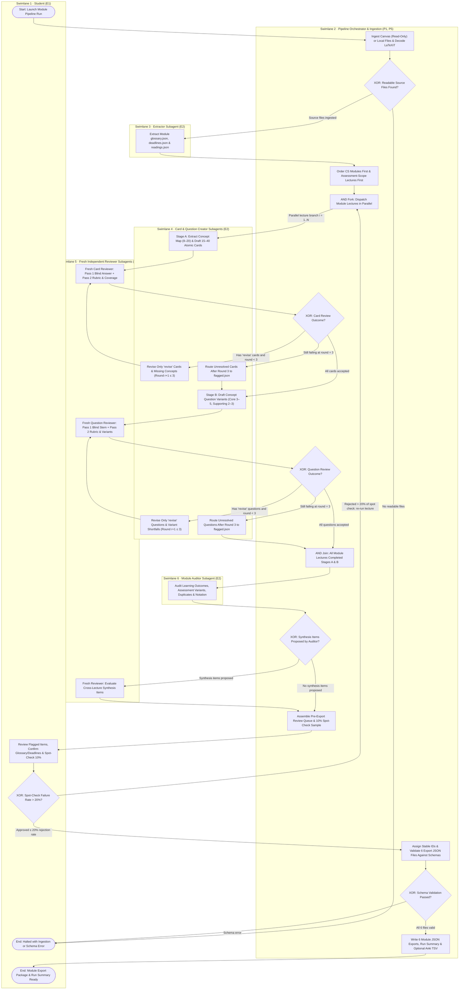

# A14 · Activity / BPMN Workflow Diagrams

Owner: Systems Analyst. Stage 2, written 2026-10-21; updated 2026-10-24 via `CR-003` (`A04` scope alignment). Catalog entry: A14. Approved and baselined at CP2 (2026-10-21).

This document models the cross-actor generation pipeline run and its independent reviewer loop (`WF-01`, `UC-01`–`UC-05`, `REQ-F-001`–`REQ-F-019`, `REQ-F-067`–`REQ-F-075`), as selected by [`tailoring.md`](../01-initiation/tailoring.md) (`A04`: *"Reduced: the pipeline run and its review loop, where parallel work and rework loops happen"*). Study-app interactions are modelled in [`use-cases.md`](use-cases.md) (`A13`) and [`decision-tables.md`](decision-tables.md) (`A15`).

The diagram satisfies all `A14` acceptance checks:
- **Swimlanes:** Each participant has a dedicated `subgraph` swimlane.
- **Labelled gateway branches (`A14.1`):** Every outgoing edge from every `XOR` gateway carries an explicit condition label.
- **Reachability (`A14.2`):** Every path from a start event (`([Start ...])`) reaches a terminal end event (`([End ...])`).
- **Balanced parallelism (`A14.3`):** Every `AND` parallel fork (`FORK_*`) pairs with a corresponding `AND` join (`JOIN_*`).

---

## 1. `WF-01` · Module Generation Pipeline & Independent Reviewer Loop (`UC-01`–`UC-05`)

