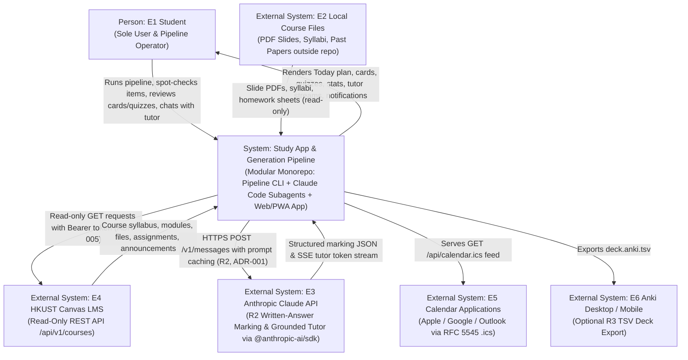
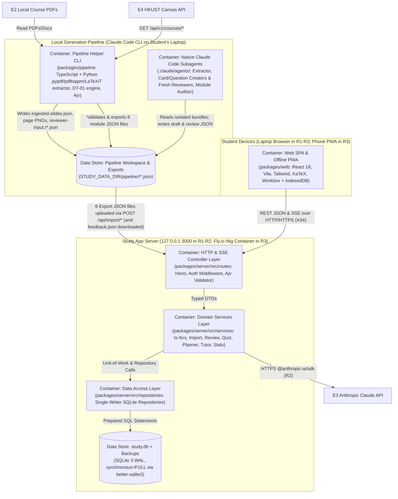
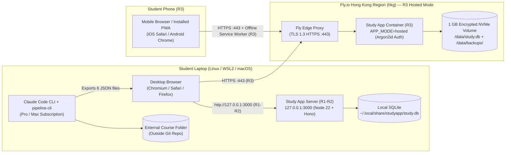

# A31 · Architecture Overview

- **Artifact ID:** `A31`
- **Stage:** Stage 3 — Architecture & Design
- **Owner:** System Architect
- **Date:** `2026-10-21`
- **Catalog entry:** `A31` (`systems_analysis_and_design_project_framework.md`)
- **Related ADRs:** [`ADR-001`](adr/ADR-001-language-and-framework.md), [`ADR-002`](adr/ADR-002-data-store-and-dual-persistence.md), [`ADR-003`](adr/ADR-003-architecture-style-and-layering.md), [`ADR-004`](adr/ADR-004-pipeline-runtime-and-subagent-isolation.md), [`ADR-005`](adr/ADR-005-canvas-integration-and-fallback.md), [`ADR-006`](adr/ADR-006-hosting-deployment-and-auth.md), [`ADR-007`](adr/ADR-007-normalization-and-json-audit-columns.md)

---

## 1. C4-Style Architecture Diagrams

### 1.1 C4 Level 1 — System Context Diagram (`A11` alignment)

### 1.2 C4 Level 2 — Container Diagram

---

## 2. Three-Tier Layering (`G3.1`, `ADR-003`)

Per `G3.1` and `ADR-003`, every runtime path in the Study App and Generation Pipeline is separated into three strict tiers with unidirectional dependencies (`Presentation → Business Logic → Data Management`):

| Tier | Responsibility | Implementing Packages & Directories | Prohibited Actions (`G3.1` / `A31` checks) |
| :-- | :-- | :-- | :-- |
| **1. Presentation Tier** | Renders screens (`SCR-01`–`SCR-11`) and reports (`RPT-01`–`RPT-10`), handles keyboard shortcuts, runs UX pre-validation (`packages/shared`), and exposes thin HTTP/SSE route handlers and CLI argument parsers. | - `packages/web/src/*` (React 18 views, components, hooks) - `packages/server/src/routes/*` (Hono controllers & auth/error middleware) - `packages/pipeline/src/cli/*` (CLI command entrypoint) | **Never** imports `better-sqlite3` or `packages/server/src/repositories/*`; **never** executes SQL or file-store writes directly; **never** implements domain scheduling or decision-table rules (`DT-01`–`DT-06`). (The sole ADR-justified offline preview exception in `R3` is documented in `ADR-003 §2.3`.) |
| **2. Business Logic Tier** | Enforces all 45 business rules (`BR-001`–`BR-045`), executes decision tables (`DT-01`–`DT-06`), delegates FSRS mathematics to `ts-fsrs`, orchestrates atomic unit-of-work transactions across repositories, and mediates external calls to Claude API (`E3`) and Canvas (`E4`). | - `packages/server/src/services/*` (`M01`–`M08`) - `packages/pipeline/src/services/*` (`M09`–`M11`) - `.claude/agents/*.md` (LLM subagent rubrics & generation rules) | **Never** constructs HTML/JSX or HTTP status headers; **never** executes raw SQL queries outside `packages/server/src/repositories/*`. |
| **3. Data Management Tier** | Owns all SQLite prepared statements, transaction boundaries (`BEGIN IMMEDIATE` / `COMMIT` / `ROLLBACK`), online `VACUUM INTO` backups, versioned schema migrations, and atomic file-system JSON reads/writes. | - `packages/server/src/repositories/*` (`SqliteUnitOfWork` + per-module repositories) - `packages/pipeline/src/store/PipelineFileStore.ts` (`M12`) | **Never** contains presentation formatting or business/scheduling logic. |

---

## 3. Module Inventory and Single-Writer Data Ownership (`A31`)

Every module has **one clear responsibility** and **exclusive write ownership** of its SQLite tables or pipeline files (`ADR-003 §2.2`). No two modules write the same SQLite table:

| Module ID | Module Name & Path | Tier | Single Responsibility | Tables / Files Written (Exclusive Write Owner) | Tables / Files Read |
| :-- | :-- | :-- | :-- | :-- | :-- |
| `M01` | **Module & Catalog Module** `packages/server/src/services/CatalogService.ts` + `repositories/CatalogRepo.ts` | Business + Data | Manages modules, lectures, concepts, concept prerequisites/card links, and module glossaries. | `module`, `lecture`, `concept`, `concept_prerequisite`, `concept_card`, `glossary_entry` | `deadline`, `concept_state` |
| `M02` | **Import, Backup & Export Module** `packages/server/src/services/ImportService.ts` + `repositories/ImportRepo.ts` | Business + Data | Validates 6 pipeline JSON files (`Ajv`), runs pre-import `VACUUM INTO` backups, computes diff previews (`DT-02`), coordinates atomic unit-of-work imports across `M01`/`M03`/`M04`/`M05` repositories, and generates Anki TSV exports (`RPT-09`). | `import_batch` *(delegates entity table writes to `M01`, `M03`, `M04`, `M05` repos within one `SqliteUnitOfWork` transaction; `ADR-003 §2.2`)* | `module`, `lecture`, `concept`, `card`, `question`, `deadline`, `reading`, `glossary_entry` |
| `M03` | **Flashcard Review Module** `packages/server/src/services/ReviewService.ts` + `repositories/CardRepo.ts` | Business + Data | Builds daily flashcard queues (`BR-025`), processes card ratings (`1`–`4`) via `ts-fsrs` (`BR-026`, `BR-027`), and handles card edits/suspensions/flags. | `card`, `card_tag`, `card_state`, `card_review_log` | `module`, `lecture`, `settings` |
| `M04` | **Concept Quiz & Assessment Module** `packages/server/src/services/QuizService.ts` + `repositories/QuizRepo.ts` | Business + Data | Selects due concepts (`BR-028`) and question variants (`DT-03`, `BR-029`, `BR-030`), marks MCQ/self-graded/Claude-graded attempts (`DT-04`, `BR-031`, `BR-032`), and runs assessment-mode mock exams (`UC-15`, `RPT-04`). | `question`, `question_option`, `question_marking_point`, `concept_state`, `question_attempt`, `question_attempt_point` | `module`, `concept`, `concept_card`, `deadline`, `glossary_entry`, `settings` |
| `M05` | **Deadlines, Tasks, Readings & Calendar Module** `packages/server/src/services/ScheduleService.ts` + `repositories/ScheduleRepo.ts` | Business + Data | Manages deadlines (`DT-05`, `BR-033`, `BR-034`), backward-counted coursework milestones (`REQ-F-056`), readings, ad-hoc tasks, and RFC 5545 `.ics` feeds (`RPT-08`). | `deadline`, `deadline_lecture`, `milestone`, `reading`, `task` | `module`, `lecture`, `settings` |
| `M06` | **Daily Planner Module** `packages/server/src/services/PlannerService.ts` + `repositories/PlannerRepo.ts` | Business + Data | Builds and persists the 9-step ordered Today checklist (`BR-035`), enforces `daily_budget_min` (`DT-06`, `BR-036`, `BR-037`), and tracks item completion (`SM-4b`). | `daily_plan`, `daily_plan_item` | `module`, `card_state`, `concept_state`, `deadline`, `milestone`, `reading`, `task`, `settings` |
| `M07` | **Grounded AI Tutor & Proposal Module** `packages/server/src/services/TutorService.ts` + `repositories/TutorRepo.ts` | Business + Data | Manages tutor threads and streaming Claude messages (`UC-13`), enforces coursework academic integrity (`BR-040`), and manages the `Proposal` review queue (`UC-14`). | `tutor_thread`, `tutor_message`, `tutor_message_citation`, `proposal` | `module`, `lecture`, `concept`, `concept_state`, `card`, `question`, `reading`, `deadline`, `glossary_entry`, `settings` |
| `M08` | **Feedback, Stats, Spend & Auth/Settings Module** `packages/server/src/services/GovernanceService.ts` + `repositories/GovernanceRepo.ts` | Business + Data | Records reported/topup/proposed `FeedbackItem` entries (`BR-038`, `RPT-07`), logs Claude API marking spend (`GradingCallLog`, `BR-041`), computes `SM-1`–`SM-6` stats & FSRS forecasts (`BR-044`, `RPT-03`), and manages `Settings` and `R3` `auth_session` rows (`BR-045`). | `feedback_item`, `grading_call_log`, `settings`, `auth_session`, `schema_migrations` | All tables (read-only for `Stats` & `Feedback` aggregation) |
| `M09` | **Pipeline Ingestion & Canvas Sync Module** `packages/pipeline/src/ingest/*` (`CanvasClient.ts`, `PdfIngestor.ts`) | Business (Pipeline) | Syncs allowlisted read-only HKUST Canvas endpoints (`ADR-005`), renders slide PNGs (`150 DPI`), extracts text, and recovers embedded `LaTeXiT` equations (`ADR-004`). | *(Writes via `M12` `PipelineFileStore`:)* `ingested-slides.json`, `pages/page-*.png` | `pipeline.config.json`, local PDFs/docs |
| `M10` | **Pipeline Review Loop & Export Engine** `packages/pipeline/src/orchestrator/*` (`ReviewLoopEngine.ts`, `ExportBuilder.ts`) | Business (Pipeline) | Builds isolated Reviewer bundles (`BR-012`), applies `DT-01` verdicts (`accept`/`revise`/`reject`/`flagged`), runs the 10% human spot check (`BR-015`), validates against `A34` JSON Schemas, and writes the 6 export files + `run-summary.json`. | *(Writes via `M12` `PipelineFileStore`:)* `reviewer-input.r*.json`, `*.final.json`, `flagged.json`, `run-summary.json`, `export/*.json` | `cards.round*.json`, `card-review.round*.json`, `questions.round*.json`, `question-review.round*.json`, `module-audit.json`, `feedback.json` |
| `M11` | **Claude Code Native Subagents** `.claude/agents/{extractor,card-creator,card-reviewer,question-creator,question-reviewer,module-auditor}.md` | Business (Pipeline AI) | Executes LLM extraction, card/question creation, fresh-context blind-answer + 8-criterion rubric review, and module synthesis/deduplicationaudit. | `glossary.json`, `deadlines.json`, `readings.json`, `concepts.json`, `cards.round*.json`, `card-review.round*.json`, `questions.round*.json`, `question-review.round*.json`, `module-audit.json` | `ingested-slides.json`, `pages/page-*.png`, `reviewer-input.r*.json`, `glossary.json` |
| `M12` | **Pipeline File Store & Schema Validator** `packages/pipeline/src/store/PipelineFileStore.ts` + `packages/shared/src/schemas/*` | Data (Pipeline) | Performs atomic temp-file + rename JSON writes and `Ajv` Draft 2020-12 schema validation for all pipeline workspace files. | Pipeline workspace filesystem (`STUDY_DATA_DIR/pipeline/<module>/`) | `packages/shared/src/schemas/*.json` |

---

## 4. Component Communication

1. **Web SPA (`packages/web`) $\leftrightarrow$ Study App Server (`packages/server`):**
   - **Synchronous REST JSON (`application/json` / `application/problem+json`):** Used for all CRUD, review rating, quiz submission, import preview/apply, and stats operations (`31` of `32` operations in `A34`).
   - **Server-Sent Events (`text/event-stream`):** Used by `POST /api/tutor/threads/:threadId/messages` (`sendTutorMessage`) to stream Claude tutor tokens within `<= 3.0 s` p90 time-to-first-token (`REQ-N-005`), ending with a structured `done` event containing slide citations, token usage, and any proposed cards/questions.
   - **Offline Queue Sync (`R3` PWA):** When `navigator.onLine == false` or network calls fail in `R3`, the Service Worker / IndexedDB queue (`OfflineSyncManager`) serves cached assets/data, records card ratings and MCQ attempts with client UTC timestamps, and queues written answers as `grader = "pending_claude"` (`REQ-F-060`, `REQ-F-061`), replaying them sequentially within `<= 30 s` of reconnection (`REQ-N-009`).
2. **Generation Pipeline (`packages/pipeline`) $\leftrightarrow$ Study App Server (`packages/server`):**
   - **Shared-Nothing File Contract (`A34` JSON Schemas):** The pipeline and web server share zero database connections or runtime memory. The student imports `concepts.json`, `deck.json`, `question-bank.json`, `deadlines.json`, `readings.json`, and `glossary.json` via `POST /api/import/preview` and `POST /api/import/apply`, and exports `feedback.json` via `GET /api/export/feedback`.

---

## 5. Deployment View (`ADR-006`)

| Environment | Purpose | Binding & Network Boundary | Secrets & Configuration (`REQ-N-013`) |
| :-- | :-- | :-- | :-- |
| **Local Study (`R1`–`R2`)** | Daily study on the student's laptop (`[USER Q-04]`) and local pipeline runs. | `127.0.0.1:3000` (loopback only). `R1` requires `0` outbound network traffic (`REQ-N-008`). `R2` allows outbound `HTTPS` (`443`) to `api.anthropic.com`. | Read from `~/.config/studyapp/credentials.env` (mode `0600`, outside git): `ANTHROPIC_API_KEY` (`R2`), `CANVAS_API_TOKEN` (pipeline only). |
| **Automated Test & CI (`dev`/`ci`)** | Unit, integration, contract, benchmark, and Playwright E2E tests in local workspace and GitHub Actions. | Ephemeral local port (`127.0.0.1:0`) + ephemeral SQLite DB (`/tmp/study-test-<uuid>.db`); external APIs mocked via deterministic fixtures (`A20 §2`). | Canary test secrets injected via test runner process env (`TEST_CANARY_SECRET`). |
| **Hosted Study (`R3`)** | Laptop + phone PWA access (`REQ-F-059`–`062`) on Fly.io `hkg` (or Tailscale Serve). | Public `HTTPS` (`TLS 1.3`) terminated at Fly.io proxy $\rightarrow$ internal container `:3000` with `APP_MODE=hosted` and `Argon2id` session cookie middleware (`REQ-N-015`). | Injected via `fly secrets set`: `ANTHROPIC_API_KEY`, `APP_PASSWORD_HASH`, `SESSION_SECRET`. (`CANVAS_API_TOKEN` is **never** deployed to the hosted server.) |

---

## 6. Single-Location Rule-Enforcement Table (`G3.6`, `A31`)

Per `G3.6` and `A31`, every business rule (`BR-001`–`BR-045` from `A17`) and every cross-cutting design rule (`DR-01`–`DR-06`) has **one authoritative enforcement location** in the Business Logic Tier (or Pipeline Orchestrator), with any database constraint or UI pre-check documented as a defensive backstop under `ADR-003 §2.3`:

| Rule ID | Summary (`A17`) | Single Authoritative Enforcement Location (`Module` / `File :: Function`) | Defensive Backstop (`ADR-003 §2.3`) |
| :-- | :-- | :-- | :-- |
| `BR-001` | Untrusted course/Canvas text wrapped as data, never agent instructions | `M09` `packages/pipeline/src/ingest/UntrustedDataWrapper.ts :: wrapUntrustedMaterial()` | System prompt guard in `.claude/agents/*.md` and `TutorService.buildSystemPrompt()` |
| `BR-002` | Canvas access strictly read-only (`GET` allowlist on in-scope courses) | `M09` `packages/pipeline/src/ingest/CanvasClient.ts :: assertAllowedCanvasRequest()` | None needed (all Canvas I/O passes through `CanvasClient`) |
| `BR-003` | Extractor produces `glossary.json` before any Creator runs on a module | `M10` `packages/pipeline/src/orchestrator/PipelineRunner.ts :: assertModuleGlossaryReady()` | Subagent precondition check in `card-creator.md` / `question-creator.md` |
| `BR-004` | Unannounced assessment date sets `due_at = null, status = "unannounced", confidence = "inferred"` | `M10` `packages/pipeline/src/orchestrator/ExtractorPostProcessor.ts :: normalizeExtractedDeadlines()` | `deadlines.schema.json` (`Ajv`) & SQLite `CHECK` on `deadline` (`A33`) |
| `BR-005` | Module run order: CS modules first, then lectures in nearest assessment scope | `M10` `packages/pipeline/src/orchestrator/RunOrderPlanner.ts :: computePipelineRunQueue()` | — |
| `BR-006` | `concept-map.json` has `8`–`20` concepts per lecture with valid `importance` & `source` | `M12` `packages/shared/src/schemas/concepts.schema.json` (`minItems: 8, maxItems: 20` via `PipelineFileStore.validate()`) | SQLite `CHECK` constraint on `concept.importance` (`A33`) |
| `BR-007` | Cards and questions are atomic and context-free (no "this slide" / "above diagram") | `M10` `packages/pipeline/src/orchestrator/ContentQualityValidator.ts :: checkContextFreeAndAtomic()` + `AI-03`/`AI-04b` Pass 1 & `context_free`/`atomic` criteria | — |
| `BR-008` | Card `back` aims for `<~15` words; `basic` / `cloze` / `reverse` card type rules | `M10` `packages/pipeline/src/orchestrator/ContentQualityValidator.ts :: checkCardFormatAndLength()` + `AI-03` `concise` & `card_type` criteria | `deck.schema.json` (`Ajv`) & SQLite `CHECK` on `card.type` (`A33`) |
| `BR-009` | Non-universal symbols/abbreviations match `GlossaryEntry.canonical` | `M10` `packages/pipeline/src/orchestrator/NotationChecker.ts :: verifyCanonicalNotation()` | `AI-03`/`AI-04b` `notation` rubric check |
| `BR-010` | Cards/questions derive only from course material and carry a non-empty `source` citation | `M10` `packages/pipeline/src/orchestrator/ContentQualityValidator.ts :: assertSourceCitationPresent()` + `AI-03`/`AI-04b` `grounded` criterion | `deck.schema.json` / `question-bank.schema.json` (`minLength: 3` on `source`) & SQLite `NOT NULL CHECK (length(source) > 0)` |
| `BR-011` | Unclear/contradictory slide point writes `FlaggedItem(reason="unclear_source")` and skips item | `M10` `packages/pipeline/src/orchestrator/ReviewLoopEngine.ts :: recordCreatorUnclearFlags()` (invoked on `AI-02`/`AI-04a` output) | SQLite / JSON Schema `enum` check on `FlaggedItem.reason` |
| `BR-012` | Fresh Reviewer subagent per round (`0` Creator reasoning), Pass 1 blind answer + Pass 2 8-criterion pass/fail rubric (`failed_criteria`, `verdict`) | `M10` `packages/pipeline/src/orchestrator/ReviewerBundleBuilder.ts :: buildIsolatedReviewerBundle()` + `ReviewLoopEngine.ts :: validateReviewRecord()` | `review-round.schema.json` (`Ajv`) |
| `BR-013` | Creator–Reviewer loop capped at `2` revision rounds (`3` review rounds total); `accept` frozen, `reject` removed | `M10` `packages/pipeline/src/orchestrator/ReviewLoopEngine.ts :: applyRoundVerdicts()` (`DT-01`) | — |
| `BR-014` | Round-3 review failures move to `flagged.json (reason="failed_3_rounds")` and are excluded from `*.final.json` | `M10` `packages/pipeline/src/orchestrator/ReviewLoopEngine.ts :: routeRoundThreeFailures()` (`DT-01-R4, R5`) | Pre-export check in `ExportBuilder.ts :: assertNoFlaggedInFinal()` |
| `BR-015` | Stage B (`Question Creator`) starts only after Stage A (`concept-map.json`) is reviewed; 10% human spot check before export | `M10` `packages/pipeline/src/orchestrator/PipelineRunner.ts :: assertStageAComplete()` & `SpotCheckRunner.ts :: runTenPercentSpotCheck()` | — |
| `BR-016` | Question variant counts per concept importance (`3–5` `core`, `2–3` `supporting`, `0–1` `detail`, upper bound in next assessment scope) | `M10` `packages/pipeline/src/orchestrator/ContentQualityValidator.ts :: checkConceptVariantCounts()` | — |
| `BR-017` | MCQ has 4 options (`A`–`D`), 1 `correct_option`, 3 `distractor_explanations`; written/calculation has `model_answer` + `2–5` `marking_points` | `M12` `packages/shared/src/schemas/question-bank.schema.json` (enforced by `PipelineFileStore.validate()` and `ImportService.validatePayload()`) | SQLite `CHECK` constraints on `question`, `question_option`, `question_marking_point` (`A33`) |
| `BR-018` | Default question-type mix (`40% mcq`, `30% short_answer/explain`, `30% calculation/scenario/compare`) when assessment format is unannounced | `M10` `packages/pipeline/src/orchestrator/PipelineRunner.ts :: resolveQuestionTypeWeights()` | — |
| `BR-019` | Module Auditor synthesis items must pass a fresh Reviewer before entering `deck.json` / `question-bank.json` | `M10` `packages/pipeline/src/orchestrator/ModuleAuditRunner.ts :: reviewAuditSynthesisItems()` | — |
| `BR-020` | Deterministic IDs (`<MODULE>-<WEEK>-K<nn>`, `-C<nnn>`, `-Q<nnn>`, `-G<nnn>`, `-D<nnn>`, `-R<nnn>`) | `M12` `packages/shared/src/validators/idPatterns.ts :: assertDeterministicId()` (used in `A34` JSON Schemas) | SQLite `CHECK (id GLOB ...)` on `lecture`, `concept`, `card`, `question`, `glossary_entry`, `deadline`, `reading` (`A33`) |
| `BR-021` | Re-import matches by stable `id`, updates content in place, and never overwrites/deletes `CardState`, `CardReviewLog`, `ConceptState`, or `QuestionAttempt` | `M02` `packages/server/src/services/ImportService.ts :: computeDiffAndApplyImport()` (`DT-02`) | SQLite `ON DELETE RESTRICT` on `card_review_log.card_id` and `question_attempt.question_id` (`A33`, `ADR-003`) |
| `BR-022` | Items absent from a re-imported lecture are marked `suspended = true`, never deleted | `M02` `packages/server/src/services/ImportService.ts :: suspendRemovedLectureItems()` (`DT-02-R3, R4`) | — |
| `BR-023` | `Deadline` with `manually_edited = true` preserves student-edited fields across re-imports | `M02` `packages/server/src/services/ImportService.ts :: mergeImportedDeadlines()` | — |
| `BR-024` | Validate all import files against `A34` schemas and create a verified SQLite backup (`VACUUM INTO`) before any import write | `M02` `packages/server/src/services/ImportService.ts :: createVerifiedPreImportBackup()` | — |
| `BR-025` | Daily flashcard queue caps (`new_cards_per_day = 20`, `review_cards_per_day = 200`), excluding `suspended` and `flagged` cards | `M03` `packages/server/src/services/ReviewService.ts :: getDailyReviewQueue()` | — |
| `BR-026` | Card and concept ratings (`1`–`4`) update `CardState` and `ConceptState` via `ts-fsrs` with `Settings.desired_retention` | `packages/shared/src/fsrs/FsrsScheduler.ts :: scheduleNextState()` (called by `ReviewService` & `QuizService`) | SQLite `CHECK (rating BETWEEN 1 AND 4)` & `CHECK (desired_retention BETWEEN 0.70 AND 0.99)` |
| `BR-027` | Submitting a card rating atomically updates `CardState` and appends `CardReviewLog` with `state_before` | `M03` `packages/server/src/services/ReviewService.ts :: submitCardRating()` | SQLite transaction in `CardRepo.recordCardReview()` |
| `BR-028` | Daily concept quiz selects due concepts up to `quiz_per_day` (default 10), sorted in assessment mode by lowest `stability` in scope | `M04` `packages/server/src/services/QuizService.ts :: selectDueConceptsForQuiz()` | — |
| `BR-029` | Variant selection (`DT-03`) excludes flagged/suspended, prefers unseen over LRS, and breaks ties by target difficulty (`1`/`2`/`3` from `stability`) | `M04` `packages/server/src/services/QuizService.ts :: selectQuestionVariantForConcept()` (`DT-03`) | — |
| `BR-030` | Zero unseen variants serves LRS variant (or skips) and logs `FeedbackItem(kind="topup")` | `M04` `packages/server/src/services/QuizService.ts :: selectQuestionVariantForConcept()` (`DT-03-R3, R4, R5`) | — |
| `BR-031` | Quiz attempt outcome maps to `Again (1)`, `Hard (2)`, `Good (3)`, `Easy (4)` (`DT-04`), with student override (`overridden = true`) | `M04` `packages/server/src/services/QuizService.ts :: computeQuizAttemptRating()` & `overrideQuizAttemptRating()` (`DT-04`) | SQLite `CHECK (rating BETWEEN 1 AND 4)` |
| `BR-032` | Quiz attempt rated `Again (1)` updates `ConceptState` and returns linked `Concept.card_ids` for immediate drill | `M04` `packages/server/src/services/QuizService.ts :: submitQuizAttempt()` (`DT-04-R4`) | — |
| `BR-033` | Deadline urgency (`low`, `medium`, `high`, `overdue`, `unannounced`) derived from `due_at - now()` with non-colour text/icon badge (`DT-05`) | `M05` `packages/server/src/services/ScheduleService.ts :: classifyDeadlineUrgency()` (`DT-05`) | UI badge component `DeadlineUrgencyBadge.tsx` renders the server-returned `urgency` + icon + text label (`REQ-N-018`) |
| `BR-034` | `Deadline` with `confidence = "inferred"` and `manually_edited = false` displays `Confirm` badge (`DT-05`) | `M05` `packages/server/src/services/ScheduleService.ts :: classifyDeadlineUrgency()` (`DT-05-R1, R3, R6`) | — |
| `BR-035` | `DailyPlanItem.est_minutes` formulas (`8s`/due card, `25s`/new card, `0.75m`/MCQ, `3.0m`/written, `pages * min_per_page`) and 9-step ordering | `M06` `packages/server/src/services/PlannerService.ts :: buildOrderedDailyPlanItems()` | — |
| `BR-036` | Defer `optional` `DailyPlanItem` entries in reverse priority order when `total_est_minutes > daily_budget_min` (`DT-06`) | `M06` `packages/server/src/services/PlannerService.ts :: applyDailyTimeBudget()` (`DT-06-R2, R3`) | — |
| `BR-037` | Never drop `required` `DailyPlanItem` entries; show over-budget warning when `required_minutes > daily_budget_min` (`DT-06`) | `M06` `packages/server/src/services/PlannerService.ts :: applyDailyTimeBudget()` (`DT-06-R5`) | — |
| `BR-038` | Reporting a card or question (`wrong` or `unclear`) creates `FeedbackItem(kind="reported")` and sets `flagged = true` | `M08` `packages/server/src/services/GovernanceService.ts :: reportStudyItem()` | SQLite `CHECK` on `feedback_item` (`kind = 'reported' implies reason in ('wrong','unclear')`, `A33`) |
| `BR-039` | Tutor responses cite course slides/pages, use canonical glossary notation, and label out-of-course material | `M07` `packages/server/src/services/TutorService.ts :: buildGroundedTutorPromptAndParseCitations()` | — |
| `BR-040` | Tutor refuses to write/complete/paraphrase assessed coursework (`homework`, `project`, `coursework`) | `M07` `packages/server/src/services/TutorService.ts :: enforceCourseworkIntegrityGuard()` | — |
| `BR-041` | Log tokens & micro-USD cost on every Claude API call; warn or block at `monthly_spend_cap_usd` | `M08` `packages/server/src/services/GovernanceService.ts :: checkAndRecordClaudeSpend()` | SQLite `CHECK (cost_micro_usd >= 0)` on `grading_call_log` and `tutor_message` (`A33`) |
| `BR-042` | Accepted tutor proposals in `feedback.json → proposed` route directly to a fresh Reviewer subagent | `M10` `packages/pipeline/src/orchestrator/FeedbackProcessor.ts :: processProposedItemsThroughReviewer()` | — |
| `BR-043` | Activate assessment mode when an unsubmitted `exam` or `midterm` is within `assessment_mode_days` (default 21 d) | `M05` `packages/server/src/services/ScheduleService.ts :: computeActiveAssessmentModes()` (consumed by `M03`, `M04`, `M06`) | — |
| `BR-044` | Formulas for trailing 30-day true retention (`SM-2`) and concept mastery (`SM-5`: `stability >= 14d` & `>= 2` attempts) | `M08` `packages/server/src/services/GovernanceService.ts :: computeModuleAndGlobalStats()` | — |
| `BR-045` | Hosted mode (`R3`) enforces owner password session auth on all routes (`<= 5` failed logins/min/IP); local mode (`R1`–`R2`) requires no login | `M08` `packages/server/src/routes/middleware/authMiddleware.ts :: requireOwnerSession()` | — |
| `DR-01` | Presentation tier never accesses `better-sqlite3` or `repositories/*` directly (`G3.1`, `A31`) | Architecture boundary enforced by module imports; verified by `TC-S-024` | ESLint `no-restricted-imports` rule |
| `DR-02` | Single-writer table ownership: each SQLite table is written by exactly one repository (`A31`) | `packages/server/src/repositories/*`; verified by `TC-S-025` | — |
| `DR-03` | Money values stored and summed as integer `micro_usd` (`1 USD = 1,000,000`), never float (`A33`, `B10`) | `M08` `packages/shared/src/money/microUsd.ts`; verified by `TC-S-026` | SQLite `INTEGER` affinity + `CHECK (typeof(cost_micro_usd) = 'integer')` |
| `DR-04` | Server secrets (`ANTHROPIC_API_KEY`, `CANVAS_API_TOKEN`, `APP_PASSWORD_HASH`) never enter client bundles, responses, or logs (`REQ-N-013`) | `packages/server/src/config/env.ts` + `logger/redactor.ts`; verified by `TC-S-013` | Vite client prefix filter (only `VITE_PUBLIC_*` exposed) |
| `DR-05` | Every HTML/Markdown/LaTeX output rendered in the browser is sanitised (`DOMPurify` + `KaTeX` `trust: false`) (`B10`) | `packages/web/src/components/RichTextRenderer.tsx` | Content-Security-Policy (`CSP`) response header (`A36`) |
| `DR-06` | Runtime SQLite schema matches `workbook/03-design/db/schema.sql` (`A31`, `A33`) | `packages/server/src/db/migrator.ts`; verified by `TC-S-027` | `PRAGMA application_id = 0x53544459` check |

---

## 7. Programmable Architecture Rules and Automated Checks (`A31`)

Catalog entry `A31` requires architecture rules that a program can check, each mapped to an automated test in `A39`:

| Rule ID | Programmable Architecture Rule | Automated Verification Method | Test ID (`A39`) |
| :-- | :-- | :-- | :-- |
| `ARCH-01` | **Strict three-tier dependency direction (`G3.1`, `A31`):** 1. Files in `packages/web/**` and `packages/server/src/routes/**` must have `0` imports of `better-sqlite3`, `packages/server/src/repositories/**`, or `packages/server/src/db/**`. 2. Files in `packages/server/src/services/**` and `packages/server/src/repositories/**` must have `0` imports of `react`, `react-dom`, `hono`, or `packages/web/**`. | Automated AST / import-graph test scanning all `.ts`/`.tsx` files in `packages/*` and asserting `0` forbidden cross-tier imports or raw SQL strings outside `repositories/**`. | `TC-S-024` |
| `ARCH-02` | **Single-writer table ownership (`A31`):** Each of the 28 domain SQLite tables in `schema.sql` (`A33`) may appear in `INSERT INTO <table>`, `UPDATE <table>`, or `DELETE FROM <table>` statements in **at most one** repository file under `packages/server/src/repositories/`. | Automated static SQL scanner parsing all `INSERT`/`UPDATE`/`DELETE` statements across `packages/server/src/repositories/*.ts` and asserting cardinality `== 1` writer module per table. | `TC-S-025` |
| `ARCH-03` | **Single business-rule enforcement location (`G3.6`, `A31`):** Each business rule `BR-001`–`BR-045` is tagged with `// @enforces BR-nnn` in its single authoritative file listed in §6 above, and `ts-fsrs` is invoked only inside `packages/shared/src/fsrs/FsrsScheduler.ts`. | Automated codebase annotation check verifying every `BR-001`–`BR-045` has exactly one `@enforces BR-nnn` annotation at its §6 path and `0` direct `new FSRS(` calls outside `FsrsScheduler.ts`. | `TC-S-026` |
| `ARCH-04` | **Live database schema parity with `A33` (`A31`):** Initializing a fresh database via the application's migration runner produces a `sqlite_master` table/index/trigger definition set and `PRAGMA application_id` identical to executing `workbook/03-design/db/schema.sql`. | Automated schema comparison test comparing `sqlite_master` AST/DDL of a migrated DB against `workbook/03-design/db/schema.sql` and running `PRAGMA foreign_key_check` and `PRAGMA integrity_check`. | `TC-S-027` |
