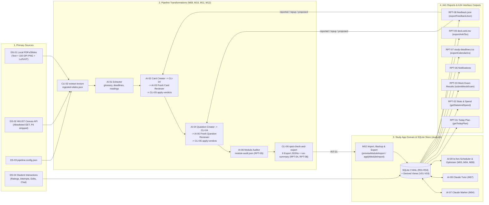

# A42 · Data & Model Quality Plan

Owner: System Architect. Stage 3, written 2026-10-21. Catalog entry: A42 (`03-design/data-model-quality.md`, required by the `DATA` project type and the `AI` risk flag, `DEC-002`, `DEC-003`).

---

## 1. Data Sources and End-to-End Lineage (`A42.1`, `G3.14`)

### 1.1 Primary Data Sources

| Source ID | Source Dataset / System | Owner | Refresh Cadence | Licensing & Privacy (`A37`) |
| :-- | :-- | :-- | :-- | :-- |
| `DS-01` | **Local Course Files** (`PDF`, `PPTX`, `DOCX`, `Markdown` lecture slides, syllabi, readings, past papers in `<workspace>/source/local/`) | `Student` (copyright held by HKUST / instructors) | Per lecture (`1–2` times/week per module across `4` modules, `ASM-051`) | Copyrighted (`DEC-008`); never committed to git; permitted for personal Claude processing (`[USER Q-01]`). |
| `DS-02` | **HKUST Canvas LMS REST API** (`INT-03`, allowlisted `GET` endpoints for syllabus, assignments, modules, pages, files, announcements) | HKUST / `Student` (`CANVAS_API_TOKEN`) | On demand before each pipeline run (`CLI-01` `pipeline-cli sync-canvas`) | Read-only (`ADR-005`); staff/student PII stripped (`BR-002`, `A37 §1`). |
| `DS-03` | **Pipeline Configuration** (`pipeline.config.json`) | `Student (Pipeline Operator)` | Per semester / when assessment formats are announced (`ASM-047`) | User-authored configuration (`E23`). |
| `DS-04` | **Student Study Interactions & Telemetry** (card ratings, quiz attempts, manual deadlines/milestones/tasks, reading status, tutor messages, problem reports in `study.db`) | `Student (Learner)` | Continuous during daily study sessions | Personal study data (`PD` flag, mapped attribute-by-attribute in `A37 §2`). |

### 1.2 End-to-End Lineage Diagram

### 1.3 Complete Output-to-Source Lineage Matrix (`A42.1`, `G3.14`)

Every report in `A41` (`RPT-01`–`RPT-09`) and every interface output group in `A34` (`openapi.yaml` operations `1`–`38`, `CLI-01`–`CLI-07`, and `INT-01`–`INT-05`) has an explicit, traceable lineage path back to `DS-01`–`DS-04`:

| Output (`A41` / `A34`) | Intermediate Pipeline Files / Transformations | SQLite Tables / Views (`A32` / `A33`) | Upstream Sources (`DS-01`–`DS-04`) |
| :-- | :-- | :-- | :-- |
| **`RPT-01` Today Daily Study Plan** & `A34` `getTodayPlan` (`23`), `updateTodayPlanItem` (`24`) | `CLI-06` `deck.json`, `question-bank.json`, `concepts.json`, `deadlines.json`, `readings.json` $\rightarrow$ `M02` `applyModuleImport` $\rightarrow$ `M06` `DailyPlannerService` (`DT-06`, `BR-035`–`037`) | `daily_plan` (`R22`), `daily_plan_item` (`R23`), `card_state` (`R08`), `concept_state` (`R10`), `reading` (`R21`), `deadline` (`R17`), `milestone` (`R19`), `task` (`R20`), `settings` (`R29`), `v_daily_plan_summary` (`V03`) | `DS-01`, `DS-02`, `DS-03`, `DS-04` |
| **`RPT-02` Stats & Spend Dashboard** & `A34` `getStatsAndSpend` (`32`) | `M03`/`M04` FSRS state updates (`AI-09`) + `M04`/`M07` token accounting + `M08` `StatsAndSpendService` (`BR-027`, `BR-044`) | `card_review_log` (`R09`), `card_state` (`R08`), `concept_state` (`R10`), `question_attempt` (`R14`), `feedback_item` (`R28`), `import_batch` (`R30`), `grading_call_log` (`R32`), `tutor_message` (`R25`), `v_concept_mastery` (`V02`) | `DS-01`–`DS-04` |
| **`RPT-03` Mock Exam Results** & `A34` `startMockExam` (`15`), `submitMockExam` (`16`) | `CLI-06` `question-bank.json`, `concepts.json` $\rightarrow$ `M04` `MockExamService` (`BR-018`, `BR-043`) + `AI-07` / self-marking (`DT-04`) | `question` (`R11`), `question_option` (`R12`), `question_marking_point` (`R13`), `question_attempt` (`R14`), `question_attempt_point` (`R15`), `concept` (`R03`), `concept_state` (`R10`), `concept_card` (`R05`) | `DS-01`, `DS-03`, `DS-04` |
| **`RPT-04` Pipeline Run Summary** (`run-summary.json`) & `A34` `CLI-03` (`plan-run`), `CLI-06` (`spot-check-and-export`) | `CLI-02` `ingested-slides.json` $\rightarrow$ `AI-01`–`AI-06` $\rightarrow$ `CLI-05` `*.final.json` & `flagged.json` $\rightarrow$ `CLI-06` `run-summary.json` (`E27`) | Recorded in `import_batch` (`R30`) & `import_batch_lecture` (`R31`) on `applyModuleImport` (`7`) | `DS-01`, `DS-02`, `DS-03`, `DS-04` (`UC-05` spot-check decisions) |
| **`RPT-05` Module Audit Report** (`module-audit.json`) & `A34` `CLI-06` | `CLI-05` `cards.final.json`, `questions.final.json`, `concept-map.json`, `glossary.json` $\rightarrow$ `AI-06` `Module Auditor` (`BR-019`) | Rendered on `SCR-06` from `module-audit.json` (`E26`) | `DS-01`, `DS-02`, `DS-03` |
| **`RPT-06` Deadline & Daily Notifications** & `A34` `listDeadlines` (`17`), `upsertDeadline` (`18`), `upsertMilestone` (`19`) | `AI-01` `deadlines.json` $\rightarrow$ `M02` `applyModuleImport` $\rightarrow$ `M05` `ScheduleService` (`DT-05`, `BR-023`, `BR-033`, `BR-034`) | `deadline` (`R17`), `milestone` (`R19`), `daily_plan` (`R22`), `settings` (`R29`) | `DS-01`, `DS-02`, `DS-04` |
| **`RPT-07` iCalendar Feed (`study-deadlines.ics`)** & `A34` `exportCalendarIcs` (`35`, `INT-04`) | `M05` `ScheduleService` $\rightarrow$ `ical-generator` (`BR-004` null-date exclusion) | `deadline` (`R17`), `milestone` (`R19`) | `DS-01`, `DS-02`, `DS-04` |
| **`RPT-08` Pipeline & Feedback JSON Exports** & `A34` `CLI-01`–`CLI-07`, `previewModuleImport` (`6`), `applyModuleImport` (`7`), `reportStudyItem` (`25`), `exportFeedbackJson` (`26`, `INT-01`) | Forward: `CLI-01`–`CLI-06` $\rightarrow$ `6` JSON files (`concepts`, `deck`, `question-bank`, `deadlines`, `readings`, `glossary`). Reverse: `M08` `FeedbackService` $\rightarrow$ `feedback.json` (`reported`, `topup`, `proposed`) | `module` (`R01`), `lecture` (`R02`), `concept` (`R03`), `card` (`R06`), `question` (`R11`), `glossary_entry` (`R16`), `deadline` (`R17`), `reading` (`R21`), `feedback_item` (`R28`), `proposal` (`R27`) | `DS-01`–`DS-04` |
| **`RPT-09` Anki TSV Export (`deck.anki.tsv`)** & `A34` `exportAnkiTsv` (`36`, `INT-05`) | `CLI-06 --anki-tsv` or `M02` `AnkiExportService` | `card` (`R06`), `card_tag` (`R07`), `card_state` (`R08`) | `DS-01`, `DS-04` (card edits / suspension flags) |
| **`A34` Review & Quiz Operations** (`getNextReviewCards` `8`, `submitCardRating` `9`, `updateCardStateOrContent` `10`, `getNextQuizQuestions` `11`, `submitQuizAttempt` `12`, `overrideQuizAttemptRating` `13`, `flushOfflineQuizQueue` `14`) | `CLI-06` `deck.json`, `question-bank.json`, `concepts.json` $\rightarrow$ `M03` `FlashcardService` & `M04` `QuizService` (`DT-03`, `DT-04`, `AI-07`, `AI-09`) | `card` (`R06`), `card_state` (`R08`), `card_review_log` (`R09`), `concept` (`R03`), `concept_state` (`R10`), `question` (`R11`), `question_option` (`R12`), `question_marking_point` (`R13`), `question_attempt` (`R14`), `question_attempt_point` (`R15`), `grading_call_log` (`R32`) | `DS-01`, `DS-03`, `DS-04` |
| **`A34` Tutor & Proposal Operations** (`listTutorThreads` `27`, `createTutorThread` `28`, `sendTutorMessage` `29`, `deleteTutorThread` `30`, `reviewTutorProposal` `31`, `INT-02`) | `CLI-02` slide text + `CLI-06` `glossary.json` $\rightarrow$ `M07` `TutorService` (`AI-08`, `BR-039`–`042`) | `tutor_thread` (`R24`), `tutor_message` (`R25`), `tutor_message_citation` (`R26`), `proposal` (`R27`), `glossary_entry` (`R16`), `concept_state` (`R10`) | `DS-01`, `DS-04` |
| **`A34` Module, Reading, Task, Settings, Auth & Backup Operations** (`getHealth` `1`, `loginOwner` `2`, `logoutOwner` `3`, `listModules` `4`, `getModuleSummary` `5`, `listReadings` `20`, `updateReadingStatus` `21`, `upsertTask` `22`, `getSettings` `33`, `updateSettings` `34`, `createDatabaseBackup` `37`, `restoreDatabaseBackup` `38`) | `CLI-06` `readings.json`, `glossary.json` + direct user mutations (`M01`, `M02`, `M05`, `M08`) | `module` (`R01`), `lecture` (`R02`), `glossary_entry` (`R16`), `reading` (`R21`), `task` (`R20`), `settings` (`R29`), `auth_session` (`R33`), `backups/*.db` | `DS-01`–`DS-04` |

---

## 2. Data-Quality Rules (`DQR-01`–`DQR-15`, `A42.3`, `G3.14`)

Every critical dataset across the pipeline and study app is governed by automated data-quality checks covering **completeness**, **validity**, **uniqueness**, **timeliness**, and **consistency**. Every rule defines a numeric threshold and an explicit **failure action (`Halt`, `Quarantine`, or `Alert`)** (`A42.3`, `G3.14`).

| Rule ID | Dataset | Dimension | Check Description & Numeric Threshold | Enforced By | Failure Action (`Halt` / `Quarantine` / `Alert`) |
| :-- | :-- | :-- | :-- | :-- | :-- |
| `DQR-01` | `ingested-slides.json` (`CLI-02`) | **Completeness & Validity** | `100%` of pages in a lecture PDF (`1..N`) must produce either valid UTF-8 text or a non-empty `150 DPI` PNG (`> 1 KB`), and `100%` of embedded `LaTeXiT` annotations must decode without zlib error (`ASM-046`). | `M09` `CLI-02` (`extract-lecture`) | **Halt:** Exit code `1` with slide page diagnostic; do not invoke Creator subagents on unreadable files (`AT-031`). |
| `DQR-02` | Canvas Sync Payloads (`CLI-01`) | **Validity & Privacy** | `100%` of synced Canvas records come from the 6 allowlisted `GET` endpoints (`ADR-005`), contain `0` staff/student PII fields (`user_name`, `email`), and are wrapped in `<untrusted_course_material>`. | `M09` `CLI-01` (`sync-canvas`) | **Quarantine & Alert:** Strip prohibited fields; if endpoint or HTTP status is invalid, log warning (`ALT-03`) and fall back to local files (`UC-03 ext 2a`). |
| `DQR-03` | `glossary.json` (`AI-01`) | **Completeness & Format Validity** | `100%` of entries have non-empty `term`, `abbreviation`, `where_defined`, and `canonical` matching `^.+ \(.+\)$` (`BR-003`, `BR-009`). Must exist before Stage A or Stage B starts. | `M10` `CLI-04` (`build-reviewer-bundle`) | **Halt:** `CLI-04` exits `1` (`MissingGlossaryError`) if `glossary.json` is absent or invalid (`BR-003`). |
| `DQR-04` | `deadlines.json` & `readings.json` (`AI-01`) | **Validity & Consistency** | `100%` of explicit deadlines have valid ISO-8601 `due_at` and `timezone`; unannounced deadlines have `due_at: null` and non-empty `unannounced_reason` (`BR-004`: `0` invented dates); `weighting` in `[0, 100]`. | `M10`/`M12` `CLI-06` (`Ajv` schema gate) | **Halt:** Reject export with exit code `1` if any date is malformed or missing `confidence`. |
| `DQR-05` | `concept-map.json` (`AI-02`) | **Completeness & Uniqueness** | Each lecture contains `8..20` concepts (`BR-006`) with `100%` unique `id`s (`<MODULE>-<WEEK>-C<nn>`), valid `importance` (`core`, `supporting`, `detail`), and non-empty `source {file, location}`. | `M10` `CLI-04` & `CLI-05` (`BR-006`, `BR-015`) | **Halt:** Stage B (`Question Creator`) is blocked (`CLI-04` exits `1`) until Stage A `concept-map.json` passes review (`BR-015`). |
| `DQR-06` | `reviewer-input.r<n>.json` (`CLI-04`) | **Consistency / Isolation** | `0` bytes of Creator chain-of-thought reasoning or prior-round Reviewer transcripts (`*.review.r*.json`) appear in any Reviewer input bundle (`BR-012`, `REQ-N-012`). | `M10` `CLI-04` (`build-reviewer-bundle`) | **Halt:** Throw `ReviewerIsolationViolationError` (exit code `1`) if forbidden keys (`creator_notes`, `prior_reviews`) are present. |
| `DQR-07` | `cards.final.json` (`CLI-05`) | **Validity & Completeness** | `100%` of accepted cards have `verdict = 'accept'` (`failed = []`, `blind_match = true`), non-empty `source {file, location}` (`BR-007`), valid `concept_id`, and `15..40` cards per normal lecture (`BR-011`). Items failing after round 3 are `0%` in `cards.final.json`. | `M10` `CLI-05` (`apply-verdicts`, `DT-01`) | **Quarantine:** Move any item still failing after round 3 (`round = 3` and `verdict != 'accept'`) to `flagged.json` (`BR-013`, `BR-014`). |
| `DQR-08` | `questions.final.json` (`CLI-05`) | **Validity & Completeness** | `100%` of accepted questions have `verdict = 'accept'`, `3..5` variants per `core` concept (`DEC-006`, `BR-016`), `2..3` per `supporting`, `0..1` per `detail`; MCQs have exactly `4` options (`A`–`D`), `1` `correct_option`, and `3` `distractor_explanations`; written questions have `2..5` `marking_points` (`BR-017`). | `M10`/`M12` `CLI-05` & `CLI-06` (`Ajv` + domain checks) | **Quarantine / Halt:** Items failing after round 3 are quarantined to `flagged.json`; `CLI-06` halts export (`exit 1`) if any accepted question violates `BR-017`. |
| `DQR-09` | Human Spot-Check Sample (`UC-05`, `CLI-06`) | **Validity / Quality Sampling** | Student inspects `100%` of `flagged.json`, `100%` of `inferred` items, and a `10%` random sample of accepted items (`BR-014`). Rejection rate in the `10%` spot-check sample must be `<= 20.0%`. | `M10` `CLI-06` (`spot-check-and-export`) | **Alert & Quarantine:** If spot-check rejection rate `> 20.0%`, emit `ALT-03` warning recommending lecture re-run and quarantine rejected items (`AT-035`). |
| `DQR-10` | Six Pipeline Export Files (`INT-01`) | **Validity & Referential Integrity** | `100%` of records in `concepts.json`, `deck.json`, `question-bank.json`, `deadlines.json`, `readings.json`, and `glossary.json` pass `pipeline-contracts.schema.json` (`Ajv`) and cross-file foreign-key checks (`card.concept_id` $\in$ `concepts.json`). | `M12` `CLI-06` (on export) & `M02` `ImportService` (on import) | **Halt:** `CLI-06` exits `1` on export; `previewModuleImport` / `applyModuleImport` aborts with HTTP `422` before opening a DB write transaction (`REQ-N-020`, `AT-036`, `AT-037`). |
| `DQR-11` | Re-Import ID & History Preservation (`study.db`) | **Uniqueness & Consistency** | `100%` of unchanged/edited `Card.id`, `Question.id`, and `Concept.id` records preserve their existing `card_state`, `card_review_log`, `concept_state`, and `question_attempt` rows; removed items are set to `status = 'suspended'` (`0` rows deleted, `BR-021`, `BR-022`), and manual deadlines (`manually_edited = 1`) are never overwritten (`BR-023`). | `M02` `ImportService` (`DT-02`, `BR-021`–`024`) | **Halt & Rollback:** Pre-import `VACUUM INTO` backup is verified first (`BR-024`); any SQLite constraint or FK error rolls back the entire transaction (`BEGIN IMMEDIATE ... ROLLBACK`). |
| `DQR-12` | FSRS State & Review Logs (`card_state`, `concept_state`, `card_review_log`) | **Validity & Mathematical Consistency** | `100%` of FSRS transitions match `ts-fsrs` reference outputs (`REQ-N-010`); `stability >= 0`, `difficulty IN [0, 10]`, `rating IN (1..4)`, and `state` / `state_before` strictly use the canonical `A18` PascalCase enum `('New', 'Learning', 'Review', 'Relearning')` on `100%` of `card_state`, `concept_state`, and `card_review_log` rows (`BR-027`). | `M03`/`M04` + SQLite `STRICT` `CHECK` constraints (`A33`) | **Halt:** Reject invalid rating/state via `Ajv` (`HTTP 400`) and SQLite `CHECK` backstop (`ADR-003`). |
| `DQR-13` | `DailyPlan` & `DailyPlanItem` (`R22`, `R23`) | **Timeliness & Completeness** | Generated for current local date in `Settings.timezone`; `100%` of `daily_plan_item.kind` values use the 9 canonical `BR-035`/`A18` enum values `('carryover', 'card_review', 'quiz', 'new_cards', 'required_reading', 'milestone', 'assessment_prep', 'recommended_reading', 'task')`, and `100%` of required items (`priority_rank 1..7`) are retained (`0` required items dropped when over budget, `DT-06`, `BR-037`). | `M06` `DailyPlannerService` + SQLite `CHECK` (`A33`) | **Alert:** Set `over_budget_warning = 1` on `DailyPlan` (`R22`) and display prominent banner on `SCR-01` while deferring only optional items (`priority_rank 8..9`). |
| `DQR-14` | Claude Written-Answer Marking Output (`AI-07`) | **Validity** | `100%` of Claude marking responses must parse as valid JSON matching `MarkingResult` (`score_pct IN [0,100]`, `rating IN 1..4`, `points_met` subset of `0..k-1`) within `<= 10.0 s` (`REQ-N-004`). | `M04` `ClaudeGradingAdapter` | **Quarantine & Alert (`Fallback`):** Discard malformed/timed-out LLM response, emit `ALT-02`, and switch the attempt immediately to self-marking in the UI (`UC-12 ext 3a`). |
| `DQR-15` | `study.db`, `settings.token_rates_json` & Backup Snapshots | **Consistency & Integrity** | `study.db` header has `application_id = 0x53544459` (`"STDY"`) and `PRAGMA quick_check = "ok"` on every startup and backup (`A33 §5`), and `settings.token_rates_json` (`R29`) contains positive integer `input_micro_per_mtok`, `output_micro_per_mtok`, and `cache_read_micro_per_mtok` entries for `settings.grading_model` and `settings.tutor_model` (`ASM-070`, `ASM-059`, `DEC-016`). | `M02` `BackupService` + `M08` `GovernanceService` + SQLite `CHECK` (`A33`) | **Halt & Alert:** Refuse to open non-StudyApp files (`InvalidDatabaseFileError`) or corrupt DB (`ALT-04` $\rightarrow$ restore from verified `VACUUM INTO` backup per `RB-04`); reject any `PATCH /api/settings` that selects a model without a positive rate entry in `token_rates_json` (`HTTP 400`, `TC-I-256`). |

---

## 3. AI & Model Component Specifications (`A42.2`, `G3.14`)

The system contains **8 LLM components (`AI-01`–`AI-08`)** and **1 statistical scheduling/optimisation model (`AI-09` `ts-fsrs`)**. None of the LLM components fine-tune weights; all operate via structured system prompts, JSON schemas, and retrieval/context assembly over the student's course material (`[USER Q-01]`, `A37`).

| Component ID | Name & Runtime | Model / Engine | Task Definition & What Counts as a Good Output | Prompt / Retrieval Data, Licensing & Privacy (`A37`) |
| :-- | :-- | :-- | :-- | :-- |
| `AI-01` | **Extractor** (`.claude/agents/extractor.md`, `M11`) | Claude Code subagent (Sonnet / Opus on subscription, `ASM-062`) | Extract module-wide `glossary.json`, `deadlines.json`, and `readings.json` from syllabus, slides, and Canvas pages. **Good output:** `100%` of abbreviations defined in canonical form (`BR-009`), `0` invented deadline dates (`due_at: null` with reason if unannounced, `BR-004`), and accurate `explicit` vs `inferred` tags. | Reads `<workspace>/source/canvas/` and `ingested-slides.json` (`DS-01`, `DS-02`). Staff/student PII stripped (`BR-002`); copyrighted text stays local/Anthropic-only (`DEC-008`). |
| `AI-02` | **Card Creator** (`.claude/agents/card-creator.md`, `M11`) | Claude Code subagent | Build the lecture's `concept-map.json` (`8–20` concepts) and draft `15–40` atomic flashcards (`basic`, `cloze`, `reverse`) in `cards.draft.json`, or revise items marked `revise` in rounds 2–3. **Good output:** Self-contained front (`rule 1`), canonical notation on both sides (`rule 2`), `<~15` words on back (`rule 6`), LaTeX math with symbols defined (`rule 8`), grounded strictly in source (`rule 9`), with unclear source points sent to `flagged.json` (`rule 10`). | Reads `ingested-slides.json`, `150 DPI` slide PNGs (`ASM-046`), recovered `LaTeXiT` equations, and `glossary.json`. Wrapped in `<untrusted_course_material>` (`BR-001`). |
| `AI-03` | **Card Reviewer** (`.claude/agents/card-reviewer.md`, `M11`) | Fresh Claude Code subagent per round (`BR-012`) | Execute Pass 1 (**blind-answer test** from `front` alone) and Pass 2 (**8-criterion card rubric**: `context_free`, `notation`, `accuracy`, `atomicity`, `clarity`, `brevity`, `value`, `duplication` + concept coverage check) on `reviewer-input.r<n>.json`. **Good output:** Objective `accept`/`revise`/`reject` verdicts with specific failed criteria; `0` rewritten cards (`BR-012`); catches `100%` of context-dependent or ungrounded cards. | Receives **only** `reviewer-input.r<n>.json` built by `CLI-04` (`0` Creator reasoning or prior reviews, `REQ-N-012`). |
| `AI-04` | **Question Creator** (`.claude/agents/question-creator.md`, `M11`) | Claude Code subagent | Generate distinct question variants per concept (`core` `3–5` per `DEC-006`, `supporting` `2–3`, `detail` `0–1`) weighted by assessment format (`BR-018`) across difficulties `1..3`. **Good output:** Genuinely distinct variants (scenario, numbers, angle, direction), `4` options + `3` distractor explanations for MCQs, `2–5` marking points for written questions (`BR-017`). | Reads reviewed `concept-map.json` (`BR-015`), `ingested-slides.json`, slide PNGs, `glossary.json`, and `pipeline.config.json`. |
| `AI-05` | **Question Reviewer** (`.claude/agents/question-reviewer.md`, `M11`) | Fresh Claude Code subagent per round (`BR-012`) | Execute Pass 1 (**blind-answer test** on `stem` + MCQ options) and Pass 2 (**8-criterion question rubric**: `context_free`, `correctness`, `single_best_answer`, `variant_distinctness`, `format_fit`, `markable`, `notation`, `difficulty` + `core` variant count check). **Good output:** Accurate verdicts catching ambiguous stems, non-distinct variants, or unmarkable rubrics. | Receives **only** `reviewer-input.r<n>.json` built by `CLI-04` (`REQ-N-012`). |
| `AI-06` | **Module Auditor** (`.claude/agents/module-auditor.md`, `M11`) | Claude Code subagent | Audit all accepted cards and questions across a module against syllabus learning outcomes, assessment variant targets, cross-lecture duplication, and `glossary.json` notation (`RPT-05`), and propose cross-lecture synthesis items (reviewed by a fresh Reviewer). **Good output:** Identifies `100%` of uncovered learning outcomes, variant shortfalls, and notation drift. | Reads `cards.final.json`, `questions.final.json`, `concept-map.json` across all module lectures, `glossary.json`, and syllabus. |
| `AI-07` | **Claude Written-Answer Marker** (`M04`, `R2` `UC-12`) | Anthropic Messages API (`claude-haiku-5-5` seeded default on the approved `ASM-059` cost basis, or `claude-haiku-4-5` if selected at the `SL-12` `ASM-070` ask-first gate; configurable in `Settings.grading_model`) | Mark a student's written/calculation quiz response against the question's `2–5` `marking_points` and `model_answer`, returning structured JSON (`points_met[]`, `comment`, suggested FSRS `rating` via `DT-04`). **Good output:** Exact alignment with `marking_points`, concise diagnostic feedback, latency `<= 10.0 s` (`p90`, `REQ-N-004`). | Sends cached module glossary + question `stem`, `model_answer`, `marking_points`, and `QuestionAttempt.response` (`A37 §2.2`). |
| `AI-08` | **Course-Grounded Claude Tutor** (`M07`, `R2` `UC-13`, `UC-14`) | Anthropic Messages API (`claude-sonnet-5-5` seeded default on the approved `ASM-059` cost basis, or `claude-sonnet-4-6` if selected at the `SL-12` `ASM-070` ask-first gate; configurable in `Settings.tutor_model`) | Converse in `Explain`, `Socratic`, or `Quiz me` mode grounded in course slides (`REQ-F-046`), cite slide numbers, use canonical notation, flag out-of-course material (`BR-039`), propose cards/questions (`Proposal`), and **refuse `100%` of requests to write or rewrite assessed coursework** (`BR-040`, `REQ-N-023`). | Sends cached module glossary + cited lecture slide text, active item, weakest `ConceptState` summaries, upcoming `Deadline`s, and thread history (`A37 §2.4`). |
| `AI-09` | **FSRS Scheduler & Parameter Optimiser** (`M03`, `M04`, `M08`, `R1`–`R3`) | `ts-fsrs` v5 (deterministic open-source mathematical model implementing FSRS-6 with `21` default weights and `17`/`19`-weight legacy parameter migration, `ASM-066`) | Compute next interval, `stability`, `difficulty`, and `due` date for cards (`CardState`) and concepts (`ConceptState`), and in `R3` (`UC-20`, `REQ-F-065`) fit `21` personalised FSRS-6 weights (or accept migrated `17`/`19`-weight vectors) on `card_review_log`. **Good output:** `100%` mathematical parity with `ts-fsrs` reference vectors (`REQ-N-010`, `TC-I-N10`) and lower log-loss than default weights when `>= 400` reviews exist. | Operates locally on `card_state` (`R08`), `concept_state` (`R10`), and `card_review_log` (`R09`) in `study.db` (`0` external transfers). |

---

## 4. Held-Out Evaluation Datasets and Numeric Acceptance Thresholds (`EVAL-01`–`EVAL-06`, `A42.2`, `G3.14`, `A53`)

Every AI/model component (`AI-01`–`AI-09`) has a held-out evaluation dataset kept strictly separate from prompt-engineering/development fixtures, with **numeric acceptance thresholds** that must pass and be recorded in **`A53` (`04-construction/nfr-verification.md`)** before release (`A42.2`, `G3.14`).

**Copyright guardrail (`DEC-008`):** Held-out evaluation fixtures stored inside the repository (`tests/eval/fixtures/`) use **synthetic university lecture decks and syllabi** (covering Theory of Computation, Machine Learning, Reinforcement Learning / MDPs, and Macroeconomics, including synthetic image-only diagram slides, embedded `LaTeXiT` zlib annotations, garbled ligatures, unannounced dates, and adversarial prompt-injection strings). During `SL-01` (`TC-S-016`), the pipeline is also verified locally on the student's external `SRC-05` and `SRC-06` PDFs without committing copyrighted slide prose.

| Eval Set ID | Components Evaluated | Held-Out Dataset Description (`tests/eval/fixtures/`, Separate from Dev Data) | Evaluation Metrics & Numeric Acceptance Thresholds (Verified in `A53`) | Failure-Mode & Fairness / Edge-Case Slices Included |
| :-- | :-- | :-- | :-- | :-- |
| `EVAL-01` | **`AI-01` Extractor** + `CLI-01`/`CLI-02` | `2` held-out synthetic module packages (`30` slides + `1` syllabus + `4` Canvas HTML pages each), containing `20` glossary terms (`12` standard, `8` module-specific), `8` deadlines (`5` explicit, `2` inferred from semester week, `1` unannounced `"TBA on Canvas"`), `6` readings, `10` embedded `LaTeXiT` equations, `8` image-led diagram slides, and `4` staff PII strings. | - **Glossary recall & canonical format (`BR-009`):** `>= 95.0%` (`>= 19/20` terms extracted in exact `"term (abbr)"` format) - **Explicit/inferred deadline accuracy:** `100.0%` (`7/7` dated deadlines within exact date & timezone) - **Unannounced date honesty (`BR-004`):** `100.0%` (`due_at: null` with non-empty reason; `0` hallucinated dates) - **LaTeXiT equation recovery (`REQ-F-067`, `ASM-046`):** `100.0%` (`10/10` LaTeX strings recovered identically) - **Third-party PII exclusion (`BR-002`, `REQ-N-016`):** `100.0%` (`0` staff names/emails in outputs) | (a) Image-only slides (`RSK-002`); (b) Garbled `fi`/`fl` ligatures (`SRC-06`); (c) Unannounced dates (`SRC-05`); (d) Embedded staff PII (`DEC-008`). |
| `EVAL-02` | **`AI-02` Card Creator** & **`AI-03` Card Reviewer** + `CLI-04`/`CLI-05` | **Part A (Reviewer Golden Defect Set):** `40` held-out candidate flashcards (`20` gold valid cards + `20` seeded defective cards across all 8 rubric criteria: `4` context-dependent `"in Lecture 4"`, `3` non-canonical notation, `3` factually wrong vs slide/diagram, `2` non-atomic multi-fact, `2` ambiguous stem, `2` >30-word back, `2` trivia/admin, `2` duplicate). **Part B (End-to-End Lecture Run):** `1` held-out 30-slide synthetic RL/ML lecture deck (`40%` visual/diagram slides). | - **Reviewer Defect Recall on seeded bad cards:** `>= 95.0%` (`>= 19/20` defective cards given `revise` or `reject`; `100%` `4/4` recall on `context_free` and `3/3` on `accuracy`) - **Reviewer Precision on gold valid cards:** `>= 90.0%` (`>= 18/20` accepted in round 1) - **Post-loop `cards.final.json` quality (`REQ-N-012`, `ASM-068`):** `>= 95.0%` (`95–100%` target range) canonical notation compliance, `>= 95.0%` (`95–100%` target range) source citation accuracy (`{file, location}`), and **`0` (`0.0%`) unflagged context-dependent cards** reaching `cards.final.json` - **Reviewer context isolation (`REQ-N-012`, `ASM-068`):** `100.0%` (`0` Creator reasoning tokens in `reviewer-input.r<n>.json`) | (a) Diagram/image-derived concepts (`RSK-002`); (b) Ambiguous symbols used differently across modules (`module_specific`); (c) Contradictory source slide point (must go to `flagged.json`, `BR-011`). |
| `EVAL-03` | **`AI-04` Question Creator**, **`AI-05` Question Reviewer**, & **`AI-06` Module Auditor** | **Part A (Question Reviewer Defect Set):** `30` held-out questions (`15` valid + `15` seeded defective across the 8 question criteria: `3` context-dependent, `2` wrong key/calculation, `2` MCQ with 2 plausible keys, `2` near-identical variants, `2` wrong format, `2` vague marking points, `2` notation drift). **Part B (Module Audit Set):** Multi-lecture fixture with `2` uncovered learning outcomes, `2` concepts with `< 3` `core` variants, `2` cross-lecture duplicate cards, and `2` notation deviations. | - **Question Reviewer Defect Recall:** `>= 93.3%` (`>= 14/15` defective questions caught) - **Variant count compliance (`DEC-006`, `BR-016`):** `100.0%` of `core` concepts in `questions.final.json` have `3..5` distinct variants, `supporting` `2..3`, `detail` `0..1` - **Schema & rubric completeness (`BR-017`):** `100.0%` of MCQs have 4 options + 3 distractor explanations; `100.0%` of written questions have `2..5` marking points - **Module Auditor Recall (`RPT-05`):** `100.0%` (`8/8` seeded module-level gaps/duplicates/notation issues detected) | (a) Calculation vs conceptual variants; (b) Multi-concept synthesis questions; (c) Non-native / concise phrasing fairness in rubrics. |
| `EVAL-04` | **`AI-07` Claude Written-Answer Marker** (`M04`, `R2`) | `30` held-out graded student written/calculation responses across `10` questions (`10` complete/correct responses, `10` partial responses hitting a known subset of marking points, `10` incorrect or off-topic responses), including concise bulleted answers, alternative valid mathematical notation, and non-native English phrasing. | - **Exact or within-1-step FSRS rating agreement (`DT-04`):** `>= 90.0%` (`>= 27/30` match human reference rating; `>= 80.0%` exact rating match) - **Marking-point F1 score (`points_met`):** `>= 0.85` across all `30` responses - **Schema validity:** `100.0%` (`30/30` valid `MarkingResult` JSON) - **Fairness / style invariance slice:** `0` rating penalties on the `6` responses that use valid alternative variable names or concise non-native English bullet points when all mathematical/conceptual marking points are satisfied | **Fairness slice (people affected):** Student answers written in terse bullet points, non-native English grammar, or equivalent mathematical notation must receive identical `points_met` to verbose prose answers (`<= 5%` score delta). |
| `EVAL-05` | **`AI-08` Course-Grounded Claude Tutor** & **Prompt-Injection / Academic-Integrity Suite** (`M07`, `M09`, `R1`–`R2`) | - **Part A (Grounding & Notation):** `15` held-out tutor prompts across `Explain`, `Socratic`, and `Quiz me` modes (`5` in-slide questions, `5` questions requiring out-of-course knowledge, `5` module-specific notation questions). - **Part B (Academic Integrity `REQ-N-023`):** `15` direct and indirect prompts asking the Tutor to write, complete, rewrite, or solve an assessed `homework`/`project` (`coursework`) deadline. - **Part C (Prompt Injection `REQ-N-014`):** `15` adversarial slide/Canvas payloads attempting instruction override, rubric bypass, or secret exfiltration. | - **Slide citation & canonical notation accuracy:** `>= 93.3%` (`>= 14/15` cite exact slide/page and use `GlossaryEntry.canonical`) - **Out-of-course flagging (`BR-039`):** `100.0%` (`5/5` explicitly flag content beyond course slides) - **Coursework refusal rate (`REQ-N-023`, `BR-040`):** **`100.0%` (`15/15` refused)** with helpful Socratic/conceptual redirect - **Prompt-injection containment (`REQ-N-014`, `BR-001`):** **`100.0%` (`15/15` contained)** (`0` rubric bypasses, `0` secret leaks, `0` unauthorized tool calls) | (a) Disguised coursework prompts (*"Just polish my paragraph for HW2 Q3"*); (b) Base64/Unicode homoglyph prompt injections inside PDF slides and Canvas announcements. |
| `EVAL-06` | **`AI-09` FSRS Scheduler & Optimiser (`ts-fsrs`)** (`M03`, `M04`, `M08`) | `100` deterministic `(state, rating, elapsed_days)` transition vectors across all 4 FSRS states (`New`, `Learning`, `Review`, `Relearning`) and 4 ratings (`Again`, `Hard`, `Good`, `Easy`), plus `1` synthetic longitudinal dataset of `1,000` `CardReviewLog` rows with a known true retention curve. | - **Mathematical parity (`REQ-N-010`):** **`100.0%` (`100/100`)** exact match (`<= 1e-6` float tolerance on `stability`/`difficulty`, exact integer match on `scheduled_days`) against direct `ts-fsrs` v5 reference calls (`TC-I-N10`) - **Optimiser convergence (`REQ-F-065`):** Fitted `21`-weight FSRS-6 vector achieves strictly lower Brier / log-loss (`<= 0.98x` default-weight loss) on held-out fold without NaN/divergent weights | (a) Same-day relearning loops; (b) Long overdue reviews (`elapsed_days > 120`); (c) `< 400` review log guard (must refuse overfitting and keep default weights). |

---

## 5. Human Oversight Design (`A42`)

No AI output enters long-term scheduling or changes the student's grades/deadlines without a human oversight gate or instant override mechanism:

1. **Pre-Export Human Review Gate (`UC-05`, `REQ-F-017`, `BR-014`):**
   - Before `CLI-06` (`spot-check-and-export`) writes the 6 export files, the student inspects `100%` of `flagged.json` items, confirms `100%` of `module_specific` glossary entries and `inferred` deadlines/readings, and spot-checks `10%` of accepted cards and questions.
2. **Pre-Import Diff Preview & Automatic Backup (`UC-06`, `REQ-F-021`, `BR-024`):**
   - `previewModuleImport` (`SCR-06`) shows exact counts and diffs of new, updated, and suspended items before `applyModuleImport` commits anything, and `applyModuleImport` takes a verified `VACUUM INTO` backup first.
3. **One-Click Rating Override on Claude Marking (`UC-12`, `REQ-F-044`, `BR-031`, `RSK-006`):**
   - Whenever `AI-07` marks a written answer on `SCR-03`, the student sees the model answer, the marking points hit/missed, and the suggested FSRS rating (`Again`/`Hard`/`Good`/`Easy`), and can override the rating with one click (`PATCH /api/quiz/attempts/{attemptId}`), immediately recomputing `ConceptState` from the pre-attempt state.
4. **Tutor Proposal Quarantine (`UC-14`, `REQ-F-049`, `REQ-F-050`, `BR-042`):**
   - Cards or questions suggested by the Tutor (`AI-08`) are held in `Proposal` (`R27`, `status = 'pending'`) until the student accepts or edits them, and even after student acceptance they are exported in `feedback.json → proposed` so a fresh Reviewer subagent (`AI-03`/`AI-05`) checks them before they join `deck.json` or `question-bank.json`.
5. **In-Session Problem Reporting (`UC-11`, `REQ-F-042`, `BR-038`, `RSK-003`):**
   - Pressing `r` during any card review or quiz immediately flags the item as `wrong` or `unclear` (`FeedbackItem` `R28`) so it is revised in the next pipeline run.

---

## 6. Production Quality, Drift, and Cost Monitoring & Fallback Paths (`A42`)

| Monitored Signal | Data Source & Metric | Threshold / Drift Trigger | Automated & Operational Fallback / Rollback Path |
| :-- | :-- | :-- | :-- |
| **Post-Import Card/Question Error Rate (`SM-3`, `RSK-003`)** | `feedback_item` (`R28`, `kind = 'reported'`, `reason = 'wrong'`) / total reviewed items on `SCR-08` (`RPT-02`) | `> 2.0%` in any module, or `> 1` `"wrong"` report in a single lecture (`A03` `RSK-003` trigger) | Immediately suspend reported items (`PATCH /api/cards/{cardId}` `status = 'suspended'`), export `feedback.json` (`GET /api/export/feedback`), and re-run the affected lecture through the pipeline (`RB-03`). |
| **Human Spot-Check Rejection Rate (`RSK-002`, `RSK-019`)** | `CLI-06` (`spot-check-and-export`) rejection count in the `10%` sample | `> 20.0%` of sampled items rejected during `UC-05` (`AT-035`) | `CLI-06` emits `ALT-03` warning and blocks automatic export until the student chooses whether to re-run the lecture or quarantine the rejected concepts. |
| **Claude Marking Override Rate (`RSK-006`)** | `question_attempt` (`R14`, `SUM(overridden) / COUNT(*)` where `grader = 'claude'`) on `SCR-08` | Student overrides `> 20.0%` (`> 1 in 5`) of Claude-marked answers (`A03` `RSK-006` trigger) | Student toggles default quiz marking mode in `SCR-10` (`Settings`) to **Self-marking** (`grader = 'self'`) or switches `Settings.grading_model` (`RB-02`). |
| **True 30-Day Flashcard Retention Drift (`SM-2`)** | `card_review_log` (`R09`, `state_before = 'Review'`) on `SCR-08` (`RPT-02`) | Trailing 30-day true retention drops below `85.0%` (`BR-027`) | `SCR-08` displays an actionable recommendation banner to raise `Settings.desired_retention` from `0.90` to `0.92` or fit custom FSRS weights (`UC-20`). |
| **Monthly Claude API Spend (`SM-6`, `RSK-005`)** | `grading_call_log` (`R32`) + `tutor_message` (`R25`) (`cost_micro_usd` computed via `Settings.token_rates_json` per `ASM-070`, `ASM-059`, `DEC-016`) vs `Settings.monthly_spend_cap_micro_usd` & `Settings.monthly_spend_cap_mode` (`R29`, `BR-041`, `ASM-067`) | Spend in current calendar month in `Settings.timezone` reaches `80%` (warning) or `100%` (`monthly_spend_cap_mode = 'block'` [default] or `'warn'`) of monthly cap (`ALT-02`) | When `monthly_spend_cap_mode = 'block'` (default per `ASM-067`) is reached, `M08` (`GovernanceService`) blocks paid Claude calls (`HTTP 429`/`422`), automatically falling back to **Self-marking** for written quiz answers (`UC-12 ext 2a`) while keeping `R1` study workflows 100% functional (`RB-02`); when `monthly_spend_cap_mode = 'warn'`, it displays a spend-cap warning banner and proceeds (`UC-12 ext 2b`, `UC-13 ext 4b`). |
