# A32 · Logical Data Model

- **Artifact ID:** `A32`
- **Stage:** Stage 3 — Architecture & Design
- **Owner:** System Architect
- **Date:** `2026-10-21`
- **Catalog entry:** `A32` (`systems_analysis_and_design_project_framework.md`, Appendix `B3`)
- **Related ADRs:** [`ADR-002`](../adr/ADR-002-data-store-and-dual-persistence.md) (Dual Persistence Strategy), [`ADR-007`](../adr/ADR-007-normalization-and-json-audit-columns.md) (`3NF` Normalization & Controlled JSON Snapshot Columns)

---

## 1. Overview and Entity-to-Relation Realisation (`G3.3`, `A32`)

Every one of the 28 conceptual entities (`E01`–`E28`) and 32 conceptual relationships (`REL-01`–`REL-32`) in `A16` (`workbook/02-analysis/conceptual-data-model.md`) is realised in this Logical Data Model (`G3.3`):
- **23 Study App Entities (`E01`–`E22`, `E28`) $\rightarrow$ 32 `3NF` Relational Tables in SQLite (`study.db`):**
  - 23 base entity tables (`module`, `lecture`, `concept`, `card`, `card_state`, `card_review_log`, `concept_state`, `question`, `question_attempt`, `glossary_entry`, `deadline`, `milestone`, `task`, `reading`, `daily_plan`, `daily_plan_item`, `tutor_thread`, `tutor_message`, `proposal`, `feedback_item`, `settings`, `import_batch`, `grading_call_log`);
  - 9 associative / multivalued child tables introduced by `1NF`/`3NF` decomposition (`concept_prerequisite`, `concept_card`, `card_tag`, `question_option`, `question_marking_point`, `question_attempt_point`, `deadline_lecture`, `tutor_message_citation`, `import_batch_lecture`) so that **every M:N relationship and every queryable multivalued attribute is resolved into `3NF`** (`A32` acceptance check, `ADR-007`);
  - 2 operational tables (`auth_session` for `R3` authentication per `ADR-006`, and `schema_migrations` for versioned DDL migrations per `A33`).
- **5 Pipeline Workspace Entities (`E23`–`E27`) $\rightarrow$ 5 JSON Document Collections (`STUDY_DATA_DIR/pipeline/<module>/`):**
  - Per `ADR-002`, pipeline-internal staging and audit entities (`E23 PipelineConfig`, `E24 ReviewRecord`, `E25 FlaggedItem`, `E26 ModuleAudit`, `E27 PipelineRunSummary`) are persisted as schema-validated JSON documents in the local pipeline workspace directory, driven by the pipeline's batch file-exchange access patterns (§5).

### 1.1 Complete `A16` Entity (`E01`–`E28`) Mapping Table (`G3.3`)

| `A16` ID | Conceptual Entity (`A16`) | Realisation Target (`A32` / `A33`) | Child / Associative Relations (`1NF`/`3NF` Resolution) | Normal Form |
| :-- | :-- | :-- | :-- | :-: |
| `E01` | `Module` | SQLite table `module` | — | `3NF` |
| `E02` | `Lecture` | SQLite table `lecture` | — | `3NF` |
| `E03` | `Concept` | SQLite table `concept` | `concept_prerequisite` (`REL-05`), `concept_card` (`REL-06`) | `3NF` |
| `E04` | `Card` | SQLite table `card` | `card_tag` (`Card.tags`), `concept_card` (`REL-06`) | `3NF` |
| `E05` | `CardState` | SQLite table `card_state` (`1:1` with `card`) | Derived `retrievability` in view `v_card_state_with_retrievability` | `3NF` |
| `E06` | `CardReviewLog` | SQLite table `card_review_log` | — | `3NF` |
| `E07` | `ConceptState` | SQLite table `concept_state` (`1:1` with `concept`) | Derived `mastery_level` in view `v_concept_mastery` | `3NF` |
| `E08` | `Question` | SQLite table `question` | `question_option` (`options`, `distractor_explanations`), `question_marking_point` (`marking_points`) | `3NF` |
| `E09` | `QuestionAttempt` | SQLite table `question_attempt` | `question_attempt_point` (`points_met`) | `3NF` |
| `E10` | `GlossaryEntry` | SQLite table `glossary_entry` | — | `3NF` |
| `E11` | `Deadline` | SQLite table `deadline` | `deadline_lecture` (`covers_lectures`, `REL-16`), `format_json` (`ADR-007`) | `3NF` |
| `E12` | `Milestone` | SQLite table `milestone` | — | `3NF` |
| `E13` | `Task` | SQLite table `task` | — | `3NF` |
| `E14` | `Reading` | SQLite table `reading` | — | `3NF` |
| `E15` | `DailyPlan` | SQLite table `daily_plan` | Derived totals in view `v_daily_plan_summary` | `3NF` |
| `E16` | `DailyPlanItem` | SQLite table `daily_plan_item` | — | `3NF` |
| `E17` | `TutorThread` | SQLite table `tutor_thread` | — | `3NF` |
| `E18` | `TutorMessage` | SQLite table `tutor_message` | `tutor_message_citation` (`citations`) | `3NF` |
| `E19` | `Proposal` | SQLite table `proposal` | `payload_json` staging snapshot (`ADR-007`) | `3NF` |
| `E20` | `FeedbackItem` | SQLite table `feedback_item` | `payload_json` export snapshot (`ADR-007`) | `3NF` |
| `E21` | `Settings` | SQLite table `settings` | `fsrs_weights_json`, `token_rates_json` (`ADR-007`) | `3NF` |
| `E22` | `ImportBatch` | SQLite table `import_batch` | `import_batch_lecture` (`lecture_ids`, `REL-27`) | `3NF` |
| `E23` | `PipelineConfig` | JSON document `pipeline.config.json` (`ADR-002`) | Validated by `pipeline-contracts.schema.json` (`#/$defs/PipelineConfigFile`, `A34`) | Doc (`ADR-002`) |
| `E24` | `ReviewRecord` | JSON documents `*-review.round<1..3>.json` (`ADR-002`) | Validated by `pipeline-contracts.schema.json` (`#/$defs/ReviewRoundFile`, `A34`) | Doc (`ADR-002`) |
| `E25` | `FlaggedItem` | JSON document `flagged.json` (`ADR-002`) | Validated by `pipeline-contracts.schema.json` (`#/$defs/FlaggedFile`, `A34`) | Doc (`ADR-002`) |
| `E26` | `ModuleAudit` | JSON document `module-audit.json` (`ADR-002`) | Validated by `pipeline-contracts.schema.json` (`#/$defs/ModuleAuditFile`, `A34`) | Doc (`ADR-002`) |
| `E27` | `PipelineRunSummary` | JSON document `run-summary.json` (`ADR-002`) | Validated by `pipeline-contracts.schema.json` (`#/$defs/RunSummaryFile`, `A34`) | Doc (`ADR-002`) |
| `E28` | `GradingCallLog` | SQLite table `grading_call_log` | — | `3NF` |

---

## 2. Relational Schema Diagram (Mermaid `erDiagram`)

```mermaid
erDiagram
  module ||--o{ lecture : "has (REL-01)"
  module ||--o{ concept : "scopes (REL-02)"
  lecture ||--o{ concept : "introduces (REL-03)"
  concept ||--o{ concept_prerequisite : "requires (REL-05)"
  concept ||--o{ concept_card : "covered_by (REL-06)"
  card ||--o{ concept_card : "links_to (REL-06)"
  module ||--o{ card : "owns (REL-07)"
  lecture ||--o{ card : "sources (REL-08)"
  card ||--o{ card_tag : "tagged_with"
  card ||--|| card_state : "scheduled_by (REL-09)"
  card ||--o{ card_review_log : "logged_in (REL-10)"
  concept ||--|| concept_state : "scheduled_by (REL-11)"
  module ||--o{ question : "owns (REL-12)"
  lecture ||--o{ question : "sources (REL-13)"
  concept ||--o{ question : "tested_by (REL-14)"
  question ||--o{ question_option : "has_mcq_options"
  question ||--o{ question_marking_point : "has_rubric_points"
  question ||--o{ question_attempt : "attempted_in (REL-15)"
  concept ||--o{ question_attempt : "updates (REL-15)"
  question_attempt ||--o{ question_attempt_point : "met_points"
  module ||--o{ glossary_entry : "defines (REL-04)"
  module ||--o{ deadline : "schedules (REL-16)"
  deadline ||--o{ deadline_lecture : "covers_lectures (REL-16)"
  lecture ||--o{ deadline_lecture : "covered_in (REL-16)"
  deadline ||--o{ milestone : "decomposed_into (REL-17)"
  module ||--o{ task : "tracks (REL-18)"
  module ||--o{ reading : "assigns (REL-19)"
  lecture |o--o{ reading : "linked_to (REL-20)"
  daily_plan ||--o{ daily_plan_item : "contains (REL-21)"
  module |o--o{ daily_plan_item : "attributed_to (REL-22)"
  module ||--o{ tutor_thread : "grounds (REL-23)"
  tutor_thread ||--o{ tutor_message : "records (REL-24)"
  tutor_message ||--o{ tutor_message_citation : "cites_slides"
  tutor_thread ||--o{ proposal : "generates (REL-25)"
  module ||--o{ proposal : "targets (REL-25)"
  module ||--o{ feedback_item : "collects (REL-26)"
  module ||--o{ import_batch : "imported_via (REL-27)"
  import_batch ||--o{ import_batch_lecture : "touches_lectures"
  question ||--o{ grading_call_log : "graded_via (REL-32)"
  question_attempt |o--o| grading_call_log : "logged_for (REL-32)"
```

---

## 3. Relational Definitions, Functional Dependencies, and `3NF` Proof (`G3.2`, Appendix `B3`)

Every relation below lists its primary key (**`PK`**), foreign keys (*`FK`*), attributes, functional dependencies ($X \to Y$), and `1NF`/`2NF`/`3NF` verification:

### 3.1 Curriculum & Flashcard Relations (`M01`, `M03`)

| # | Relation (`snake_case`) | Primary Key (`PK`) | Foreign Keys (`FK`) | Non-Key Attributes | Functional Dependencies & `3NF` Proof (`Appendix B3`) |
| :-- | :-- | :-- | :-- | :-- | :-- |
| `R01` | `module` (`E01`) | `id` | — | `code` (`UNIQUE`), `name`, `colour`, `priority_rank`, `is_cs`, `exam_type`, `timezone`, `new_cards_per_day`, `max_reviews_per_day`, `quiz_per_day`, `desired_retention`, `created_at` | `id -> code, name, colour, priority_rank, is_cs, exam_type, timezone, new_cards_per_day, max_reviews_per_day, quiz_per_day, desired_retention, created_at`; `code -> id`. Single-attribute PK (`2NF`), all attributes atomic (`1NF`), no non-key attribute determines another (`is_cs` is an independent classification flag from `Q-12`, and optional per-module cap overrides `new_cards_per_day`, `max_reviews_per_day`, `quiz_per_day`, `desired_retention` are independent per-module settings from `A18`). **In `3NF`.** |
| `R02` | `lecture` (`E02`) | `id` | `module_id -> module(id)` | `module_id`, `week`, `number`, `title`, `source_file`, `processed_at` | `id -> module_id, week, number, title, source_file, processed_at`; `(module_id, week) -> id`. Atomic attributes (`1NF`), single-column PK (`2NF`), no transitive dependency among non-key attributes. **In `3NF`.** |
| `R03` | `concept` (`E03`) | `id` | `module_id -> module(id)`, `lecture_id -> lecture(id)` | `module_id`, `lecture_id`, `name`, `summary`, `importance`, `source` | `id -> module_id, lecture_id, name, summary, importance, source`. Multivalued `prerequisites` and `card_ids` decomposed into `R04` and `R05` (`1NF`). Single-column PK (`2NF`), no non-key determinants (`module_id` is enforced consistent with `lecture.module_id` via composite FK `(lecture_id, module_id) -> lecture(id, module_id)`). **In `3NF`.** |
| `R04` | `concept_prerequisite` (`REL-05`) | `(concept_id, prerequisite_concept_id)` | `concept_id -> concept(id)`, `prerequisite_concept_id -> concept(id)` | *(none — all-key associative relation)* | All attributes are part of the primary key. **In `BCNF` / `3NF`.** |
| `R05` | `concept_card` (`REL-06`) | `(concept_id, card_id)` | `concept_id -> concept(id)`, `card_id -> card(id)` | `display_order` | `(concept_id, card_id) -> display_order`. Depends on the whole composite key (`2NF`), no transitive dependencies. **In `3NF`.** |
| `R06` | `card` (`E04`) | `id` | `module_id -> module(id)`, `lecture_id -> lecture(id)`, `concept_id -> concept(id)` | `module_id`, `lecture_id`, `concept_id`, `type`, `front`, `back`, `extra`, `source`, `suspended`, `flagged`, `edited_by_user`, `updated_at` | `id -> module_id, lecture_id, concept_id, type, front, back, extra, source, suspended, flagged, edited_by_user, updated_at`. Multivalued `tags` extracted to `R07` (`1NF`). Composite FKs ensure `lecture_id` and `concept_id` belong to `module_id`. **In `3NF`.** |
| `R07` | `card_tag` (`E04.tags`) | `(card_id, tag)` | `card_id -> card(id)` | *(none — all-key relation)* | All attributes are part of the primary key. **In `BCNF` / `3NF`.** |
| `R08` | `card_state` (`E05`) | `card_id` | `card_id -> card(id)` | `state`, `stability`, `difficulty`, `elapsed_days`, `scheduled_days`, `reps`, `lapses`, `due`, `last_review` | `card_id -> state, stability, difficulty, elapsed_days, scheduled_days, reps, lapses, due, last_review`. Derived `retrievability` is not stored (`ADR-007`); computed in `v_card_state_with_retrievability`. **In `3NF`.** |
| `R09` | `card_review_log` (`E06`) | `id` | `card_id -> card(id)` | `card_id`, `rating`, `state_before`, `stability_before`, `stability_after`, `retrievability_at_review`, `is_first_lapse`, `duration_ms`, `reviewed_at` | `id -> card_id, rating, state_before, stability_before, stability_after, retrievability_at_review, is_first_lapse, duration_ms, reviewed_at`. Append-only immutable point-in-time event log (`B3`); every attribute records the state at `reviewed_at`. **In `3NF`.** |

### 3.2 Concept Quiz, Glossary, and Schedule Relations (`M01`, `M04`, `M05`, `M06`)

| # | Relation (`snake_case`) | Primary Key (`PK`) | Foreign Keys (`FK`) | Non-Key Attributes | Functional Dependencies & `3NF` Proof (`Appendix B3`) |
| :-- | :-- | :-- | :-- | :-- | :-- |
| `R10` | `concept_state` (`E07`) | `concept_id` | `concept_id -> concept(id)` | `state`, `stability`, `difficulty`, `reps`, `lapses`, `due`, `last_quiz` | `concept_id -> state, stability, difficulty, reps, lapses, due, last_quiz`. Derived `mastery_level` is computed in view `v_concept_mastery` (`ADR-007`). **In `3NF`.** |
| `R11` | `question` (`E08`) | `id` | `module_id -> module(id)`, `lecture_id -> lecture(id)`, `concept_id -> concept(id)` | `module_id`, `lecture_id`, `concept_id`, `variant_group`, `type`, `difficulty`, `stem`, `correct_option`, `model_answer`, `source`, `suspended`, `flagged` | `id -> module_id, lecture_id, concept_id, variant_group, type, difficulty, stem, correct_option, model_answer, source, suspended, flagged`. Multivalued `options`/`distractor_explanations` and `marking_points` decomposed into `R12` and `R13` (`1NF`). **In `3NF`.** |
| `R12` | `question_option` (`E08.options`) | `(question_id, option_key)` | `question_id -> question(id)` | `option_text`, `distractor_explanation` | `(question_id, option_key) -> option_text, distractor_explanation` (`option_key` in `{'A','B','C','D'}`). Depends on the whole composite PK (`2NF`), no transitive dependency. **In `3NF`.** |
| `R13` | `question_marking_point` (`E08.marking_points`) | `(question_id, point_index)` | `question_id -> question(id)` | `point_text` | `(question_id, point_index) -> point_text`. Depends on whole composite PK (`2NF`), no transitive dependency. **In `3NF`.** |
| `R14` | `question_attempt` (`E09`) | `id` | `question_id -> question(id)`, `concept_id -> concept(id)` | `question_id`, `concept_id`, `mode`, `mock_exam_id`, `user_answer`, `rating`, `grader`, `feedback`, `overridden`, `duration_ms`, `attempted_at` | `id -> question_id, concept_id, mode, mock_exam_id, user_answer, rating, grader, feedback, overridden, duration_ms, attempted_at`. Multivalued `points_met` decomposed into `R15` (`1NF`). Composite FK `(question_id, concept_id) -> question(id, concept_id)` prevents concept mismatch. **In `3NF`.** |
| `R15` | `question_attempt_point` (`E09.points_met`) | `(attempt_id, point_index)` | `attempt_id -> question_attempt(id)` | `met` (`0` or `1`) | `(attempt_id, point_index) -> met`. Depends on whole composite PK (`2NF`). **In `3NF`.** |
| `R16` | `glossary_entry` (`E10`) | `id` | `module_id -> module(id)`, `first_lecture_id -> lecture(id)` | `module_id`, `term`, `abbreviation`, `kind`, `canonical`, `definition`, `where_defined`, `first_lecture_id`, `confirmed` | `id -> module_id, term, abbreviation, kind, canonical, definition, where_defined, first_lecture_id, confirmed`. Note: `canonical` is imported from `glossary.json` (`BR-009`) and verified against `kind` + `term` + `abbreviation` by `CHECK` constraint (`A33`). **In `3NF`.** |
| `R17` | `deadline` (`E11`) | `id` | `module_id -> module(id)` | `module_id`, `title`, `type`, `due_at`, `unannounced_reason`, `timezone`, `weighting`, `submission_url`, `format_json`, `origin`, `confirmed`, `status`, `confidence`, `manually_edited`, `source`, `notes` | `id -> module_id, title, type, due_at, unannounced_reason, timezone, weighting, submission_url, format_json, origin, confirmed, status, confidence, manually_edited, source, notes`. Multivalued `covers_lectures` decomposed into `R18` (`1NF`); optional `format_json` justified by `ADR-007`. Time-dependent `urgency` is computed dynamically (`BR-033`), not stored. **In `3NF`.** |
| `R18` | `deadline_lecture` (`REL-16`) | `(deadline_id, lecture_id)` | `deadline_id -> deadline(id)`, `lecture_id -> lecture(id)` | *(none — all-key associative relation)* | Resolves M:N `Deadline.covers_lectures`. **In `BCNF` / `3NF`.** |
| `R19` | `milestone` (`E12`) | `id` | `deadline_id -> deadline(id)` | `deadline_id`, `title`, `due_on`, `est_minutes`, `done`, `order_index` | `id -> deadline_id, title, due_on, est_minutes, done, order_index`. Single-column PK, atomic attributes, no transitive dependencies. **In `3NF`.** |
| `R20` | `task` (`E13`) | `id` | `module_id -> module(id)` (nullable) | `module_id`, `title`, `due_on`, `est_minutes`, `priority`, `recurrence`, `done`, `created_at` | `id -> module_id, title, due_on, est_minutes, priority, recurrence, done, created_at`. **In `3NF`.** |
| `R21` | `reading` (`E14`) | `id` | `module_id -> module(id)`, `lecture_id -> lecture(id)` (nullable) | `module_id`, `lecture_id`, `title`, `citation`, `kind`, `pages`, `page_count`, `est_minutes`, `due_on`, `confidence`, `confirmed`, `status`, `completed_at`, `source` | `id -> module_id, lecture_id, title, citation, kind, pages, page_count, est_minutes, due_on, confidence, confirmed, status, completed_at, source`. (`est_minutes` is editable per reading, defaulting to `page_count * minutes_per_page` at creation, so it is not functionally dependent on `page_count` alone). **In `3NF`.** |
| `R22` | `daily_plan` (`E15`) | `id` | — | `plan_date` (`UNIQUE`), `budget_min`, `generated_at` | `id -> plan_date, budget_min, generated_at`; `plan_date -> id`. Derived aggregates (`total_est_minutes`, `required_minutes`, `over_budget_warning`, `completed`) are computed in view `v_daily_plan_summary` (`ADR-007`) so updating a `daily_plan_item` never causes an update anomaly. **In `3NF`.** |
| `R23` | `daily_plan_item` (`E16`) | `id` | `plan_id -> daily_plan(id)`, `module_id -> module(id)` (nullable) | `plan_id`, `kind`, `ref_id`, `module_id`, `title`, `est_minutes`, `priority`, `order_index`, `completed`, `completed_at`, `carried_over`, `deferred` | `id -> plan_id, kind, ref_id, module_id, title, est_minutes, priority, order_index, completed, completed_at, carried_over, deferred`. (`title` and `est_minutes` are point-in-time plan snapshots for historical plan auditability). **In `3NF`.** |

### 3.3 Tutor, Governance, Import, and Operational Relations (`M02`, `M07`, `M08`)

| # | Relation (`snake_case`) | Primary Key (`PK`) | Foreign Keys (`FK`) | Non-Key Attributes | Functional Dependencies & `3NF` Proof (`Appendix B3`) |
| :-- | :-- | :-- | :-- | :-- | :-- |
| `R24` | `tutor_thread` (`E17`) | `id` | `module_id -> module(id)` | `module_id`, `title`, `mode`, `linked_type`, `linked_id`, `created_at`, `updated_at` | `id -> module_id, title, mode, linked_type, linked_id, created_at, updated_at`. **In `3NF`.** |
| `R25` | `tutor_message` (`E18`) | `id` | `thread_id -> tutor_thread(id)` | `thread_id`, `role`, `content`, `model`, `input_tokens`, `output_tokens`, `cached_tokens`, `cost_micro_usd`, `created_at` | `id -> thread_id, role, content, model, input_tokens, output_tokens, cached_tokens, cost_micro_usd, created_at`. Multivalued `citations` decomposed into `R26` (`1NF`). (`cost_micro_usd` is an immutable historical point-in-time charge recorded at the call's token rate). **In `3NF`.** |
| `R26` | `tutor_message_citation` (`E18.citations`) | `(message_id, citation_index)` | `message_id -> tutor_message(id)` | `source_ref` | `(message_id, citation_index) -> source_ref`. Depends on whole composite PK (`2NF`). **In `3NF`.** |
| `R27` | `proposal` (`E19`) | `id` | `thread_id -> tutor_thread(id)`, `module_id -> module(id)` | `thread_id`, `module_id`, `kind`, `payload_json`, `status`, `created_at`, `reviewed_at` | `id -> thread_id, module_id, kind, payload_json, status, created_at, reviewed_at`. `payload_json` is a transient unapproved draft blob justified by `ADR-007`. **In `3NF`.** |
| `R28` | `feedback_item` (`E20`) | `id` | `module_id -> module(id)` | `module_id`, `kind`, `item_type`, `item_id`, `reason`, `comment`, `payload_json`, `exported`, `created_at`, `exported_at` | `id -> module_id, kind, item_type, item_id, reason, comment, payload_json, exported, created_at, exported_at`. `payload_json` is an immutable export snapshot justified by `ADR-007`. **In `3NF`.** |
| `R29` | `settings` (`E21`) | `id` (`CHECK (id = 'default')`) | — | `daily_budget_min`, `new_cards_per_day`, `review_cards_per_day`, `quiz_per_day`, `reading_lookahead_days`, `minutes_per_page`, `desired_retention`, `scheduler_mode`, `assessment_mode_days`, `grading_model`, `tutor_model`, `monthly_spend_cap_micro_usd`, `monthly_spend_cap_mode`, `timezone`, `notifications_enabled`, `fsrs_weights_json`, `token_rates_json`, `updated_at` | Singleton configuration row (`id = 'default'`). `monthly_spend_cap_mode` (`'block'` \| `'warn'`, default `'block'` per `ASM-067`). `token_rates_json` seeds per-MTok `micro_usd` rates for `claude-haiku-4-5` and `claude-sonnet-4-6` (`ASM-070`) and `claude-haiku-5-5` and `claude-sonnet-5-5` (`ASM-059`), and a table-level `CHECK` enforces that `grading_model` and `tutor_model` always have positive rate entries in `token_rates_json` (`DEC-016`, `REQ-F-048`, `REQ-F-083`). Opaque vectors `fsrs_weights_json` and `token_rates_json` justified by `ADR-007`. **In `3NF`.** |
| `R30` | `import_batch` (`E22`) | `id` | `module_id -> module(id)` | `module_id`, `file_kind`, `new_count`, `updated_count`, `unchanged_count`, `suspended_count`, `backup_path`, `backup_sha256`, `imported_at` | `id -> module_id, file_kind, new_count, updated_count, unchanged_count, suspended_count, backup_path, backup_sha256, imported_at`. Multivalued `lecture_ids` decomposed into `R31` (`1NF`). **In `3NF`.** |
| `R31` | `import_batch_lecture` (`E22.lecture_ids`) | `(batch_id, lecture_id)` | `batch_id -> import_batch(id)`, `lecture_id -> lecture(id)` | *(none — all-key relation)* | Resolves M:N `ImportBatch.lecture_ids`. **In `BCNF` / `3NF`.** |
| `R32` | `grading_call_log` (`E28`) | `id` | `question_id -> question(id)`, `attempt_id -> question_attempt(id)` (nullable) | `question_id`, `attempt_id`, `model`, `input_tokens`, `output_tokens`, `cached_tokens`, `cost_micro_usd`, `duration_ms`, `status`, `called_at` | `id -> question_id, attempt_id, model, input_tokens, output_tokens, cached_tokens, cost_micro_usd, duration_ms, status, called_at`. Append-only immutable API call ledger. **In `3NF`.** |
| `R33` | `auth_session` (`ADR-006`) | `id` | — | `token_sha256` (`UNIQUE`), `user_agent`, `issued_at`, `expires_at`, `revoked_at` | `id -> token_sha256, user_agent, issued_at, expires_at, revoked_at`. Operational session table for `R3` (client IP is not persisted per `A37 §2.4`). **In `3NF`.** |
| `R34` | `schema_migrations` (`A33`) | `version` | — | `name`, `checksum_sha256`, `applied_at` | `version -> name, checksum_sha256, applied_at`. Operational migration ledger. **In `3NF`.** |

---

## 4. View-Integration Notes (`A32`, Appendix `B3`)

1. **Resolution of Synonyms & Conceptual-to-Logical Attribute Mappings (`A18 §2`):**
   - *Module vs Course:* Standardised on `module` / `module_id` across all SQLite tables and JSON schemas (`canvas_course_id` is used only in `pipeline.config.json` when mapping to Canvas's `/api/v1/courses/:id` URL).
   - *Marking vs Grading:* Prose uses *Marking* (`A18 §2`), while schema identifiers preserve `grader`, `grading_model`, and `grading_call_log` for 1-for-1 alignment with `A16`/`A18`.
   - *Cost in USD vs Micro-USD:* Conceptual attributes `cost_usd` and `monthly_spend_cap_usd` (`A16`/`A18`) are physically stored as exact 64-bit integer `cost_micro_usd` and `monthly_spend_cap_micro_usd` (`1 USD = 1,000,000 micro_usd`, `ADR-002`, `ADR-007`) and exposed as decimal USD numbers in SQL views (`cost_micro_usd / 1000000.0 AS cost_usd`) and JSON API responses.
   - *Normalized Relationship & Column Name Mappings (`A18` $\rightarrow$ `A32`/`A33`):*
     - `Concept.question_ids` and `Question.concept_ids`: realised via `question.concept_id` (`R11` FK to `concept.id`) and cross-lecture synthesis joins.
     - `Concept.assessments` and `Question.assessments`: realised via `deadline_lecture` (`R18`: `deadline_id`, `lecture_id`) joined to `concept.lecture_id` / `question.lecture_id`.
     - `Reading.read_by` (`A18`): stored in SQLite as `reading.due_on` (`R21`, ISO-8601 `YYYY-MM-DD`) and in `readings.json` as `due_on`.
2. **Resolution of Homonyms (`A18 §3`):**
   - *`card_state.state` / `concept_state.state` (`New`, `Learning`, `Review`, `Relearning`)* is kept distinct from workflow `deadline.status` (`upcoming`, `unannounced`, `submitted`, `done`, `missed`, `overdue`), `reading.status` (`unread`, `todo`, `done`, `skimmed`, `skipped`), and `proposal.status` (`pending`, `accepted`, `edited`, `discarded`).
   - *`question.difficulty` (`INTEGER` tier `1`, `2`, `3`)* is kept distinct from FSRS `card_state.difficulty` / `concept_state.difficulty` (`REAL` `1.0`–`10.0`).
3. **Elimination of Transitive Dependencies via Read Views (`ADR-007`):**
   - `v_card_state_with_retrievability`: computes `retrievability` dynamically from `stability` and `julianday('now') - julianday(last_review)`.
   - `v_concept_mastery`: computes `mastery_level` (`unseen`, `weak`, `developing`, `strong`, `mastered`) and `attempt_count` by joining `concept_state` and `question_attempt` (`BR-044`).
   - `v_daily_plan_summary`: computes `total_est_minutes`, `required_minutes`, `over_budget_warning` (`required_minutes > budget_min`), and `completed` (`count(uncompleted required) = 0`) by aggregating `daily_plan_item` rows for each `daily_plan` (`BR-035`–`BR-037`).
4. **Supertype / Subtype Realisation (`A16 §5.2`, `Appendix B3`):**
   - `StudyItem` (`Card`, `Question`) and `SchedulableWorkItem` (`Deadline`, `Milestone`, `Reading`, `Task`) are realised via **separate concrete relations per subtype** (`card` vs `question`; `deadline`, `milestone`, `reading`, `task`) because each subtype has distinct structural relationships (`CardState` vs `ConceptState` + `question_option`/`question_marking_point`) and distinct lifecycle rules (`BR-025` vs `BR-028`). Polymorphic references in `daily_plan_item (kind, ref_id)`, `tutor_thread (linked_type, linked_id)`, and `feedback_item (item_type, item_id)` use a typed `(discriminator, id)` pair validated at the service layer (`M06`, `M07`, `M08`).

---

## 5. Pipeline Workspace Document Collections (`E23`–`E27`, `ADR-002`)

For the non-relational JSON document store (`STUDY_DATA_DIR/pipeline/<module>/`), each collection is designed around its sequential pipeline stage access pattern (`WF-01`) and validated by a strict JSON Schema in `A34`:

| Entity (`A16`) | Document Path Pattern | Key Attributes (`A18` $\rightarrow$ `A34` JSON Schema) | Access Pattern (Writer $\rightarrow$ Reader) | JSON Schema (`A34`) |
| :-- | :-- | :-- | :-- | :-- |
| `E23 PipelineConfig` | `<module>/pipeline.config.json` | `module_id`, `code`, `name`, `semester`, `timezone`, `is_cs`, `exam_type`, `assessments_json` (`assessments`), `cards_per_lecture`, `variants_json` (`variants_per_importance`), `max_revision_rounds`, `parallel_lectures`, `human_spot_check_rate` | Edited by Student / CLI $\rightarrow$ read at start of every `pipeline-cli` command (`M09`, `M10`). | `pipeline-contracts.schema.json` (`#/$defs/PipelineConfigFile`) |
| `E24 ReviewRecord` | `<module>/lectures/<Wnn>/{card,question}-review.round<1..3>.json` | `stage`, `round`, `item_type`, `item_id`, `blind_answer`, `blind_match`, `failed_criteria`, `verdict`, `feedback` | Written once by fresh Reviewer subagent (`AI-03` / `AI-05`) $\rightarrow$ read by `ReviewLoopEngine` (`M10`) to apply `DT-01`. | `pipeline-contracts.schema.json` (`#/$defs/ReviewRoundFile`) |
| `E25 FlaggedItem` | `<module>/flagged.json` | `id`, `module_id`, `lecture_id`, `item_type`, `item_id`, `reason`, `round_history`, `disposition` (`student_decision`) | Appended by `ReviewLoopEngine` (`M10`, `BR-011`, `BR-014`) $\rightarrow$ read/updated during Student CLI spot check (`UC-05`). | `pipeline-contracts.schema.json` (`#/$defs/FlaggedFile`) |
| `E26 ModuleAudit` | `<module>/module-audit.json` | `module_id`, `audited_at`, `uncovered_outcomes_json` (`uncovered_outcomes`), `low_variant_concepts_json` (`shortfall_concepts`), `duplicate_pairs_json` (`duplicate_cards`), `notation_deviations_json` (`notation_drift`), `proposed_synthesis_json` (`synthesis_items`) | Written by `Module Auditor` (`AI-06`) $\rightarrow$ read by `ModuleAuditRunner` (`M10`, `BR-019`). | `pipeline-contracts.schema.json` (`#/$defs/ModuleAuditFile`) |
| `E27 PipelineRunSummary` | `<module>/run-summary.json` | `module_id`, `run_id`, `started_at`, `finished_at`, `lectures_processed`, `cards_accepted`, `cards_rejected`, `cards_flagged`, `questions_accepted`, `questions_rejected`, `questions_flagged` | Written by `ExportBuilder` (`M10`) at end of run $\rightarrow$ displayed to Student (`RPT-04`). | `pipeline-contracts.schema.json` (`#/$defs/RunSummaryFile`) |
