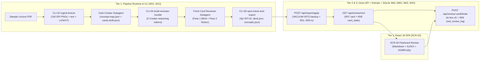

# A40 · Slice Plan

Owner: System Architect. Stage 3, written 2026-10-21. Catalog entry: A40 (`03-design/slice-plan.md`).

---

## 1. Slice Ordering Rationale and WBS Confirmation (`A40.1`, `A40.2`, `G3.11`)

Per catalog `A40` and gate check `G3.11`, vertical slices (`SL-01`–`SL-21`) are ordered by:
1. **Risk first (`A40.2`, `G3.11`):**
   - **`SL-01` (Walking Skeleton)** traverses the highest-risk architectural boundary first: deterministic slide/LaTeXiT extraction (`M11`, `CLI-02`) $\rightarrow$ Stage A Card Creator + context-isolated Card Reviewer (`M12`, `CLI-04`) $\rightarrow$ `Ajv`-validated `deck.json`/`concepts.json` export (`CLI-06`, `INT-01`) $\rightarrow$ atomic SQLite WAL import (`M01`, `applyModuleImport`, `R01`–`R09`) $\rightarrow$ `ts-fsrs` flashcard review (`M02`, `SCR-02`). It retires **`RSK-002`** (slide text/equation/figure extraction), **`RSK-004`** (single-lecture Claude Code session footprint), and **`RSK-018`** (Reviewer isolation and JSON schema contract) before any downstream feature work begins.
   - **`SL-02`–`SL-05`** retire the remaining pipeline quality, Canvas integration, and multi-agent orchestration risks (`RSK-001`, `RSK-003`, `RSK-010`, `RSK-012`, `RSK-014`, `RSK-015`, `RSK-019`, `RSK-021`).
   - **`SL-06`–`SL-11`** retire the core local study app risks: re-import progress preservation and crash-safe backups (`RSK-007`, `RSK-023`), FSRS scheduling fidelity (`RSK-005`), concept-level variant selection (`RSK-006`), deadline timezone/confidence tracking (`RSK-011`), and the daily Today plan (`RSK-016`).
2. **Dependencies second (`A40.2`):**
   - Within Release 1 (`R1`), pipeline generation and export (`SL-01`–`SL-05`) precede full module import diffing (`SL-06`), which precedes flashcard review (`SL-07`), concept quizzes (`SL-08`), deadlines (`SL-09`), the composite Today checklist (`SL-10`), and item problem reporting (`SL-11`).
   - Within Release 2 (`R2`), Claude written-answer marking and prompt-cache plumbing (`SL-12`) precede the streaming Claude tutor (`SL-13`) and tutor card/question proposals (`SL-14`), followed by assessment mode/mock exams (`SL-15`), time-budgeting/milestones/`.ics` export (`SL-16`), and the composite Stats & Spend dashboard (`SL-17`).
   - Within Release 3 (`R3`), hosted authentication, PWA offline sync, and notifications (`SL-18`) precede full `feedback.json` + top-up runs (`SL-19`), FSRS parameter fitting (`SL-20`), and Anki `.tsv` export (`SL-21`).
3. **Priority / Release grouping third (`DEC-010`):**
   - **Release `R1` (`SL-01`–`SL-11`):** `100%` of **Must** requirements (`REQ-F-001`–`REQ-F-042` and Must `REQ-N`s `REQ-N-001`–`003`, `006`–`008`, `010`–`014`, `016`–`020`, `022`).
   - **Release `R2` (`SL-12`–`SL-17`):** `100%` of **Should** requirements (`REQ-F-043`–`REQ-F-058` and Should `REQ-N`s `REQ-N-004`, `005`, `021`, `023`).
   - **Release `R3` (`SL-18`–`SL-21`):** `100%` of **Could** requirements (`REQ-F-059`–`REQ-F-066` and Could `REQ-N`s `REQ-N-009`, `015`).

**WBS Confirmation (`A05`, `CR-001`):** This slice plan confirms the 21 provisional slice work packages (`SL-01`–`SL-21`) in `A05` (`workbook/01-initiation/wbs.md` and `wbs.csv`) with zero changes to slice IDs, order, predecessor chain, or PERT estimates (`CR-001` in `A00`).

---

## 2. Walking Skeleton Architecture Traversal (`SL-01`, `G3.11`)

---

## 3. Master Slice Plan (`SL-01`–`SL-21`)

Every slice delivers end-to-end functionality across Presentation (`SCR-*` / `RPT-*` / `.claude/` commands), Interface (`HTTP` / `CLI-*`), Business Logic (`M01`–`M12`), and Data Access (`R01`–`R34` / `<workspace>` JSON).

### 3.1 Release 1 (`R1`) — Must Slices (`SL-01`–`SL-11`)

| Slice ID & Slug | WBS Leaf & Pred. | UCs Covered | `REQ-F` & `REQ-N` Covered | End-to-End Layers Touched (UI / API-CLI / Modules / Data) | Risks Retired (`A03`) | Assigned Test Cases (`A39` `test-cases.csv`, `G4.1`) |
| :-- | :-- | :-- | :-- | :-- | :-- | :-- |
| **`SL-01`** `SL-01-walking-skeleton` | `SL-01` (Pred: `M3`) | `UC-01`, `UC-06`, `UC-07` *(core loop)* | **Must `REQ-F`:** `REQ-F-001`, `REQ-F-007`, `REQ-F-008`, `REQ-F-009`, `REQ-F-018`, `REQ-F-022`, `REQ-F-024`, `REQ-F-026` **Must `REQ-N`:** `REQ-N-006`, `REQ-N-010`, `REQ-N-016`, `REQ-N-020`, `REQ-N-022` (`ARCH-01`–`04`) | **UI/Cmd:** `SCR-02` (Review), `.claude/commands/process-lecture.md` **API/CLI:** `getHealth`, `listModules`, `applyModuleImport`, `getNextReviewCards`, `submitCardRating`; `CLI-02`, `CLI-04` **Modules:** `M01`, `M02`, `M10`, `M11`, `M12` **Data:** `R01`–`R09`, `R32`, `R33`, `<workspace>` `E23`–`E25` | `RSK-002`, `RSK-004`, `RSK-018`, `RSK-012`, `RSK-021` | **27 TCs:** `TC-I-001`, `TC-I-002`, `TC-I-010`, `TC-I-011`, `TC-I-019`, `TC-I-020`, `TC-I-022`, `TC-I-023`, `TC-I-025`, `TC-I-026`, `TC-I-120`–`122`, `TC-I-126`–`128`, `TC-I-138`, `TC-I-139`, `TC-I-166`, `TC-I-N10`, `TC-S-006`, `TC-S-016`, `TC-S-022`, `TC-S-024`–`027` |
| **`SL-02`** `SL-02-card-review-loop-and-spot-check` | `SL-02` (Pred: `SL-01`) | `UC-01`, `UC-05` | **Must `REQ-F`:** `REQ-F-007`–`REQ-F-010`, `REQ-F-017` **Must `REQ-N`:** `REQ-N-012`, `REQ-N-014` | **UI/Cmd:** `.claude/agents/card-creator.md`, `card-reviewer.md`, human review CLI table **API/CLI:** `CLI-05` (`apply-verdicts` / `DT-01`), `CLI-06` (`spot-check-and-export`) **Modules:** `M12` **Data:** `cards.draft.json`, `cards.review.r1..3.json`, `cards.final.json`, `flagged.json` | `RSK-001`, `RSK-010`, `RSK-019` | **18 TCs:** `TC-I-129`–`134`, `TC-I-202`–`209` (`DT-01-C1`–`C8`), `TC-I-251`, `TC-I-N12`, `TC-S-012`, `TC-S-014` |
| **`SL-03`** `SL-03-extractor-and-canvas-sync` | `SL-03` (Pred: `SL-02`) | `UC-03` | **Must `REQ-F`:** `REQ-F-001`–`REQ-F-005` **Must `REQ-N`:** `REQ-N-013` | **UI/Cmd:** `.claude/agents/extractor.md` **API/CLI:** `CLI-01` (`sync-canvas` / `INT-03`), `CLI-02` **Modules:** `M11`, `M12` **Data:** `glossary.json`, `deadlines.json`, `readings.json`, `<workspace>/canvas-cache/` | `RSK-011`, `RSK-013`, `RSK-014` | **7 TCs:** `TC-I-117`–`119`, `TC-I-170`, `TC-I-171`, `TC-I-250`, `TC-S-013` |
| **`SL-04`** `SL-04-question-bank-and-module-audit` | `SL-04` (Pred: `SL-03`) | `UC-02` | **Must `REQ-F`:** `REQ-F-011`–`REQ-F-016` | **UI/Cmd:** `.claude/agents/question-creator.md`, `question-reviewer.md`, `module-auditor.md`; `RPT-05` **API/CLI:** `CLI-04`, `CLI-05` (Stage B & Audit synthesis) **Modules:** `M12` **Data:** `questions.draft.json`, `questions.review.r1..3.json`, `questions.final.json`, `module-audit.json` (`E26`) | `RSK-001`, `RSK-003`, `RSK-015` | **2 TCs:** `TC-I-252`, `TC-I-253` *(plus Stage B execution of `TC-I-126`–`131`, `TC-I-202`–`209`)* |
| **`SL-05`** `SL-05-run-order-summary-and-exports` | `SL-05` (Pred: `SL-04`) | `UC-04`, `UC-05` | **Must `REQ-F`:** `REQ-F-006`, `REQ-F-018`, `REQ-F-019` **Must `REQ-N`:** `REQ-N-017` | **UI/Cmd:** `.claude/commands/process-module.md`, `RPT-04` (`run-summary.json`) **API/CLI:** `CLI-03` (`plan-run`), `CLI-06`, `CLI-07` (`clean-rounds`) **Modules:** `M11`, `M12` **Data:** All 6 `export/*.json` files, `run-summary.json` (`E27`) | `RSK-004`, `RSK-012` | **8 TCs:** `TC-I-123`–`125`, `TC-I-135`–`137`, `TC-I-N17`, `TC-S-017` |
| **`SL-06`** `SL-06-import-with-preview-and-glossary` | `SL-06` (Pred: `SL-05`) | `UC-05`, `UC-06` | **Must `REQ-F`:** `REQ-F-021`–`REQ-F-023`, `REQ-F-028` **Must `REQ-N`:** `REQ-N-011`, `REQ-N-020` | **UI:** `SCR-07` (Glossary), `SCR-09` (Import/Export/Backup) **API:** `getModuleSummary`, `previewModuleImport`, `applyModuleImport`, `listGlossaryEntries`, `confirmGlossaryEntry`, `createDatabaseBackup`, `restoreDatabaseBackup` **Modules:** `M01`, `M10` **Data:** `R01`–`R21`, `R30`–`R32`, `VACUUM INTO` backups | `RSK-007`, `RSK-023` | **30 TCs:** `TC-I-013`–`018`, `TC-I-109`–`116`, `TC-I-167`, `TC-I-178`, `TC-I-179`, `TC-I-198`, `TC-I-199`, `TC-I-210`–`217` (`DT-02-C1`–`C8`), `TC-I-N20`, `TC-S-011`, `TC-S-020` |
| **`SL-07`** `SL-07-flashcard-review` | `SL-07` (Pred: `SL-06`) | `UC-07` | **Must `REQ-F`:** `REQ-F-024`–`REQ-F-027` **Must `REQ-N`:** `REQ-N-001`, `REQ-N-010`, `REQ-N-019` | **UI:** `SCR-02` (Flashcard Review), `SCR-10` (Settings: FSRS & daily limits) **API:** `getNextReviewCards`, `submitCardRating`, `updateCardStateOrContent`, `getSettings`, `updateSettings` **Modules:** `M02`, `M09` **Data:** `R07`, `R08`, `R09`, `R29`, `v_card_state_with_retrievability` | `RSK-005` | **22 TCs:** `TC-I-028`–`030`, `TC-I-097`–`102`, `TC-I-140`–`145`, `TC-I-192`–`195`, `TC-S-001`, `TC-S-010`, `TC-S-019` |
| **`SL-08`** `SL-08-daily-quiz` | `SL-08` (Pred: `SL-07`) | `UC-08` | **Must `REQ-F`:** `REQ-F-029`–`REQ-F-034` **Should `REQ-F`:** `REQ-F-044` *(self-mark override path)* **Must `REQ-N`:** `REQ-N-002` | **UI:** `SCR-03` (Concept Quiz Screen) **API:** `getNextQuizQuestions`, `submitQuizAttempt`, `overrideQuizAttemptRating` **Modules:** `M03` (`DT-03`, `DT-04`), `M07` **Data:** `R05`, `R06`, `R10`–`R15`, `R28` (`topup` queue) | `RSK-006` | **32 TCs:** `TC-I-031`–`039`, `TC-I-146`–`151`, `TC-I-218`–`233` (`DT-03-C1`–`C8`, `DT-04-C1`–`C8`), `TC-S-002` |
| **`SL-09`** `SL-09-deadlines-and-countdowns` | `SL-09` (Pred: `SL-08`) | `UC-09` | **Must `REQ-F`:** `REQ-F-035`–`REQ-F-038` **Must `REQ-N`:** `REQ-N-018` | **UI:** `SCR-05` (Deadlines & Milestones Screen) **API:** `listDeadlines`, `upsertDeadline` **Modules:** `M05` (`DT-05`) **Data:** `R17`, `R18` | `RSK-011` | **23 TCs:** `TC-I-049`–`054`, `TC-I-156`–`163`, `TC-I-234`–`241` (`DT-05-C1`–`C8`), `TC-S-018` |
| **`SL-10`** `SL-10-today-checklist` | `SL-10` (Pred: `SL-09`) | `UC-10` | **Must `REQ-F`:** `REQ-F-027`, `REQ-F-039`–`REQ-F-041` **Must `REQ-N`:** `REQ-N-003`, `REQ-N-007` | **UI:** `SCR-01` (Today Checklist / `RPT-01`), `SCR-06` (Readings) **API:** `getTodayPlan`, `updateTodayPlanItem`, `listReadings`, `updateReadingStatus`, `listTasks`, `upsertTask` **Modules:** `M05`, `M06` (`DT-06`) **Data:** `R20`, `R22`, `R23`, `R24`, `v_daily_plan_summary` | `RSK-016` | **29 TCs:** `TC-I-058`–`072`, `TC-I-164`, `TC-I-165`, `TC-I-174`–`177`, `TC-I-190`, `TC-I-191`, `TC-I-242`, `TC-I-243`, `TC-I-248`, `TC-I-249`, `TC-S-003`, `TC-S-007` |
| **`SL-11`** `SL-11-report-item-and-export-reports` | `SL-11` (Pred: `SL-10`) | `UC-04`, `UC-11` | **Must `REQ-F`:** `REQ-F-020`, `REQ-F-042` **Must `REQ-N`:** `REQ-N-008` | **UI:** Report Popover (`SCR-02`/`SCR-03`), `SCR-09` (`RPT-08` `reported` export) **API/CLI:** `reportStudyItem`, `exportFeedbackJson`; `CLI-03` (`--feedback`) **Modules:** `M07`, `M12` **Data:** `R28` (`feedback_item`), `feedback.json` | `RSK-001` | **11 TCs:** `TC-I-073`–`078`, `TC-I-152`–`155`, `TC-S-008` |

---

### 3.2 Release 2 (`R2`) — Should Slices (`SL-12`–`SL-17`)

| Slice ID & Slug | WBS Leaf & Pred. | UCs Covered | `REQ-F` & `REQ-N` Covered | End-to-End Layers Touched (UI / API-CLI / Modules / Data) | Risks Retired (`A03`) | Assigned Test Cases (`A39` `test-cases.csv`, `G4.1`) |
| :-- | :-- | :-- | :-- | :-- | :-- | :-- |
| **`SL-12`** `SL-12-claude-written-marking` | `SL-12` (Pred: `M4`) | `UC-12` | **Should `REQ-F`:** `REQ-F-043`, `REQ-F-044`, `REQ-F-047`, `REQ-F-048` **Should `REQ-N`:** `REQ-N-004` | **UI:** `SCR-03` (Written answer Claude marking & self-mark fallback) **API:** `submitQuizAttempt` (`grader='claude'`), `overrideQuizAttemptRating`, `INT-02` **Modules:** `M03`, `M04`, `M09` **Data:** `R14`, `R15`, `R16` (`grading_call_log`), `R29` | `RSK-003`, `RSK-009`, `RSK-020` | **3 TCs:** `TC-I-168`, `TC-I-169`, `TC-S-004` *(plus Claude-grader assertions in `TC-I-034`, `TC-I-037`)* |
| **`SL-13`** `SL-13-claude-tutor` | `SL-13` (Pred: `SL-12`) | `UC-13` | **Should `REQ-F`:** `REQ-F-045`–`REQ-F-048`, `REQ-F-051`, `REQ-F-052` **Should `REQ-N`:** `REQ-N-005`, `REQ-N-023` | **UI:** `SCR-08` (Course-Grounded Claude Tutor Screen) **API:** `listTutorThreads`, `createTutorThread`, `getTutorThread`, `deleteTutorThread`, `sendTutorMessage` (SSE), `INT-02` **Modules:** `M04`, `M09` **Data:** `R25` (`tutor_thread`), `R26` (`tutor_message`) | `RSK-003`, `RSK-010`, `RSK-020`, `RSK-022` | **20 TCs:** `TC-I-079`–`090`, `TC-I-180`–`185`, `TC-S-005`, `TC-S-023` |
| **`SL-14`** `SL-14-tutor-proposals` | `SL-14` (Pred: `SL-13`) | `UC-14` | **Should `REQ-F`:** `REQ-F-049`, `REQ-F-050` | **UI:** `SCR-08` (Inline Proposal Banner & Proposal Queue Drawer) **API/CLI:** `updateTutorProposal`; `CLI-04`/`CLI-05` (`feedback.json -> proposed`) **Modules:** `M04`, `M07`, `M12` **Data:** `R27` (`proposal`), `R28` (`feedback_item`) | `RSK-001` | **3 TCs:** `TC-I-091`–`093` *(plus `proposed` routing in `TC-I-126`, `TC-I-129`)* |
| **`SL-15`** `SL-15-assessment-mode-and-mock-exams` | `SL-15` (Pred: `SL-14`) | `UC-15` | **Should `REQ-F`:** `REQ-F-053`, `REQ-F-054` | **UI:** `SCR-04` (Timed Mock Exam & Assessment Mode), `RPT-02` **API:** `startMockExam`, `submitMockExam` **Modules:** `M03`, `M06` **Data:** `R05`, `R06`, `R10`–`R15`, `R17`, `R18`, `v_concept_mastery` | `RSK-006`, `RSK-017` | **10 TCs:** `TC-I-043`–`048`, `TC-I-186`–`189` |
| **`SL-16`** `SL-16-time-budget-milestones-and-ics` | `SL-16` (Pred: `SL-15`) | `UC-16` | **Should `REQ-F`:** `REQ-F-055`–`REQ-F-057` | **UI:** `SCR-01` (Budget bar & deferral toggle), `SCR-05` (Milestones), `RPT-07` (`.ics`) **API:** `upsertMilestone`, `exportCalendarIcs` (`GET /api/calendar.ics`, `INT-04`) **Modules:** `M05`, `M06` (`DT-06`), `M07` **Data:** `R19` (`milestone`), `R22`, `R23` | `RSK-011`, `RSK-016` | **11 TCs:** `TC-I-055`–`057`, `TC-I-103`–`105`, `TC-I-172`, `TC-I-244`–`247` (`DT-06-C3`–`C6`) |
| **`SL-17`** `SL-17-stats-and-spend-dashboard` | `SL-17` (Pred: `SL-16`) | `UC-17` | **Should `REQ-F`:** `REQ-F-048`, `REQ-F-058` **Should `REQ-N`:** `REQ-N-021` | **UI:** `SCR-11` (Stats & Spend Dashboard / `RPT-03`) **API:** `getStatsAndSpend` **Modules:** `M08`, `M09` **Data:** `R06`, `R08`, `R09`, `R14`, `R16`, `R26`, `R28`, `v_concept_mastery` | `RSK-003` | **6 TCs:** `TC-I-094`–`096`, `TC-I-196`, `TC-I-197`, `TC-S-021` |

---

### 3.3 Release 3 (`R3`) — Could Slices (`SL-18`–`SL-21`)

| Slice ID & Slug | WBS Leaf & Pred. | UCs Covered | `REQ-F` & `REQ-N` Covered | End-to-End Layers Touched (UI / API-CLI / Modules / Data) | Risks Retired (`A03`) | Assigned Test Cases (`A39` `test-cases.csv`, `G4.1`) |
| :-- | :-- | :-- | :-- | :-- | :-- | :-- |
| **`SL-18`** `SL-18-hosted-auth-pwa-offline-and-notifications` | `SL-18` (Pred: `M5`) | `UC-18` | **Could `REQ-F`:** `REQ-F-059`–`REQ-F-062` **Could `REQ-N`:** `REQ-N-009`, `REQ-N-015` | **UI:** `SCR-10` (Login Modal & Notification toggles), `RPT-06`, Service Worker + IndexedDB queue **API:** `loginOwner`, `logoutOwner`, `flushOfflineQuizQueue` **Modules:** `M03`, `M09`, `M10` **Data:** `R14` (`pending_claude`), `R29`, `R34` (`session`) | `RSK-008` | **18 TCs:** `TC-I-003`–`009`, `TC-I-012`, `TC-I-021`, `TC-I-024`, `TC-I-027`, `TC-I-040`–`042`, `TC-I-200`, `TC-I-201`, `TC-S-009`, `TC-S-015` |
| **`SL-19`** `SL-19-full-feedback-and-topup-loop` | `SL-19` (Pred: `SL-18`) | `UC-19` | **Could `REQ-F`:** `REQ-F-063`, `REQ-F-064` | **UI/Cmd:** `SCR-09` (`RPT-08` full `feedback.json`), `.claude/commands/process-module.md --feedback` **API/CLI:** `exportFeedbackJson`; `CLI-03`, `CLI-04`, `CLI-05` **Modules:** `M07`, `M12` **Data:** `R28` (`reported`, `topup`, `proposed`), `feedback.json` | `RSK-006` | **1 TC:** `TC-I-255` *(plus `TC-I-076`–`078`, `TC-I-129`–`131`)* |
| **`SL-20`** `SL-20-fsrs-optimiser-and-load-forecast` | `SL-20` (Pred: `SL-19`) | `UC-20` | **Could `REQ-F`:** `REQ-F-065` | **UI:** `SCR-10` (Fit Custom FSRS Parameters), `SCR-11` (`RPT-03` 30-day load forecast) **API:** `getStatsAndSpend` (`fitFsrs`), `updateSettings` **Modules:** `M02`, `M08`, `M09` **Data:** `R08`, `R09`, `R29` (`fsrs_weights_json`) | `RSK-005` | **1 TC:** `TC-I-254` |
| **`SL-21`** `SL-21-anki-tsv-export` | `SL-21` (Pred: `SL-20`) | `UC-21` | **Could `REQ-F`:** `REQ-F-066` | **UI:** `SCR-09` (`RPT-09` Anki TSV Export card) **API:** `exportAnkiTsv` (`GET /api/export/anki.tsv`, `INT-05`) **Modules:** `M07` **Data:** `R07` (`card`), `R08` (`card_state`) | — | **4 TCs:** `TC-I-106`–`108`, `TC-I-173` |

---

## 4. Requirement-to-Slice Coverage Audit (`A40.1`, `G3.11`)

- **Must Functional Requirements (`42/42` covered in `R1` slices `SL-01`–`SL-11`):**
  - `REQ-F-001`: `SL-01`, `SL-03`
  - `REQ-F-002`–`REQ-F-005`: `SL-03`
  - `REQ-F-006`: `SL-05`
  - `REQ-F-007`–`REQ-F-009`: `SL-01`, `SL-02`
  - `REQ-F-010`, `REQ-F-017`: `SL-02`
  - `REQ-F-011`–`REQ-F-016`: `SL-04`
  - `REQ-F-018`: `SL-01`, `SL-05`
  - `REQ-F-019`: `SL-05`
  - `REQ-F-020`, `REQ-F-042`: `SL-11`
  - `REQ-F-021`, `REQ-F-023`, `REQ-F-028`: `SL-06`
  - `REQ-F-022`: `SL-01`, `SL-06`
  - `REQ-F-024`, `REQ-F-026`: `SL-01`, `SL-07`
  - `REQ-F-025`: `SL-07`
  - `REQ-F-027`: `SL-07`, `SL-10`
  - `REQ-F-029`–`REQ-F-034`: `SL-08`
  - `REQ-F-035`–`REQ-F-038`: `SL-09`
  - `REQ-F-039`–`REQ-F-041`: `SL-10`
- **Should Functional Requirements (`17/17` covered in `R2` slices `SL-12`–`SL-17`, plus `SL-08` for self-mark override):**
  - `REQ-F-043`: `SL-12`
  - `REQ-F-044`: `SL-08`, `SL-12`
  - `REQ-F-045`, `REQ-F-046`, `REQ-F-051`, `REQ-F-052`: `SL-13`
  - `REQ-F-047`: `SL-12`, `SL-13`
  - `REQ-F-048`: `SL-12`, `SL-13`, `SL-17`
  - `REQ-F-049`, `REQ-F-050`: `SL-14`
  - `REQ-F-053`, `REQ-F-054`: `SL-15`
  - `REQ-F-055`–`REQ-F-057`: `SL-16`
  - `REQ-F-058`: `SL-17`
- **Could Functional Requirements (`7/7` covered in `R3` slices `SL-18`–`SL-21`):**
  - `REQ-F-059`–`REQ-F-062`: `SL-18`
  - `REQ-F-063`, `REQ-F-064`: `SL-19`
  - `REQ-F-065`: `SL-20`
  - `REQ-F-066`: `SL-21`
- **Non-Functional Requirements (`23/23` covered across `SL-01`–`SL-18` and verified at system level in `A53`):**
  - **Must (`17/17` in `R1`):** `REQ-N-001` (`SL-07`), `REQ-N-002` (`SL-08`), `REQ-N-003` (`SL-10`), `REQ-N-006` (`SL-01`), `REQ-N-007` (`SL-10`), `REQ-N-008` (`SL-11`), `REQ-N-010` (`SL-01`, `SL-07`), `REQ-N-011` (`SL-06`), `REQ-N-012` (`SL-02`), `REQ-N-013` (`SL-03`), `REQ-N-014` (`SL-02`), `REQ-N-016` (`SL-01`), `REQ-N-017` (`SL-05`), `REQ-N-018` (`SL-09`), `REQ-N-019` (`SL-07`), `REQ-N-020` (`SL-01`, `SL-06`), `REQ-N-022` (`SL-01`).
  - **Should (`4/4` in `R2`):** `REQ-N-004` (`SL-12`), `REQ-N-005` (`SL-13`), `REQ-N-021` (`SL-17`), `REQ-N-023` (`SL-13`).
  - **Could (`2/2` in `R3`):** `REQ-N-009` (`SL-18`), `REQ-N-015` (`SL-18`).
- **Test Cases Assigned (`286/286` in `A39` `test-cases.csv`):** Every one of the 286 Integration and System test cases (`TC-I-001`–`TC-I-255`, `TC-I-N10`, `TC-I-N12`, `TC-I-N17`, `TC-I-N20`, `TC-S-001`–`TC-S-027`) is assigned to a slice in the table above (`27 + 18 + 7 + 2 + 8 + 30 + 22 + 32 + 23 + 29 + 11 + 3 + 20 + 3 + 10 + 11 + 6 + 18 + 1 + 1 + 4 = 286`).
