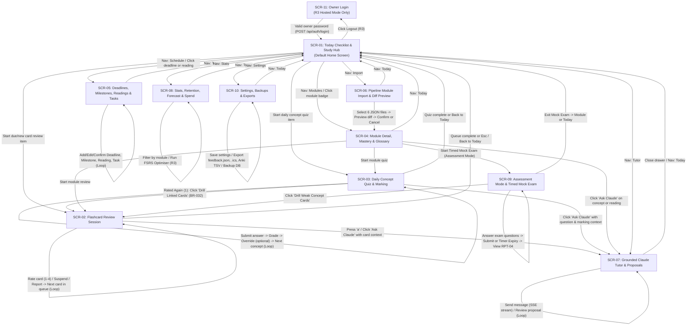

# A35 · UI & Dialogue Design

- **Artifact ID:** `A35`
- **Stage:** Stage 3 — Architecture & Design
- **Owner:** System Architect
- **Date:** `2026-10-21`
- **Catalog entry:** `A35` (`systems_analysis_and_design_project_framework.md`, Appendices `B4`, `B5`, `B6`)

---

## 1. Screen Inventory (`SCR-01`–`SCR-11`)

Per `A04 §3` (`DEC-002`), the generation pipeline runs interactively in Claude Code CLI (`ADR-004`), while the Study App provides a keyboard-first web SPA (`R1`–`R2` on laptop `1280×800`, `[USER Q-04]`) and installable offline-capable PWA (`R3` on phone `375×812` and laptop, `REQ-F-060`, `REQ-N-021`). All 11 screens serve the sole `Student` role (`[SEED §2]`, `ASM-021`):

| Screen ID | Screen Name | Route | Purpose | `UC` Served | `REQ` Served | Release |
| :-- | :-- | :-- | :-- | :-- | :-- | :-: |
| `SCR-01` | **Today Checklist & Study Hub** | `/today` (default `/` redirect) | Displays today's 9-step ordered study checklist (`RPT-01`), time-budget bar (`DT-06`), active assessment-mode banners, top-3 deadline countdowns, and one-click launch into due reviews, quizzes, and readings. | `UC-10`, `UC-16` | `REQ-F-038`–`041`, `REQ-F-053`, `REQ-F-055`, `REQ-F-056`, `REQ-N-003` | `R1` (`R2` budget) |
| `SCR-02` | **Flashcard Review Session** | `/review` | Keyboard-first (`Space`, `1`–`4`, `r`, `f`, `e`, `a`) flashcard review with LaTeX (`KaTeX`) and code rendering, FSRS interval previews, inline card edit/suspend/flag, one-keystroke problem report (`wrong`/`unclear`), and `"Ask Claude"` drawer trigger. | `UC-07`, `UC-11`, `UC-13` | `REQ-F-023`–`027`, `REQ-F-042`, `REQ-F-045`, `REQ-N-001`, `REQ-N-002`, `REQ-N-019` | `R1` |
| `SCR-03` | **Daily Concept Quiz & Written Marking** | `/quiz` | Serves due concept questions (`DT-03`: MCQ, short answer, calculation, explain, scenario, compare, essay plan), grades MCQ automatically and written answers via self-marking (`R1`) or Claude API (`R2`, `REQ-F-043`), allows rating override (`REQ-F-044`), and offers immediate linked-card drill on `Again (1)` (`REQ-F-034`). | `UC-08`, `UC-11`, `UC-12`, `UC-13`, `UC-18` | `REQ-F-028`–`034`, `REQ-F-042`–`045`, `REQ-F-061`, `REQ-N-002`, `REQ-N-004`, `REQ-N-019` | `R1` (`R2` Claude mark) |
| `SCR-04` | **Module Detail, Mastery Map & Glossary** | `/modules/:moduleId` | Displays module lectures, per-concept mastery status (`RPT-02`: `unseen`, `weak`, `developing`, `strong`, `mastered`), prerequisite graph, assessment-scope coverage (`SM-5`), and searchable canonical notation glossary (`GlossaryEntry.canonical`). | `UC-03`, `UC-08`, `UC-15`, `UC-17` | `REQ-F-003`, `REQ-F-005`, `REQ-F-053`, `REQ-F-058` | `R1` |
| `SCR-05` | **Deadlines, Milestones, Readings & Tasks** | `/schedule` | Manages module deadlines with non-colour urgency badges (`DT-05`, `BR-033`) and `Confirm` badges on `inferred` dates (`BR-034`), backward-counted coursework milestones (`REQ-F-056`), readings (`unread`/`in_progress`/`completed`), and ad-hoc study tasks. | `UC-09`, `UC-10`, `UC-16` | `REQ-F-035`–`038`, `REQ-F-041`, `REQ-F-056`, `REQ-F-057`, `REQ-N-018` | `R1` (`R2` milestones) |
| `SCR-06` | **Pipeline Module Import & Diff Preview** | `/import` | Uploads the 6 pipeline export JSON files (`concepts`, `deck`, `question-bank`, `deadlines`, `readings`, `glossary`), validates against `A34` schemas, displays the `DT-02` diff preview (`new`, `updated`, `unchanged`, `suspended` counts and item diff list), and triggers atomic backup + import on confirmation. | `UC-06` | `REQ-F-021`, `REQ-F-022`, `REQ-N-011`, `REQ-N-020` | `R1` |
| `SCR-07` | **Grounded Claude Tutor & Proposal Queue** | `/tutor` (and contextual slide-over drawer) | Streams grounded Claude tutor responses (`explain`, `socratic`, `quiz_me`) with clickable slide/page citations (`BR-039`), coursework academic-integrity guard (`BR-040`), thread search & deletion (`REQ-F-052`), and the `Proposal` queue (`accept`, `edit`, `discard`, `REQ-F-049`). | `UC-13`, `UC-14` | `REQ-F-045`–`052`, `REQ-N-005`, `REQ-N-023` | `R2` |
| `SCR-08` | **Stats, Retention, Forecast & API Spend** | `/stats` | Displays `SM-1`–`SM-6` metrics (`RPT-03`): daily review bar chart, trailing 30-day true retention (`SM-2`), per-module reported-wrong rate (`SM-3`), assessment-scope `>= 2`-attempt coverage (`SM-5`), current-month Claude API spend vs cap (`SM-6`), and `R3` 30-day FSRS load forecast (`REQ-F-065`). | `UC-17`, `UC-20` | `REQ-F-048`, `REQ-F-058`, `REQ-F-065` | `R2` (`R3` forecast) |
| `SCR-09` | **Assessment Mode & Timed Mock Exam** | `/exams/mock` | Configures and runs a timed mock exam for an upcoming midterm or final (`REQ-F-054`), displaying a countdown timer, question navigator, and post-submission concept-level marked results report (`RPT-04`) with one-click weak-concept flashcard drill. | `UC-15` | `REQ-F-053`, `REQ-F-054` | `R2` |
| `SCR-10` | **Settings, Backups & File Exports** | `/settings` | Configures daily limits (`new_cards_per_day`, `review_cards_per_day`, `quiz_per_day`, `daily_budget_min`), `desired_retention`, Claude models & `monthly_spend_cap_usd`, notifications (`REQ-F-062`), manual SQLite backup/restore (`UDP-04`), and one-click downloads of `feedback.json`, `calendar.ics`, and `deck.anki.tsv`. | `UC-06`, `UC-11`, `UC-16`–`21` | `REQ-F-026`, `REQ-F-039`, `REQ-F-042`, `REQ-F-048`, `REQ-F-055`, `REQ-F-057`, `REQ-F-062`, `REQ-F-063`, `REQ-F-066`, `REQ-N-011` | `R1`–`R3` |
| `SCR-11` | **Owner Login (`R3` Hosted Mode)** | `/login` | Password login screen shown only when `APP_MODE=hosted` and no valid `__Host-study_session` cookie is present (`REQ-F-059`, `REQ-N-015`). | `UC-18` | `REQ-F-059`, `REQ-N-015` | `R3` |

*(Note per `A35`: detailed designs of reports, exports, and notifications `RPT-01`–`RPT-10` are in [`workbook/03-design/reports.md`](reports.md) `A41`.)*

---

## 2. Screen Dialogue Diagram (`A35.1`)

Every screen (`SCR-01`–`SCR-11`) is reachable from the persistent top/bottom navigation bar (or contextual action) and has an explicit exit back to `SCR-01` (`Today`). Loops (reviewing next card, answering next quiz question, multi-turn tutor chat) and conditional branches (wrong quiz answer $\rightarrow$ linked card drill; unauthenticated in `R3` $\rightarrow$ `SCR-11`) are shown below:



---

## 3. Low-Fidelity Wireframes (`SCR-01`–`SCR-11`, `Appendix B5` & `B6`)

### 3.1 `SCR-01` · Today Checklist & Study Hub
```text
+--------------------------------------------------------------------------------------------------+
| [Study App]  [Today*] [Review] [Quiz] [Modules] [Schedule] [Tutor] [Stats] [Import] [Settings]   |
+--------------------------------------------------------------------------------------------------+
| TODAY — Wednesday, 21 Oct 2026 (Asia/Hong_Kong)                 Streak: 6/7 days (SM-4b) [Sync]  |
| Study Time Budget: [=================>          ] 68 / 90 min (22 min remaining)                 |
| [!] ASSESSMENT MODE ACTIVE: COMP4901B Final Exam in 18 days (covers W01-W10)   [Start Mock Exam] |
+--------------------------------------------------------------------------------------------------+
| UPCOMING DEADLINES (Top 3)                                                     [View All / .ics] |
| 1. [!! HIGH - 38h 15m] COMP4901B HW2: Policy Gradients (10%) [?] Confirm Date   [Submitted? [ ]] |
| 2. [!  MED  - 9 days ] ML COMP4211 Midterm (25%) — Confirmed                    [Submitted? [ ]] |
| 3. [   TBD  - Unann. ] ECON2123 Problem Set 3 (5%) [?] Confirm Date             [Submitted? [ ]] |
+--------------------------------------------------------------------------------------------------+
| TODAY'S ORDERED STUDY CHECKLIST (9-Step Priority Sequence — BR-035)                              |
| [x] 1. [CARRYOVER] [REQ] COMP4901B Reading: Sutton & Barto Ch.13 (pp.321-330)    30 min  [Done]  |
| [ ] 2. [REVIEW]    [REQ] Due Flashcards: COMP4901B (24), COMP4211 (18)            6 min  [Start] |
| [ ] 3. [QUIZ]      [REQ] Daily Concept Quiz: COMP4901B (10 due concepts)         15 min  [Start] |
| [ ] 4. [NEW CARDS] [REQ] New Flashcards: COMP4901B W04 (20 cards)                 9 min  [Start] |
| [ ] 5. [MILESTONE] [REQ] HW2 Step 2: Implement REINFORCE baseline                 8 min  [Check] |
| [ ] 6. [READING]   [OPT] Optional: Schulman PPO Paper (12 pp.) -> [Defer to Tomorrow]    [Start] |
+--------------------------------------------------------------------------------------------------+
```

### 3.2 `SCR-02` · Flashcard Review Session
```text
+--------------------------------------------------------------------------------------------------+
| [<- Back to Today (Esc)]   Module: COMP4901B · Lecture W04 (Policy Gradient)   Remaining: 23 due |
| Card ID: COMP4901B-W04-C012 · Type: basic · Concept: COMP4901B-W04-K03 (REINFORCE Variance)      |
+--------------------------------------------------------------------------------------------------+
|                                                                                                  |
|   FRONT:                                                                                         |
|   In the REINFORCE policy gradient estimator, why do we subtract a state-dependent               |
|   baseline $b(s_t)$ from the return $G_t$?                                                       |
|                                                                                                  |
|   --------------------------------------------------------------------------------------------   |
|   BACK (Revealed via [Space]):                                                                   |
|   To reduce variance of the gradient estimate without introducing bias ($\mathbb{E}[\nabla \log  |
|   \pi_\theta(a_t|s_t) b(s_t)] = 0$).                                                             |
|                                                                                                  |
|   EXTRA:                                                                                         |
|   A common choice for $b(s_t)$ is the learned state-value function $\hat{V}(s_t)$.               |
|   Source: COMP4901b_Sept24_RL.pdf, slide 28                                                      |
|                                                                                                  |
+--------------------------------------------------------------------------------------------------+
| [1: Again (<10m)]    [2: Hard (2d)]    [3: Good (6d)]    [4: Easy (14d)]                         |
+--------------------------------------------------------------------------------------------------+
| Actions: [e: Edit Card]  [f: Flag]  [s: Suspend]  [r: Report Wrong/Unclear]  [a: Ask Claude]     |
+--------------------------------------------------------------------------------------------------+
```

### 3.3 `SCR-03` · Daily Concept Quiz & Written-Answer Marking
```text
+--------------------------------------------------------------------------------------------------+
| [<- Back to Today (Esc)]   Concept Quiz: COMP4901B (Question 3 of 10)   Concept Stability: 4.2d  |
| Question ID: COMP4901B-W04-Q008 · Type: short_answer · Difficulty: [2/3 Medium]                  |
+--------------------------------------------------------------------------------------------------+
| STEM:                                                                                            |
| Explain why using the total trajectory reward $R(\tau)$ instead of reward-to-go $\hat{Q}_t$      |
| increases variance in policy gradient updates.                                                   |
|                                                                                                  |
| YOUR ANSWER:                                                                                     |
| +----------------------------------------------------------------------------------------------+ |
| | Past rewards before step t do not depend on action a_t, so including them adds noise without | |
| | changing the expected gradient direction (causality).                                        | |
| +----------------------------------------------------------------------------------------------+ |
| [Mark with Claude (Haiku 4.5)]   [Self-Mark Against Rubric]   [r: Report Question]               |
+--------------------------------------------------------------------------------------------------+
| MARKING RESULT (Claude Grader — 1.8s, $0.0002):                                                  |
| [x] Point 1: Actions at step t cannot affect rewards received at steps t' < t (causality).       |
| [x] Point 2: Including past rewards adds zero-mean variance to the gradient estimator.           |
| Model Answer: By causality, action a_t only affects future rewards r_{t' >= t}...                |
| Suggested Rating: [3: Good]  (Override: [1: Again] [2: Hard] [3: Good*] [4: Easy])  [Ask Claude] |
| (If rated 1 Again -> Banner: "Review 2 linked flashcards for COMP4901B-W04-K03 now? [Drill Now]")|
+--------------------------------------------------------------------------------------------------+
```

### 3.4 `SCR-04` · Module Detail, Mastery Map & Glossary
```text
+--------------------------------------------------------------------------------------------------+
| [<- Modules]  COMP4901B: Large Language Models (CS Priority #1)   [Assessment Mode: Final 18d]   |
| [Review Due (24)]  [Start Concept Quiz (10)]  [Start Timed Mock Exam]  [Import Updated JSON]     |
+--------------------------------------------------------------------------------------------------+
| Tabs: [Concept Mastery & Lectures*]  [Canonical Notation Glossary (42 terms)]                    |
| Filter: [All Lectures v]  [In Final Exam Scope Only [x]]  [Importance: All v]                    |
|                                                                                                  |
| Lecture W04: Reinforcement Learning for LLMs (12 concepts)          Scope Coverage: 10/12 (>=2x) |
| +----------------------------------------------------------------------------------------------+ |
| | ID                 | Concept Name          | Imp. | Mastery       | Stab. | Quiz Attempts    | |
| | COMP4901B-W04-K01  | MDP Formulation       | core | [Mastered]    | 21.4d | 3 attempts       | |
| | COMP4901B-W04-K02  | Policy Gradient Thm   | core | [Developing]  |  6.1d | 2 attempts       | |
| | COMP4901B-W04-K03  | REINFORCE Baseline    | core | [Weak !]      |  1.8d | 1 attempt [Quiz] | |
| +----------------------------------------------------------------------------------------------+ |
+--------------------------------------------------------------------------------------------------+
```

### 3.5 `SCR-05` · Deadlines, Milestones, Readings & Tasks
```text
+--------------------------------------------------------------------------------------------------+
| SCHEDULE & WORKLOAD   [+ Add Deadline]  [+ Add Task]  [Download / Subscribe .ics Calendar Feed]  |
+--------------------------------------------------------------------------------------------------+
| DEADLINES & COURSEWORK MILESTONES (Sorted by Due Date — DT-05)                                   |
| 1. [!! HIGH - 38h 15m] COMP4901B · HW2: Policy Gradients (homework, 10%)                         |
|    Due: 2026-10-23 23:59 HKT · Status: [Upcoming v] · [!] Inferred from syllabus [Confirm Date]  |
|    Milestones: [x] M1 Setup env (30m)  [ ] M2 REINFORCE baseline (Due Today, 45m) [+ Milestone]  |
| 2. [   TBD  - Unannounced] ECON2123 · Problem Set 3 (homework, 5%)                               |
|    Due: Unannounced (TBD) · [!] Inferred [Set Date / Confirm] [Edit]                             |
+--------------------------------------------------------------------------------------------------+
| READINGS (Filter: [All Modules v] [Unread / In Progress v])                                      |
| - [Required] COMP4901B W04: Sutton & Barto Ch.13 (10 pp., ~30 min) · Due: 2026-10-22 [Status: v] |
+--------------------------------------------------------------------------------------------------+
| AD-HOC STUDY TASKS                                                                               |
| - [ ] Review COMP4211 tutorial sheet 3 solutions (Due: 2026-10-22, 25 min, [Optional])   [Edit]  |
+--------------------------------------------------------------------------------------------------+
```

### 3.6 `SCR-06` · Pipeline Module Import & Diff Preview
```text
+--------------------------------------------------------------------------------------------------+
| IMPORT PIPELINE EXPORT PACKAGE (UC-06)                                                           |
| Select Module Folder or Drop 6 JSON Files (concepts, deck, question-bank, deadlines, readings,   |
| glossary):  [Choose Files...]   Selected: COMP4901B export package (6/6 files present)           |
| [Run Schema Validation & Preview Diff]                                                           |
+--------------------------------------------------------------------------------------------------+
| DIFF PREVIEW (Schema Validation: PASSED — 0 errors)                                              |
| - New items to insert:       18 cards, 32 questions, 5 concepts, 1 deadline                      |
| - Existing items updated:     4 cards (content updated in place; FSRS state & logs preserved!)   |
| - Unchanged items:          122 cards, 180 questions                                             |
| - Removed items to suspend:   2 cards (marked suspended=true; zero review history deleted)       |
| - Manually edited deadlines:  1 deadline (COMP4901B-D002 kept your edited date — BR-023)         |
|                                                                                                  |
| [Cancel]                  [Back Up SQLite DB & Apply Import Atomically (POST /api/import/apply)] |
+--------------------------------------------------------------------------------------------------+
```

### 3.7 `SCR-07` · Grounded Claude Tutor & Proposal Queue
```text
+--------------------------------------------------------------------------------------------------+
| GROUNDED COURSE TUTOR — Module: [COMP4901B v]  Mode: ([Explain*] [Socratic] [Quiz Me])           |
| Context Loaded: Card COMP4901B-W04-C012 + Slide 28 + Module Glossary + 3 Weakest Concepts        |
+-----------------------------------------------------------------------------+--------------------+
| Thread: "Why does baseline b(s) have zero expectation?"      [Delete Thread]| THREAD HISTORY     |
| --------------------------------------------------------------------------- | [Search threads..] |
| [Student]: Can you show why E[grad log pi(a|s) * b(s)] = 0?                 | - Baseline proof*  |
| [Claude Tutor (Sonnet 4.6 · 1.4s TTFT · $0.008)]:                           | - MDP Bellman eq   |
| Using the module's notation $\pi_\theta(a_t \mid s_t)$ (Policy in this      |                    |
| module), we factor $b(s_t)$ out of the inner sum over actions:              | PROPOSAL QUEUE (1) |
| $$\sum_a \nabla_\theta \pi_\theta(a|s) b(s) = b(s) \nabla_\theta 1 = 0$$    | [Card Draft]       |
| Citations: [COMP4901b_Sept24_RL.pdf, slide 28]                              | "Identity used in  |
| (Note: Coursework guard active — tutor never writes assessed assignments.)  |  baseline proof"   |
| +-------------------------------------------------------------------------+ | [Accept] [Edit]    |
| | Ask a follow-up question...                                     [Send]  | | [Discard]          |
+-----------------------------------------------------------------------------+--------------------+
```

### 3.8 `SCR-08` · Stats, Retention, Forecast & Claude API Spend
```text
+--------------------------------------------------------------------------------------------------+
| STUDY STATS & SUCCESS METRICS (RPT-03)                         Filter: [All Modules v] [Refresh] |
+--------------------------------------------------------------------------------------------------+
| [SM-2 Retention (30d)]   [SM-3 Wrong Rate]     [SM-4a Missed Deadlines]   [SM-6 Month API Spend] |
|     91.4% (>=85% OK)      0.6% (<2.0% OK)            0 (Target: 0)         $1.42 / $15.00 cap    |
+--------------------------------------------------------------------------------------------------+
| DAILY REVIEWS (Last 30 Days — Bar Chart) & 30-DAY FSRS LOAD FORECAST (Line Graph — R3)           |
|   120 |    ||  ||                                     ...---...  (Forecast peak: 95 cards/day)   |
|    60 | || ||  || || || ||                         .--         --.                               |
|     0 +----------------------------------------------------------------------------------------  |
|                                                                        [Fit Custom FSRS Weights] |
+--------------------------------------------------------------------------------------------------+
| SM-1 & SM-5 ASSESSMENT READINESS BY MODULE                                                       |
| - COMP4901B Final (7 Dec): 10/10 lectures processed (SM-1 OK) · 88% concepts >=2x quizzed (SM-5) |
+--------------------------------------------------------------------------------------------------+
```

### 3.9 `SCR-09` · Assessment Mode & Timed Mock Exam
```text
+--------------------------------------------------------------------------------------------------+
| TIMED MOCK EXAM — COMP4901B Final Exam Prep                    Time Remaining: [01:14:22] [Exit] |
| Progress: 8 / 15 Answered · Format Mix: 6 MCQ, 5 Short Answer, 4 Calculation                     |
| Question Navigator: [1*] [2*] [3*] [4*] [5*] [6*] [7*] [8*] [9 Current] [10] [11] [12]..[15]     |
+--------------------------------------------------------------------------------------------------+
| (Question stem & answer input area; on [Submit Exam] or timer 00:00:00 -> renders RPT-04         |
|  Concept-Level Mock Exam Breakdown with [Drill Linked Flashcards for Weak Concepts] button)      |
+--------------------------------------------------------------------------------------------------+
```

### 3.10 `SCR-10` · Settings, Backups & File Exports
```text
+--------------------------------------------------------------------------------------------------+
| SETTINGS, BACKUPS & EXPORTS                                                                      |
+--------------------------------------------------------------------------------------------------+
| DAILY LIMITS & FSRS SCHEDULER                                                                    |
| Daily Study Budget (min): [ 90 ]   New Cards/Day/Mod: [ 20 ]   Max Due Reviews/Day/Mod: [ 200 ]  |
| Daily Quiz Concepts/Mod:  [ 10 ]   Reading Min/Page:  [ 3.0 ]  Desired Retention:      [ 0.90 ]  |
| Scheduler Mode: ([FSRS*] [SM-2 Fallback])   Assessment Mode Window (days): [ 21 ]                |
|                                                                                                  |
| CLAUDE API MODELS & SPEND GUARD (R2)                                                             |
| Marking Model: [claude-haiku-4-5 v]   Tutor Model: [claude-sonnet-4-6 v]                         |
| Monthly Spend Cap (USD): [ 15.00 ]    Cap Action: ([No Limit] [Warn*] [Hard Stop])               |
|                                                                                                  |
| EXPORTS & DATABASE BACKUPS                                                       [Save Settings] |
| [Export feedback.json (3 unexported)]  [Download calendar.ics]  [Export Anki TSV (deck.anki.tsv)]|
| [Create Verified SQLite Backup Now]    [Restore Prior Backup... (Requires Confirmation Modal)]   |
+--------------------------------------------------------------------------------------------------+
```

### 3.11 `SCR-11` · Owner Login (`R3` Hosted Mode Only)
```text
+--------------------------------------------------------------------------------------------------+
|                                    STUDY APP — OWNER LOGIN                                       |
|                         +-------------------------------------------+                            |
|                         | Owner Password: [***********************] |                            |
|                         | [             Sign In (Enter)           ] |                            |
|                         +-------------------------------------------+                            |
|             (Protected by Argon2id + HttpOnly Secure SameSite=Strict cookie;                     |
|              rate-limited to <= 5 failed attempts per minute per IP — REQ-N-015)                 |
+--------------------------------------------------------------------------------------------------+
```

---

## 4. Field Validation Table (`G3.5`, `A35.3`, Appendix `B4`)

Every user-editable input field across `SCR-01`–`SCR-11` is validated on both client and server (`ADR-003 §2.3`) using the validation categories in Catalog Appendix `B4` (`Missing data`, `Range`, `Size`, `Values`, `Picture / template`, `Class / composition`, `Combinations`, `Expected values`, `Reasonableness`), and displays the exact plain-language error message below (`G3.5`):

| Field ID | Screen | Field Name | Data Type | Req? | Validation Types (`Appendix B4`) & Rule | Exact Error Message Text (`B6`) | `BR` / `REQ` Trace |
| :-- | :-- | :-- | :-- | :-: | :-- | :-- | :-- |
| `FLD-01` | `SCR-02` | `rating` (Card Rating) | `integer` | Yes | `Missing data`, `Values` (`{1, 2, 3, 4}`) | `"Select a rating between 1 (Again) and 4 (Easy)."` | `REQ-F-023`, `BR-026` |
| `FLD-02` | `SCR-02` | `front` (Edit Card Front) | `text` | Yes | `Missing data`, `Size` (`1..2000` chars after trim) | `"Card front cannot be empty and must be under 2,000 characters."` | `REQ-F-025`, `BR-007` |
| `FLD-03` | `SCR-02` | `back` (Edit Card Back) | `text` | Yes | `Missing data`, `Size` (`1..2000` chars after trim), `Reasonableness` (warns if `> 15` words, `BR-008`) | `"Card back cannot be empty and must be under 2,000 characters."` | `REQ-F-025`, `BR-008` |
| `FLD-04` | `SCR-02` | `extra` (Edit Card Extra) | `text` | No | `Size` (`0..4000` chars) | `"Extra notes must be 4,000 characters or fewer."` | `REQ-F-025`, `BR-008` |
| `FLD-05` | `SCR-03` | `userAnswer` (MCQ Option) | `enumeration` | Yes | `Missing data`, `Values` (`{'A', 'B', 'C', 'D'}`) | `"Choose option A, B, C, or D before submitting."` | `REQ-F-032`, `BR-017` |
| `FLD-06` | `SCR-03` | `userAnswer` (Written Answer) | `text` | Yes | `Missing data`, `Size` (`1..10000` chars after trim) | `"Enter your written answer (up to 10,000 characters) before submitting."` | `REQ-F-033`, `REQ-F-043` |
| `FLD-07` | `SCR-03` | `rating` (Override Quiz Rating) | `integer` | Yes | `Missing data`, `Values` (`{1, 2, 3, 4}`) | `"Choose a replacement rating between 1 (Again) and 4 (Easy)."` | `REQ-F-044`, `BR-031` |
| `FLD-08` | `SCR-02`, `SCR-03` | `reason` (Report Item Modal) | `enumeration` | Yes | `Missing data`, `Values` (`{'wrong', 'unclear'}`) | `"Please select whether this item is 'wrong' or 'unclear'."` | `REQ-F-042`, `BR-038`, `AT-050` |
| `FLD-09` | `SCR-02`, `SCR-03` | `comment` (Report Item Modal) | `text` | No | `Size` (`0..2000` chars) | `"Report comment must be 2,000 characters or fewer."` | `REQ-F-042`, `BR-038` |
| `FLD-10` | `SCR-05` | `title` (Deadline Title) | `text` | Yes | `Missing data`, `Size` (`1..200` chars after trim) | `"Enter a deadline title of 1 to 200 characters."` | `REQ-F-036` |
| `FLD-11` | `SCR-05` | `type` (Deadline Type) | `enumeration` | Yes | `Missing data`, `Values` (`exam`, `midterm`, `quiz`, `homework`, `project`, `coursework`, `other`) | `"Select a valid deadline type."` | `REQ-F-036` |
| `FLD-12` | `SCR-05` | `dueAt` & `status` (Deadline Due Date) | `date-time` | Cond | `Picture / template` (ISO-8601), `Combinations` (`dueAt == null` iff `status == 'unannounced'`, `BR-004`) | `"Enter a valid date and time, or mark the deadline status as Unannounced (TBD)."` | `REQ-F-036`, `BR-004`, `AT-048` |
| `FLD-13` | `SCR-05` | `weighting` (Deadline Weight %) | `number` | No | `Range` (`0 <= weighting <= 100`) | `"Weighting must be between 0 and 100."` | `REQ-F-036`, `AT-048` |
| `FLD-14` | `SCR-05` | `title` (Milestone / Task Title) | `text` | Yes | `Missing data`, `Size` (`1..200` chars after trim) | `"Enter a title of 1 to 200 characters."` | `REQ-F-038`, `REQ-F-056` |
| `FLD-15` | `SCR-05` | `dueOn` (Milestone / Task / Reading Due Date) | `date` | Yes | `Missing data`, `Picture / template` (`YYYY-MM-DD`) | `"Enter a valid calendar date in YYYY-MM-DD format."` | `REQ-F-038`, `REQ-F-041`, `REQ-F-056` |
| `FLD-16` | `SCR-05` | `estMinutes` (Milestone / Task / Reading Duration) | `integer` | Yes | `Missing data`, `Range` (`1..600` minutes), `Reasonableness` (warns if `> 180` min for a single step) | `"Estimated time must be between 1 and 600 minutes."` | `REQ-F-038`, `REQ-F-056` |
| `FLD-17` | `SCR-06` | `importFiles` (6 Module JSON Files) | `json` | Yes | `Missing data`, `Picture / template` & `Expected values` (valid JSON matching `pipeline-contracts.schema.json` `A34`) | `"Import validation failed: <file> (<field>: <schema error>). Fix or re-export the file and try again."` | `REQ-F-021`, `REQ-N-020`, `AT-037` |
| `FLD-18` | `SCR-07` | `mode` (Tutor Mode) | `enumeration` | Yes | `Values` (`{'explain', 'socratic', 'quiz_me'}`) | `"Select a tutor mode: Explain, Socratic, or Quiz Me."` | `REQ-F-046` |
| `FLD-19` | `SCR-07` | `content` (Tutor User Message) | `text` | Yes | `Missing data`, `Size` (`1..8000` chars), `Combinations` (coursework guard `BR-040` on `homework`/`project`/`coursework` topics) | `"Enter a question or message between 1 and 8,000 characters."` | `REQ-F-046`, `REQ-F-051`, `BR-040` |
| `FLD-20` | `SCR-07` | `q` (Tutor Thread Search) | `text` | No | `Size` (`0..200` chars) | `"Search query must be 200 characters or fewer."` | `REQ-F-052` |
| `FLD-21` | `SCR-09` | `durationMinutes` (Mock Exam Duration) | `integer` | Yes | `Missing data`, `Range` (`10..300` minutes) | `"Mock exam duration must be between 10 and 300 minutes."` | `REQ-F-054` |
| `FLD-22` | `SCR-09` | `questionCount` (Mock Exam Size) | `integer` | Yes | `Missing data`, `Range` (`5..100` questions) | `"Mock exam question count must be between 5 and 100."` | `REQ-F-054` |
| `FLD-23` | `SCR-10` | `dailyBudgetMin` (Daily Study Budget) | `integer` | Yes | `Missing data`, `Range` (`15..720` minutes) | `"Daily study budget must be between 15 and 720 minutes."` | `REQ-F-039`, `REQ-F-055`, `BR-036` |
| `FLD-24` | `SCR-10` | `newCardsPerDay` / `reviewCardsPerDay` / `quizPerDay` | `integer` | Yes | `Range` (`0..200` new cards, `1..1000` review cards, `1..100` quiz concepts) | `"Enter a valid daily limit (New cards: 0–200, Reviews: 1–1000, Quizzes: 1–100)."` | `REQ-F-026`, `BR-025`, `BR-028` |
| `FLD-25` | `SCR-10` | `desiredRetention` (FSRS Target Retention) | `number` | Yes | `Range` (`0.70..0.99`) | `"Desired retention must be a decimal between 0.70 and 0.99 (default 0.90)."` | `BR-026` |
| `FLD-26` | `SCR-10` | `monthlySpendCapUsd` (Monthly Claude Cap) | `money` | No | `Class / composition` (non-negative decimal with `<= 2` decimal places), `Range` (`0.00..1000.00`) | `"Monthly spend cap must be a non-negative dollar amount (for example, 15.00)."` | `REQ-F-048`, `BR-041` |
| `FLD-27` | `SCR-10` | `backupFileName` & `confirmOverwrite` | `text` + `boolean` | Yes | `Expected values` (existing verified backup file), `Combinations` (`confirmOverwrite == true`, `UDP-04`) | `"Select a verified backup file and tick the confirmation box to restore."` | `REQ-N-011`, `UDP-04` |
| `FLD-28` | `SCR-11` | `password` (Owner Password in `R3`) | `text` | Yes | `Missing data`, `Size` (`8..256` chars), `Expected values` (matches `APP_PASSWORD_HASH`) | `"Invalid password. Please try again."` (or `"Too many failed login attempts. Please wait 60 seconds."` on `429`) | `REQ-F-059`, `REQ-N-015`, `BR-045` |

---

## 5. Destructive Action Confirmation, Reversal (`Undo`), and Accessibility (`WCAG 2.2 AA`)

### 5.1 Confirmation & Reversal Rules (`A35.2`, `Appendix B6`)
1. **Card Rating / Suspend / Flag (`SCR-02`):** Immediately reversible via a `Ctrl+Z` / `[Undo Last Action]` toast shown for `10` seconds after rating, suspending, or flagging a card.
2. **Quiz Rating (`SCR-03`):** Immediately reversible via the inline `[Override Rating: 1 | 2 | 3 | 4]` control (`REQ-F-044`).
3. **Tutor Thread Deletion (`SCR-07`, `REQ-F-052`):** Opens a confirmation modal (`"Delete thread '<title>' and all its messages? This cannot be undone. [Cancel] [Delete Thread]"`) before calling `DELETE /api/tutor/threads/:id`.
4. **Database Backup Restore (`SCR-10`, `UDP-04`):** Opens a two-step confirmation modal displaying the current vs backup row counts and automatically creates a safety backup of the current database before restoring.

### 5.2 Accessibility (`WCAG 2.2 Level AA`, `REQ-N-018`, `REQ-N-019`) & Workflow Continuity (`G3.15`)
- **Full Keyboard Operability (`REQ-N-019`):** All screens are navigable via `Tab`/`Shift+Tab` with a `2px solid #2563eb` focus ring (`outline-offset: 2px`), and `SCR-02`/`SCR-03` bind single-key shortcuts (`Space`, `1`–`4`, `r`, `f`, `s`, `e`, `a`, `Esc`) whenever focus is not inside a text input.
- **Colour & Non-Colour Redundancy (`REQ-N-018`, `B5`):** Text contrast is `>= 4.5:1` (slate-900 `#0f172a` on white `#ffffff`, `17.4:1`), and every deadline urgency state (`DT-05`) and concept mastery state renders both an explicit text badge (`[!! HIGH - 38h]`, `[OVERDUE]`, `[Unannounced (TBD)]`) and a distinct SVG icon so colour alone never carries meaning.
- **Transition from Current Work (`G3.15`, `DEC-013`):** The student currently uses Anki for flashcards (`[USER Q-09, Q-14]`) and keeps studying their usual way until `R1` is ready (`ASM-032`). `SCR-02` preserves Anki's familiar `Space` / `1`–`4` muscle memory (`Again`, `Hard`, `Good`, `Easy`) while eliminating manual card authoring (`SCR-06`) and integrating concept quizzes (`SCR-03`) and the Today checklist (`SCR-01`).
